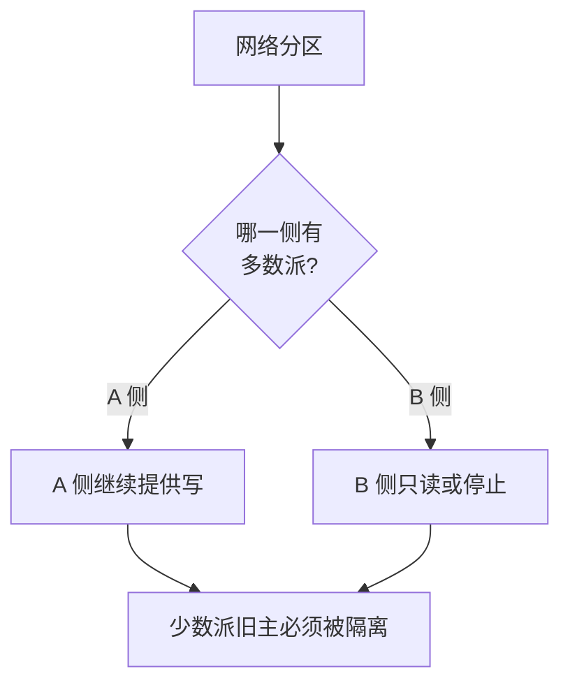

切换的核心不是“把从库提成主库”，而是保证同一时刻只有一个可写节点。做不到这一点，就会出现两个主库各自接受写入，数据永久分叉。

## 计划内切换

用于主库维护、升级、机房迁移：

1. 停止写入或切到只读；
2. 等待从库追上（GTID 差值为空）；
3. 提升目标从库，更新路由或 VIP；
4. 应用重连，观察错误率；
5. 旧主降级为从库，重新加入复制。

关键是“先追平再切”，否则会丢失尚未回放的事务。

## 计划外切换

主库崩溃后：

- **GR / InnoDB Cluster**：组内选举新主，Router 更新路由；
- **外部编排（MHA / Orchestrator）**：检测心跳，选延迟最小的从库提升；
- **人工切换**：确认旧主不可恢复后，手工提升从库并改连接。

计划外切换的最大风险是旧主“还活着但被隔离”，恢复网络后继续接受写入。

## 脑裂

脑裂指两个节点都认为自己是主：

- 网络分区导致两侧各自选主；
- 外部编排误判心跳，同时提升两个从库；
- 旧主进程未被杀死，VIP 漂移后仍可写。

防范手段：

| 手段 | 作用 |
| --- | --- |
| 奇数节点 + 多数派 | 少数派无法形成新主 |
| Fencing（关机/断网/撤 VIP） | 强制旧主失去可写能力 |
| 独立仲裁节点 | 避免 2 节点集群失去多数派 |
| 只读 + `super_read_only` | 从库默认不可写 |
| Router / 代理统一入口 | 客户端不直连旧主 |

GR 通过组内多数派避免脑裂；外部编排必须自己实现 fencing，否则“自动切换”只是在制造双主。

## 切换后的验证

1. 新主可写，旧主已只读或被隔离；
2. 应用连接全部指向新主，错误率恢复正常；
3. 复制链路重新建立，延迟归零；
4. 关键表行数与业务核对；
5. 监控与备份任务切到新主；
6. 记录切换耗时，更新值班手册。

## 演练

- 每季度做一次计划内切换；
- 每半年模拟一次主库宕机（隔离环境或低峰期）；
- 演练必须包含“旧主恢复后如何处理”；
- 记录 RTO、数据丢失量与人工步骤数；
- 任何一步依赖某个人记忆，都要写进手册。

## 常见坑

- **2 节点集群**：失去一个节点就没有多数派，无法自动选主；
- **只做主从不做 fencing**：旧主恢复后双写；
- **切换后忘记改备份**：备份仍连旧主，实际没有备份新数据；
- **应用连接池不重连**：DNS/VIP 切换后旧连接仍指向旧主；
- **未校验数据就开放流量**：新主缺事务，业务读到旧状态。

## 小结

- 切换的前提是多数派与 fencing，而不是脚本能跑；
- GR/InnoDB Cluster 把选主与路由交给组件，外部编排要自己防脑裂；
- 计划内切换先追平，计划外切换先隔离旧主；
- 切换后必须验证写入、复制、备份与连接；
- 只有演练过的切换流程才算可用。
