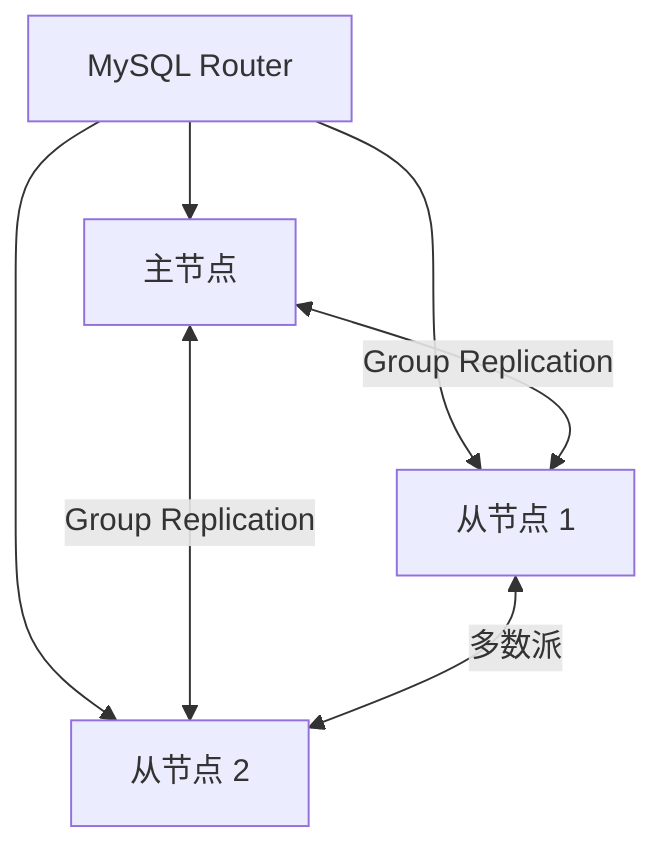

主从复制解决“有备份从库”，但主库宕机后仍需要人判断、改指向、重启应用。高可用要解决的是自动检测、自动切换与客户端重连，代价是更复杂的共识与运维。



## 可用性指标

- **RTO**：故障到恢复服务的时间；
- **RPO**：允许丢失的数据量；
- **切换方式**：人工、脚本、编排器或数据库自身。

没有明确指标就上集群，通常得到一套没人敢演练的复杂系统。先确定“能接受几分钟不可用、能接受丢多少数据”，再选方案。

## 方案对比

| 方案 | 切换 | 一致性 | 复杂度 | 适用 |
| --- | --- | --- | --- | --- |
| 主从 + 人工切换 | 手动 | 异步可能丢数据 | 低 | 小业务、可接受停机 |
| MHA / Orchestrator | 脚本自动 | 依赖半同步与选主 | 中 | 传统主从架构 |
| Group Replication | 组内自动 | 多数派确认 | 高 | 需要自动切换 |
| InnoDB Cluster | Router 自动路由 | 同 GR | 高 | 推荐的整体方案 |
| 云托管多可用区 | 平台负责 | 取决于产品 | 低 | 不想自建 |

## Group Replication

GR 把多个实例组成一个组，事务在组内认证后提交：

- 组内超过半数节点确认，事务才算成功；
- 单主模式下一主多从，主节点故障后自动选举；
- 多主模式允许多节点写入，但应用要处理冲突与死锁；
- 节点加入、离开与恢复由组自动管理。

部署前提：

- InnoDB 引擎；
- 每张表有主键（写入需要唯一标识）；
- `binlog_format=ROW`、GTID 开启；
- 节点数量建议 3 或 5，保证多数派；
- 网络延迟稳定，组通信对网络敏感。

## InnoDB Cluster

InnoDB Cluster 是官方推荐的组合：

- **Group Replication** 提供数据复制与成员管理；
- **MySQL Shell** 负责创建集群、添加节点、检查状态；
- **MySQL Router** 负责读写分离与故障转移，应用只连 Router。

创建流程大致是：用 Shell 连接主节点，执行 `dba.createCluster()`，再逐个 `addInstance()`，最后用 Router 引导应用连接。

```javascript
// MySQL Shell（JavaScript 模式）
var cluster = dba.createCluster('prod');
cluster.addInstance('ic@10.0.0.12:3306');
cluster.status();
```

Router 提供读写端口与只读端口，主节点变化后自动更新路由。应用不再维护主库地址，这是它相对手工主从的主要价值。

## 选择建议

- 业务能接受分钟级停机：主从 + 可靠备份 + 人工切换；
- 需要自动切换且团队有运维能力：InnoDB Cluster；
- 没有专职 DBA：优先云托管多可用区；
- 多主写入只在确有分区写入需求时使用，冲突处理成本很高。

## 小结

- 高可用由 RTO/RPO 定义，不由节点数量定义；
- GR 靠多数派保证一致，节点数应为奇数且至少 3 个；
- InnoDB Cluster 用 Shell 管理、Router 路由，是官方整体方案；
- 方案选择要匹配团队能力，复杂架构必须配套演练。
