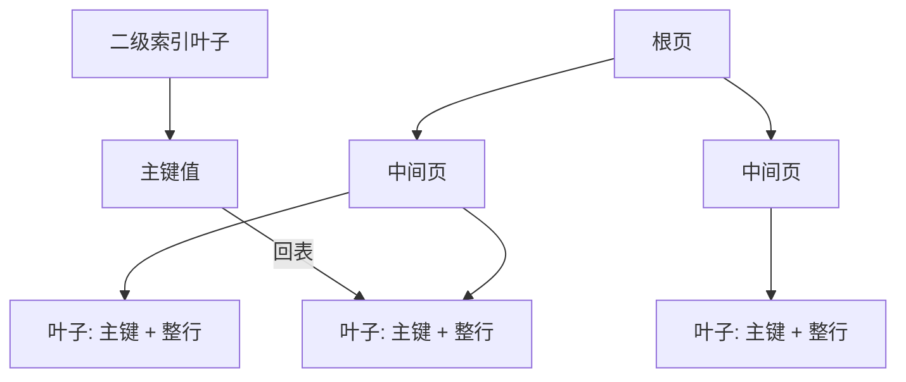

索引不是“给字段加个开关”，而是一棵按页组织的 B+ 树。InnoDB 的表本身就是一棵以主键为键的聚簇索引，其他索引都是二级索引。理解这一点，才能解释回表、覆盖索引与联合索引的最左前缀。



## 聚簇索引

InnoDB 按主键组织数据，叶子节点存放整行记录：

- 主键查询一次 B+ 树即可拿到整行；
- 没有主键时，InnoDB 会选择唯一非空索引，否则生成隐藏的 6 字节 row id；
- 主键不宜过长，因为每个二级索引的叶子都要存主键值；
- 随机主键（如 UUID）会导致页分裂与写入放大，自增或有序 ID 更友好。

## 二级索引与回表

二级索引的叶子只存“索引列 + 主键”。通过二级索引查非索引列时，需要再按主键查一次聚簇索引，这一步叫回表。

```sql
SELECT id, user_id, amount
FROM orders
WHERE user_id = 1001;
```

如果只有 `idx_user_created (user_id, created_at)`，查询需要的 `amount` 不在索引里，就要回表。需要的列都在索引中时，称为覆盖索引，可以避免回表：

```sql
SELECT user_id, created_at
FROM orders
WHERE user_id = 1001;
```

`EXPLAIN` 的 `Extra` 出现 `Using index`，表示走了覆盖索引。

## 联合索引与最左前缀

联合索引 `(a, b, c)` 按 a、再按 b、再按 c 排序。它可以支持：

- `a`、`(a, b)`、`(a, b, c)` 作为条件；
- `a` 的等值 + `b` 的范围；
- 不能跳过 a 直接用 b 或 c 做有效查找。

这就是最左前缀原则。设计联合索引时，把等值条件、选择性高的列放在左边，范围条件放在最后。

## 索引类型

| 类型 | 用途 | 注意 |
| --- | --- | --- |
| 主键 | 聚簇索引 | 短、有序、稳定 |
| 唯一索引 | 业务唯一性 | 冲突时写入失败，需处理重试 |
| 普通索引 | 加速过滤与排序 | 注意回表成本 |
| 前缀索引 | 长字符串 | 选择性可能不足 |
| 全文索引 | 文本检索 | 中文分词与相关性需要额外配置 |

前缀索引示例：

```sql
ALTER TABLE users ADD KEY idx_email_prefix (email(20));
```

前缀长度要兼顾选择性与索引大小，太短会导致大量回表。

## 页与扇出

B+ 树的每个节点是一页（默认 16KB），非叶子节点只存键与页指针。扇出越大，树越矮，查询需要的页读取越少。主键越长，非叶子节点能放的键越少，树越高，IO 越多。

这也是“短主键”的实际意义：不是省几字节，而是减少整棵树的层数与二级索引体积。

## 小结

- InnoDB 表就是主键聚簇索引，叶子存整行；
- 二级索引叶子存主键，查非索引列要回表；
- 覆盖索引避免回表，`Using index` 是信号；
- 联合索引遵守最左前缀，等值在前、范围在后；
- 主键要短且有序，索引长度直接影响树高与写入成本。
