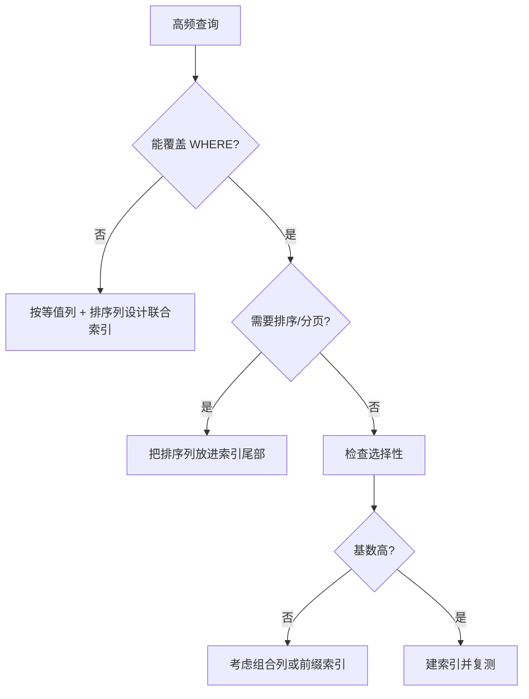

索引不是越多越好。每个索引都会增加写入成本、占用缓冲池，并让优化器多一个选择。好的索引设计只覆盖真正高频的查询路径，其余交给表扫描或归档策略。



## 选择性

选择性 = 不同值数量 / 总行数。接近 1 的列适合单独建索引，接近 0 的列（性别、状态）单独索引收益很低。

```sql
SELECT COUNT(DISTINCT user_id) / COUNT(*) AS selectivity
FROM orders;
```

低选择性列通常作为联合索引的一部分，而不是单独索引。优化器是否使用索引还取决于范围条件与数据分布，最终以 `EXPLAIN` 为准。

## 联合索引顺序

经验规则：

- 等值条件在前，范围条件在后；
- 区分度高的列靠前；
- 覆盖高频查询的列，减少回表；
- 排序列放在最后，避免额外 `filesort`。

例如订单列表按用户查、按时间倒序：

```sql
ALTER TABLE orders ADD KEY idx_user_created (user_id, created_at);
```

它同时支持 `WHERE user_id = ?`、`WHERE user_id = ? ORDER BY created_at DESC`，以及 `WHERE user_id = ? AND created_at >= ?`。

## 索引失效的常见写法

```sql
-- 函数包裹列：索引失效
WHERE DATE(created_at) = '2026-11-24'
-- 改写为范围
WHERE created_at >= '2026-11-24' AND created_at < '2026-11-25'

-- 隐式类型转换：字符串列传数字，可能全表扫描
WHERE phone = 13800000000
-- 改写为字符串
WHERE phone = '13800000000'

-- 前导通配符：无法使用 B+ 树前缀
WHERE name LIKE '%ada'
-- 后缀匹配考虑倒序存储或全文索引

-- OR 两侧只有一个有索引
WHERE user_id = 1 OR status = 1
-- 拆成 UNION，或给两侧都建可用索引
```

`NOT`、`!=`、`IS NOT NULL` 不必然失效，但通常选择性差、扫描范围大，需要结合执行计划判断。

## 覆盖索引

```sql
ALTER TABLE orders ADD KEY idx_user_status_amount (user_id, status, amount);

SELECT user_id, status, amount
FROM orders
WHERE user_id = 1001 AND status = 1;
```

列都在索引中，`Extra` 出现 `Using index`，避免回表。覆盖索引适合列表页与统计查询，但索引列不宜过多，否则索引本身接近一张宽表。

## 前缀索引与函数索引

```sql
-- 长字符串前缀索引
ALTER TABLE users ADD KEY idx_email_prefix (email(24));

-- 8.0.13+ 函数索引
ALTER TABLE orders ADD KEY idx_created_date ((DATE(created_at)));
```

前缀索引要验证选择性；函数索引把表达式固化到索引中，查询必须使用同一表达式才会命中。

## 冗余索引

以下情况属于冗余：

- `(a)` 与 `(a, b)`：前者可被后者覆盖；
- 主键列再加普通索引；
- 唯一索引与普通索引同列。

```sql
SELECT * FROM sys.schema_redundant_indexes;
SELECT * FROM sys.schema_unused_indexes;
```

两个视图能帮助清理，但“未使用”要结合完整的业务周期观察，避免误删低频查询依赖的索引。

## 索引评审清单

1. 这条查询的过滤列、排序列、返回列分别是什么；
2. 联合索引顺序是否满足等值与范围；
3. 能否用覆盖索引避免回表；
4. 是否存在函数、隐式转换、前导通配符；
5. 新索引是否与既有索引冗余；
6. 写入频率高的表，索引增量是否可接受。

## 小结

- 索引设计从高频查询出发，选择性决定单列索引价值；
- 联合索引等值在前、范围在后，排序列放尾部；
- 函数、隐式转换与 `%前缀` 会让索引失效；
- 覆盖索引减少回表，但列不宜过多；
- 定期清理冗余与长期未使用的索引。
