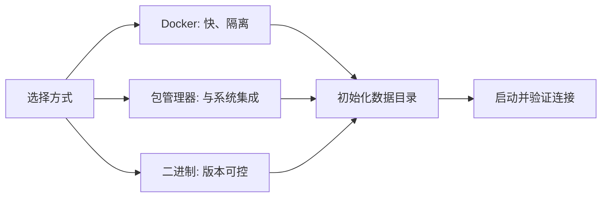

单机部署有三种常见方式：系统包管理器、官方二进制包与 Docker。开发与测试优先 Docker，交付环境优先包管理器或二进制，容器更适合无状态应用，而数据库需要把数据目录明确挂出来。



## Docker 部署

```bash
docker run -d --name mysql8 \
  -p 3306:3306 \
  -e MYSQL_ROOT_PASSWORD='change-me' \
  -v mysql-data:/var/lib/mysql \
  mysql:8.4
```

要点：

- 标签写 `8.4`，不要用 `latest`。官方文档说明 `latest` 指向最新的 Innovation 版本；
- 数据卷必须挂载到 `/var/lib/mysql`，否则容器删除即丢库；
- `MYSQL_ROOT_PASSWORD` 只用于首次初始化，之后修改密码要进库执行；
- 端口按需暴露，公网环境不要直接把 3306 开放出去。

Oracle 官方镜像的地址是 `container-registry.oracle.com/mysql/community-server:8.4`，与 Docker Hub 的 `mysql` 镜像功能一致，按网络情况选择。

验证：

```bash
docker logs mysql8 | tail -20
docker exec -it mysql8 mysql -uroot -p
```

日志出现 `ready for connections` 表示实例已就绪。首次启动会初始化系统库，耗时与磁盘性能相关。

## 包管理器安装

Debian / Ubuntu：

```bash
sudo apt install mysql-server
sudo systemctl enable --now mysql
sudo mysql_secure_installation
```

RHEL 系：

```bash
sudo dnf install mysql-server
sudo systemctl enable --now mysqld
```

包管理器安装会自动创建服务单元、数据目录与日志目录，适合长期维护的虚机。注意发行版仓库里的版本可能落后，需要 8.4 时使用官方 APT/YUM 源。

## 二进制安装

二进制包适合需要固定版本、又不希望引入系统包的场景。步骤是：解压到固定目录、创建 `mysql` 用户、初始化数据目录、写配置文件、注册服务。

```bash
groupadd mysql
useradd -r -g mysql -s /bin/false mysql
mkdir -p /data/mysql
chown -R mysql:mysql /data/mysql

mysqld --initialize --user=mysql --datadir=/data/mysql
```

`--initialize` 会生成一个临时的 root 密码，写在错误日志里；`--initialize-insecure` 生成空密码，只适合内网临时环境。

## 关键配置

配置文件通常位于 `/etc/my.cnf` 或 `/etc/mysql/my.cnf`，容器内可用挂载覆盖：

```ini
[mysqld]
bind-address = 0.0.0.0
character-set-server = utf8mb4
collation-server = utf8mb4_0900_ai_ci
default-time-zone = '+08:00'
innodb_buffer_pool_size = 2G
innodb_redo_log_capacity = 1G
max_connections = 300
```

- `bind-address` 决定监听地址，默认只监听本机时远程连不上；
- `innodb_buffer_pool_size` 是 InnoDB 最重要的内存参数，一般给物理内存的 50%–70%；
- `innodb_redo_log_capacity` 在 8.0.30 之后取代旧的 `innodb_log_file_size`，容量越大，写入突发的缓冲越充足；
- `default-time-zone` 影响 `NOW()` 与时间字段的写入，应用侧最好统一 UTC。

修改后重启生效，并用 `SHOW VARIABLES` 核对，不要假设配置文件一定被读取。

## 常见坑

- **用 `latest` 拉到 Innovation 版**：升级路径与兼容性都不同，生产必须固定版本；
- **数据目录没挂卷**：容器重建后数据全部丢失；
- **只改了 `my.cnf` 没确认加载顺序**：多个配置文件并存时，后加载的覆盖前面的；
- **SELinux 或 AppArmor 拦截数据目录**：自定义目录要设置正确的安全上下文；
- **直接暴露 3306 到公网**：暴力破解与扫描是常态，至少限制来源网段。

## 小结

- 开发与测试用 Docker，长期运行优先包管理器或二进制；
- 固定 `mysql:8.4`，数据目录必须持久化；
- 初始化后立即验证监听地址、字符集、时区与缓冲池；
- 配置文件改完要用系统变量核对，避免“以为生效”的假象。
