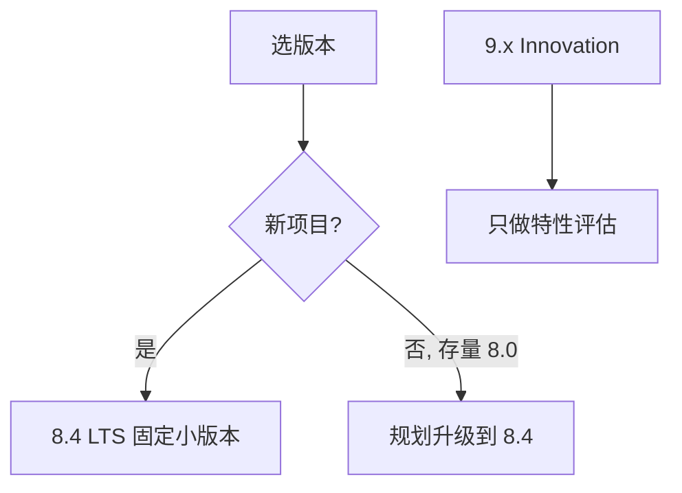

选型讨论常常从“用 MySQL 还是 PostgreSQL”开始，但对多数业务，真正决定稳定性的不是品牌，而是版本、存储引擎与配套的备份、复制和监控。MySQL 的默认引擎 InnoDB 提供事务、行级锁与崩溃恢复，配合主从复制与可验证的备份，足以支撑中小规模的在线业务。

## 它解决的问题

- 结构化数据与关系约束：订单、用户、库存这类强一致数据；
- 事务：一组写操作要么全部生效，要么全部回滚；
- 行级锁与并发控制：读写混合场景下尽量少阻塞；
- 成熟的生态：各类语言驱动、ORM、监控、云托管与备份工具。

这些能力组合起来，适合在线交易（OLTP）与中小规模业务库。数据量到单表千万级、访问以点查和范围查询为主时，MySQL 仍然是稳妥选择，前提是索引与 SQL 写对、备份与复制做到位。

## 不适合的场景

- 大规模分析报表：列式存储或数仓更合适；
- 海量半结构化数据：文档数据库更直接；
- 高写入吞吐的时序数据：专用时序库在压缩与聚合上更优；
- 跨地域强一致的全球事务：需要在应用层或分布式数据库解决，单机 MySQL 不具备这个能力。

把 MySQL 当万能存储，最后通常会在容量、查询复杂度或一致性上付出代价。

## 版本线怎么选

| 版本线 | 定位 | 生产建议 |
| --- | --- | --- |
| 8.0 | 上一代 LTS，2026 年 4 月结束官方支持 | 仅维护存量，尽快规划升级 |
| 8.4 | 当前 LTS，支持周期到 2032 年 | 新项目默认选择 |
| 9.x | Innovation，季度发布，生命周期短 | 评估新特性，不直接承载核心业务 |

8.4 有两个容易被忽略的变化：

- **mysql_native_password 默认关闭**。从 8.4.0 起该插件不再默认启用，新账号使用 `caching_sha2_password`；老客户端如果只支持旧插件，需要升级驱动，或在服务端显式开启 `--mysql-native-password=ON`；
- **Docker 的 `latest` 标签指向 Innovation 版**。官方镜像文档明确说明 `latest` 是最新的创新版本，不是 LTS。生产必须写固定标签，例如 `mysql:8.4`。

升级前还应运行官方升级检查工具，核对被移除的参数与保留字，不要直接在生产上跨大版本启动。

## 部署形态

- 单机：开发、测试与小流量业务；
- 主从：读写分离与备份从库；
- InnoDB Cluster：需要自动故障转移时使用；
- 云托管：把备份、复制与升级交给平台，自己保留 SQL 与索引的治理能力。

形态越复杂，运维成本越高。没有明确的可用性指标时，单机加可靠备份往往比一套没人维护的集群更稳。

## 选型清单

1. 版本固定为 8.4 LTS，不使用 `latest`；
2. 存储引擎使用 InnoDB；
3. 字符集统一 `utf8mb4`；
4. 上线前完成一次真实恢复演练；
5. 监控覆盖连接数、慢查询、复制延迟与磁盘空间。

## 小结

- MySQL 的定位是关系型 OLTP，不是通用存储；
- 新项目选 8.4 LTS，8.0 已结束支持，9.x 只用于评估；
- 8.4 的认证插件与镜像标签变化要在客户端和部署脚本里落实；
- 选型必须把备份、复制、监控一起考虑，而不是只看单机性能。
