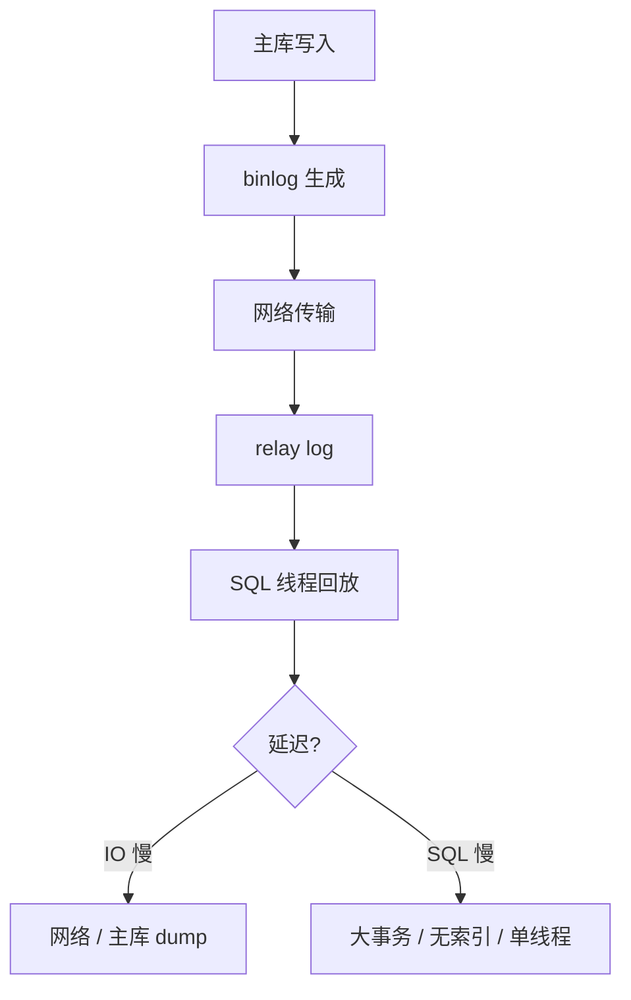

复制延迟的典型表现是“主库写成功，页面读不到”。排查要先分清是网络拉取慢、回放慢，还是主库写入本身就慢。只看 `Seconds_Behind_Source` 会被大事务误导，需要结合多个指标。



## 延迟从哪来

- **大事务**：一次更新几十万行，从库必须整体回放，期间不提交；
- **无主键或无索引**：ROW 格式回放需要定位行，缺索引会全表扫描；
- **从库硬件弱**：磁盘 IO 与 CPU 不足，回放速度跟不上；
- **单线程回放**：主库并发高，从库串行执行；
- **DDL**：大表加索引或改结构，从库执行时间与主库接近甚至更长；
- **锁冲突**：从库上的长查询阻塞回放。

## 判断方法

```sql
SHOW REPLICA STATUS\G
```

关注：

- `Replica_SQL_Running_State`：当前在做什么，例如 `Waiting for dependent transaction`；
- `Seconds_Behind_Source`：粗略值，大事务期间可能显示 0 或跳变；
- `Relay_Log_Space`：relay log 是否持续增长；
- `Retrieved_Gtid_Set` 与 `Executed_Gtid_Set` 的差值：更准确的积压量。

更可靠的延迟监控是心跳表：主库定期写时间戳，从库读取并与当前时间比较。它不受大事务与时钟漂移影响。

## 并行复制

8.0 起默认支持基于 LOGICAL_CLOCK 的并行回放：

```ini
[mysqld]
replica_parallel_workers = 4
replica_parallel_type = LOGICAL_CLOCK
replica_preserve_commit_order = ON
```

- 并行度按从库 CPU 与主库并发调整，不是越大越好；
- `replica_preserve_commit_order=ON` 保证提交顺序与主库一致；
- 主库事务之间如果没有并发，从库也无法并行。

## 复制中断

常见错误码：

| 错误 | 含义 | 处理 |
| --- | --- | --- |
| 1062 | 主键或唯一键冲突 | 核对数据，确认后跳过或重建从库 |
| 1032 | 要更新的行不存在 | 同上，优先重建而不是盲目跳过 |
| 1236 | 找不到 binlog 或 GTID | 检查保留周期与复制起点 |

跳过事务要非常谨慎：

```sql
-- 仅用于明确知道影响范围的场景
SET GTID_NEXT = 'uuid:1';
BEGIN; COMMIT;
SET GTID_NEXT = 'AUTOMATIC';
```

跳过意味着主从数据已经不一致，之后必须做校验或重建。

## 一致性校验

- `pt-table-checksum` 对比主从块级校验和；
- `pt-table-sync` 修复差异，执行前备份；
- 定期抽样比对关键表；
- 大版本升级或长时间中断后，优先重建从库而不是修补。

## 减少延迟的做法

1. 大事务拆小，控制单次更新行数；
2. 所有表有主键，更新条件走索引；
3. 从库硬件不低于主库，磁盘优先 SSD；
4. 合理设置并行复制；
5. 大 DDL 放到低峰期，或用在线改表工具；
6. 对延迟敏感的读流量切回主库或使用读己之写路由。

## 小结

- 延迟要看回放状态与 GTID 差值，不能只信 `Seconds_Behind_Source`；
- 大事务、无索引与单线程回放是主要来源；
- 并行复制能缓解但不能消除主库串行事务；
- 复制中断优先核对数据，跳过事务后必须校验；
- 延迟治理最终落在写入方式与表结构上。
