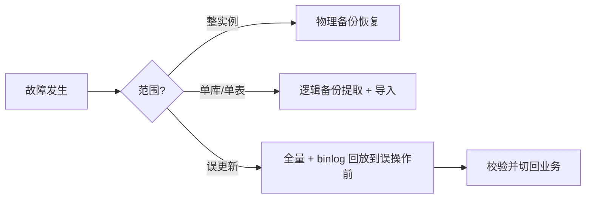

恢复的第一步不是执行命令，而是判断故障类型：整实例损坏、单库误删、单表误删、还是几行数据被改错。路径不同，RTO 差别很大，错误的选择可能覆盖掉仅存的数据。



## 先止血

1. 立即停止相关写入，避免错误扩散；
2. 保留现场：不要急着重启、重建或清理日志；
3. 记录误操作时间点与 SQL，确定恢复目标时刻；
4. 在隔离环境恢复，验证后再切回生产。

误删后继续写入会覆盖 binlog 中可用的回放区间，止血越早，恢复越完整。

## 整实例恢复

```bash
# 物理备份
xtrabackup --prepare --target-dir=/backup/full
systemctl stop mysqld
rm -rf /data/mysql/*
xtrabackup --copy-back --target-dir=/backup/full
chown -R mysql:mysql /data/mysql
systemctl start mysqld
```

物理恢复要求数据目录干净，且工具版本与目标版本一致。恢复后先核对系统库、账号与复制状态，再开放业务。

## 单库或单表恢复

逻辑备份可以只取需要的部分：

```bash
# 导出单表
mysqldump -u backup -p shop orders > orders.sql

# 恢复单表（确认目标库后执行）
mysql -u app -p shop < orders.sql
```

如果备份是整库文件，可以先导入临时实例，再导出目标表，避免直接覆盖生产。

## 时间点恢复

```bash
# 全量恢复
mysql -u root -p < shop-20261124.sql

# 回放 binlog 到误操作之前
mysqlbinlog --start-datetime='2026-11-24 09:00:00' \
  --stop-datetime='2026-11-24 10:15:00' \
  mysql-bin.000123 | mysql -u root -p
```

要点：

- `--stop-datetime` 要早于误操作时间，宁可少回放再补；
- GTID 环境下用 `--skip-gtids` 或按 GTID 区间回放，避免重复事务；
- 回放前在临时库验证 SQL 影响范围；
- 回放后核对行数、关键字段与业务抽样。

## 延迟从库

如果有一套延迟从库（例如延迟 1 小时），误操作后可以在延迟窗口内追上之前的状态，快速替代时间点恢复。延迟从库不能替代备份，但能显著缩短 RTO。

## 恢复后的校验

1. 表数量、行数与备份记录一致；
2. 关键业务表抽样比对；
3. 账号与权限、字符集、时区正确；
4. 复制关系与 GTID 状态正常；
5. 应用连接池切换后观察错误率与慢查询。

校验不通过时不要切流量，先回到隔离环境继续修复。

## 演练清单

- 每季度至少一次整库恢复；
- 每半年一次时间点恢复，覆盖误更新场景；
- 记录实际 RTO，与目标对比；
- 演练后更新备份策略与联系人；
- 备份文件保留周期覆盖演练间隔。

## 常见坑

- **binlog 已被清理**：保留周期短于恢复窗口，时间点恢复无法完成；
- **恢复时字符集不一致**：导入后出现乱码或排序变化；
- **直接覆盖生产库**：没有隔离验证，二次事故；
- **忘记恢复账号与授权**：应用连不上；
- **恢复后未检查复制**：从库继续回放旧事务，数据再次被污染。

## 小结

- 恢复先判断范围与目标时间点，再选物理、逻辑或时间点路径；
- 误删后立即止血，保留 binlog 与现场；
- 时间点恢复依赖全量备份与连续的 binlog；
- 延迟从库能缩短 RTO，但不能替代备份；
- 恢复能力只能通过演练证明。
