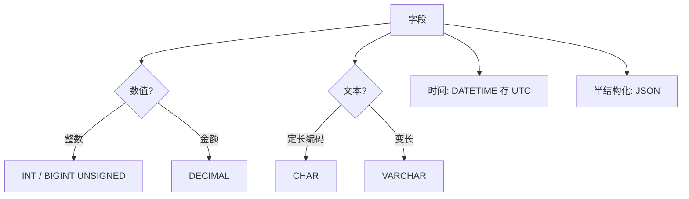

表结构一旦上线，改动成本远高于代码。字段类型选错会带来精度丢失、索引超长与迁移困难；约束缺失则让脏数据在系统里扩散。设计阶段多花十分钟，后面少做几次数据修复。



## 数值

- 自增主键与关联 ID 用 `BIGINT UNSIGNED`，不要用 `INT` 省空间，几年后就会溢出；
- 状态、类型用 `TINYINT UNSIGNED`，并在代码里维护枚举；
- 金额、单价、结算金额用 `DECIMAL(12,2)` 或按分存 `BIGINT`；
- `FLOAT/DOUBLE` 只用于科学计算，不用于需要精确相等的业务字段；
- MySQL 的整数运算溢出不会报错，会按类型截断，写入前要校验范围。

## 字符串

- 一般文本用 `VARCHAR(n)`，长度按业务上限而不是“越大越好”；
- 固定长度编码（如国家代码、哈希）用 `CHAR`；
- 超长正文用 `TEXT`，但不要把经常检索的字段放进去；
- 字符集统一 `utf8mb4`，它每个字符最多 4 字节；InnoDB 单列索引前缀上限是 3072 字节，`VARCHAR(768)` 左右就会触顶，需要前缀索引或改用哈希列。

```sql
CREATE TABLE users (
  id        BIGINT UNSIGNED NOT NULL AUTO_INCREMENT,
  email     VARCHAR(255) NOT NULL,
  nickname  VARCHAR(64) NOT NULL,
  bio       TEXT NULL,
  PRIMARY KEY (id),
  UNIQUE KEY uk_email (email)
) ENGINE = InnoDB;
```

## 时间

| 类型 | 范围 | 时区行为 |
| --- | --- | --- |
| `DATETIME` | 1000–9999 | 原样存储，不做时区转换 |
| `TIMESTAMP` | 1970–2038 | 按会话时区转换，有 2038 上限 |
| `DATE` | 日期 | 只存日期 |

业务时间统一用 `DATETIME` 存 UTC，展示时在应用层转换。`TIMESTAMP` 的自动时区转换看似方便，但会让“同一份数据在不同连接下显示不同”，排查时非常容易误判。

## JSON

```sql
ALTER TABLE orders ADD COLUMN extra JSON NULL;
```

JSON 适合存放结构不固定的附加信息，不适合作为主要查询维度：

- 高频过滤的字段应提升为独立列并建索引；
- JSON 上的函数索引需要显式创建；
- JSON 列不参与普通索引，排序与聚合也比普通列慢。

## 约束

```sql
CREATE TABLE order_items (
  id        BIGINT UNSIGNED NOT NULL AUTO_INCREMENT,
  order_id  BIGINT UNSIGNED NOT NULL,
  sku_id    BIGINT UNSIGNED NOT NULL,
  quantity  INT UNSIGNED NOT NULL DEFAULT 1,
  price     DECIMAL(12,2) NOT NULL,
  PRIMARY KEY (id),
  KEY idx_order (order_id),
  CONSTRAINT fk_item_order
    FOREIGN KEY (order_id) REFERENCES orders (id),
  CONSTRAINT ck_quantity CHECK (quantity > 0)
) ENGINE = InnoDB;
```

- 主键：聚簇索引的入口，必须稳定且尽量短；
- 唯一键：业务唯一性的最后一道防线，例如邮箱、订单号；
- 外键：保证引用完整性，但分库分表、批量导入与高并发写入时会成为负担，很多团队选择在应用层校验；
- `CHECK`：8.0.16 起真正生效，适合范围与枚举校验；
- `NOT NULL` 与默认值：能非空就不要允许空，空值会让比较与索引统计变复杂。

## 范式与反范式

- 第三范式减少冗余，更新一处即可一致；
- 读多写少的报表场景可以适度冗余，用空间换查询次数；
- 宽表把常用字段放在一起，减少 JOIN，但要注意单行大小与更新频率；
- 反范式的前提是有明确的同步机制，否则冗余字段迟早不一致。

## 设计检查清单

1. 主键短且稳定，业务字段不承担主键职责；
2. 金额用 `DECIMAL`，时间存 UTC；
3. 唯一性由唯一索引保证，不靠应用“先查再插”；
4. 常用查询条件有对应索引；
5. 外键是否启用与分库分表策略一致；
6. 预留扩展字段时优先考虑独立表，而不是无限加列。

## 小结

- 类型选择首先保证精度与范围，其次才是省空间；
- 约束把数据规则写进库，而不是只写在代码里；
- 时间统一 UTC，避免 `TIMESTAMP` 的隐式转换歧义；
- 范式保证一致，反范式换取性能，两者都要有维护机制。
