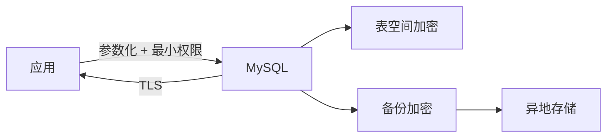

数据库安全分三层：应用层防注入、传输层防窃听、存储层防文件泄露。任何一层缺失，其他层的努力都会被打折。



## SQL 注入

注入成立需要三个条件同时满足：应用拼接 SQL、数据库账号权限过宽、错误信息暴露结构。防护要同时拆掉这三个条件。

```python
# 错误：字符串拼接
sql = f"SELECT * FROM users WHERE email = '{email}'"

# 正确：参数化
cursor.execute("SELECT * FROM users WHERE email = %s", (email,))
```

- 所有输入走参数化，不区分“可信”与“不可信”；
- 动态列名、表名与排序方向无法参数化时，用白名单映射；
- 业务账号只给 DML，DROP/ALTER 交给迁移账号；
- 生产环境关闭详细报错，错误信息不回显 SQL 与表结构；
- WAF 只能作为补充，不能替代代码修复。

## 审计

- **MySQL Enterprise Audit**：企业版插件，记录连接、语句与对象访问，需付费；
- **general_log**：记录所有语句，开销大，只适合短期排查；
- **performance_schema**：可观测语句摘要与等待，但不是合规审计；
- **外部审计**：通过 binlog、代理层或日志平台采集，适合社区版；
- 审计日志要单独存储、限制访问，并设定保留周期。

审计的目标是“能回答谁在什么时间做了什么”，而不是收集尽可能多的日志。

## 传输加密

```ini
[mysqld]
require_secure_transport = ON
```

开启后所有连接必须使用 TLS 或本地 socket。客户端：

```bash
mysql --ssl-mode=REQUIRED -h 10.0.0.11 -u app -p
```

应用连接串也要显式要求 TLS，并校验证书。内部网络同样建议加密，避免“内网可信”的假设在横向移动时失效。

## 静态加密

- InnoDB 表空间加密需要 keyring 组件，例如 `component_keyring_file`；
- 加密保护的是磁盘文件被复制或窃取的情况，不防数据库账号被盗；
- 密钥要与数据分离存放，并纳入备份与轮换流程；
- 备份文件本身也应加密，尤其是传到对象存储或异地时。

```sql
CREATE TABLE payments (
  id BIGINT UNSIGNED NOT NULL AUTO_INCREMENT,
  amount DECIMAL(12,2) NOT NULL,
  PRIMARY KEY (id)
) ENGINE = InnoDB ENCRYPTION = 'Y';
```

## 备份与日志安全

- 备份文件包含全量数据，权限等同于数据库；
- 备份传输使用加密通道，落地后加密存储；
- 备份账号只读，且限制来源；
- 日志中避免输出密码、令牌与完整身份证号；
- 恢复环境同样需要访问控制，避免测试库成为泄露源。

## 安全检查清单

1. 应用是否全部使用参数化查询；
2. 业务账号是否只有目标库 DML；
3. 生产错误信息是否回显 SQL 细节；
4. 是否强制 TLS，证书是否校验；
5. 数据文件与备份是否加密，密钥是否分离；
6. 审计日志是否保留并可检索；
7. 公网 3306 是否已关闭。

## 常见坑

- **只在入口做过滤**：二次拼接、ORM 原生 SQL 仍可能注入；
- **用 `mysql_real_escape_string` 代替参数化**：编码与字符集差异会留下缺口；
- **开启 `require_secure_transport` 后旧客户端连不上**：升级驱动或配置证书；
- **加密后不备份密钥**：数据文件还在，但永远解不开；
- **审计日志与业务库同机**：入侵者可以一并删除。

## 小结

- 注入防护的核心是参数化与最小权限，WAF 只是补充；
- 审计要能回答“谁在何时做了什么”，并单独保存；
- TLS 保护传输，静态加密保护文件，两者解决不同问题；
- 备份与密钥的安全等级等同数据库本身；
- 安全检查要定期执行，而不是上线时做一次。
