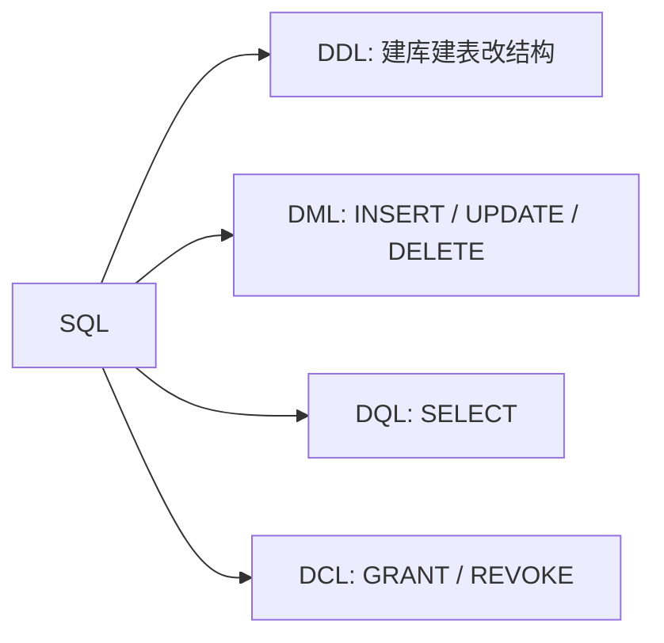

运维排查最终都会落到 SQL 上：一条慢查询、一次误更新、一个没加索引的关联，都会直接表现为故障。先把建表与增删改查写对，后面的索引、锁与复制才有讨论基础。



## 建库与建表

```sql
CREATE DATABASE shop
  CHARACTER SET utf8mb4
  COLLATE utf8mb4_0900_ai_ci;

USE shop;

CREATE TABLE orders (
  id          BIGINT UNSIGNED NOT NULL AUTO_INCREMENT,
  user_id     BIGINT UNSIGNED NOT NULL,
  status      TINYINT NOT NULL DEFAULT 0,
  amount      DECIMAL(12, 2) NOT NULL,
  created_at  DATETIME NOT NULL DEFAULT CURRENT_TIMESTAMP,
  updated_at  DATETIME NOT NULL DEFAULT CURRENT_TIMESTAMP
              ON UPDATE CURRENT_TIMESTAMP,
  PRIMARY KEY (id),
  KEY idx_user_created (user_id, created_at)
) ENGINE = InnoDB;
```

约定比语法更重要：

- 主键用 `BIGINT UNSIGNED AUTO_INCREMENT`，避免业务字段做主键；
- 金额用 `DECIMAL`，不要用 `FLOAT/DOUBLE`；
- 时间用 `DATETIME`，统一存 UTC；
- 每张表都带 `created_at` 与 `updated_at`；
- 显式写 `ENGINE=InnoDB`，不要依赖默认值。

## 增删改查

```sql
INSERT INTO orders (user_id, status, amount)
VALUES (1001, 0, 199.00), (1002, 0, 59.90);

UPDATE orders
SET status = 1
WHERE id = 1;

DELETE FROM orders
WHERE id = 2;

SELECT id, user_id, amount
FROM orders
WHERE user_id = 1001
ORDER BY created_at DESC
LIMIT 20;
```

生产环境的写操作要遵守两条：

1. **写操作先在事务里执行**，确认影响行数再提交；
2. **UPDATE / DELETE 必须带 WHERE**，执行前先用同条件的 SELECT 核对范围。

```sql
START TRANSACTION;

UPDATE orders
SET status = 1
WHERE id = 1 AND status = 0;

-- 影响行数为 0 时说明状态已变，回滚或重新判断
COMMIT;
```

## 查询结构

```sql
SELECT u.id, u.name, COUNT(o.id) AS order_count, SUM(o.amount) AS total
FROM users u
LEFT JOIN orders o ON o.user_id = u.id
WHERE u.created_at >= '2026-01-01'
GROUP BY u.id, u.name
HAVING total > 0
ORDER BY total DESC
LIMIT 10;
```

执行顺序可以粗略记成：`FROM → JOIN → WHERE → GROUP BY → HAVING → SELECT → ORDER BY → LIMIT`。理解这一点，才能解释“为什么 WHERE 里不能用 SELECT 的别名”“为什么 HAVING 比 WHERE 慢”。

## 高频事故点

- **UPDATE / DELETE 忘了 WHERE**：先 SELECT 验证条件，必要时开事务；
- **`SELECT *`**：列变更会破坏调用方，宽表还会放大 IO；
- **隐式类型转换**：字符串列用数字比较会让索引失效，见后面索引篇；
- **大批量删除**：一次删几百万行会长时间持锁，应分批并控制事务大小；
- **在应用里拼接 SQL**：注入风险的根源，一律使用参数化查询。

## 小结

- 建表约定先定好，主键、金额类型、时间字段与索引随之明确；
- 写操作进事务，改删先用 SELECT 核对范围；
- 查询要能画出执行顺序，才知道条件该放在 WHERE 还是 HAVING；
- 生产 SQL 的安全底线是参数化与可控的批量大小。
