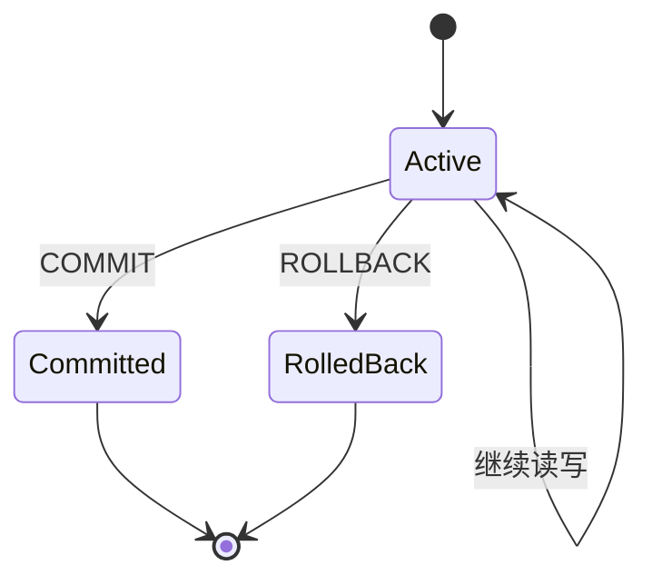

事务解决的是“要么全成功、要么全失败”，隔离级别解决的是“并发事务互相能看到多少”。两者共同决定并发写入时的正确性与性能，也是长事务、死锁与复制延迟的根源之一。



## ACID

- **原子性**：事务内的操作要么全部生效，要么全部回滚，靠 undo log 实现；
- **一致性**：约束、外键与业务规则在事务前后都成立；
- **隔离性**：并发事务之间按隔离级别互相可见或不可见；
- **持久性**：提交后的数据不因崩溃丢失，靠 redo log 与刷盘策略保证。

InnoDB 的日志体系是理解事务的基础：redo log 保证崩溃恢复，undo log 支持回滚与 MVCC。MyISAM 不支持事务，选引擎时不要只看“能用”。

## 隔离级别

```sql
SET SESSION TRANSACTION ISOLATION LEVEL READ COMMITTED;
SELECT @@transaction_isolation;
```

| 级别 | 脏读 | 不可重复读 | 幻读 | 说明 |
| --- | --- | --- | --- | --- |
| READ UNCOMMITTED | 可能 | 可能 | 可能 | 很少使用 |
| READ COMMITTED | 否 | 可能 | 可能 | 很多互联网业务的默认选择 |
| REPEATABLE READ | 否 | 否 | InnoDB 下基本避免 | MySQL 默认 |
| SERIALIZABLE | 否 | 否 | 否 | 并发性能最差 |

InnoDB 默认 `REPEATABLE READ`。它通过 MVCC 让同一事务内的快照读看到一致的数据，并用 next-key lock 处理当前读的幻读问题。

## 快照读与当前读

- **快照读**：普通 `SELECT`，读取事务开始时的 read view；
- **当前读**：`SELECT ... FOR UPDATE`、`SELECT ... LOCK IN SHARE MODE`、`UPDATE`、`DELETE`，读取最新提交版本并加锁。

```sql
START TRANSACTION;

SELECT amount FROM orders WHERE id = 1;          -- 快照读
SELECT amount FROM orders WHERE id = 1 FOR UPDATE; -- 当前读，加排他锁

COMMIT;
```

这解释了一个常见现象：同一事务里两次普通查询结果一致，但 `FOR UPDATE` 能看到其他事务刚提交的值。

## MVCC 的代价

- undo log 需要保留旧版本，长事务会让 undo 空间持续增长；
- 快照太旧会影响 purge 线程，进而拖慢整体性能；
- 长事务持有锁与旧 read view，是复制延迟与锁等待的常见原因。

排查长事务：

```sql
SELECT trx_id, trx_started, trx_mysql_thread_id, trx_query
FROM information_schema.innodb_trx
ORDER BY trx_started;
```

## 使用约定

1. 事务只包住必要的写操作，远程调用、文件上传不要放进来；
2. 显式 `START TRANSACTION` 与 `COMMIT`，不要依赖自动提交的偶然行为；
3. 事务内避免等待用户输入或调用外部接口；
4. 高并发写入按固定顺序访问行，减少死锁；
5. 批量操作分批提交，控制单事务行数。

## 小结

- ACID 由 undo/redo 与隔离机制共同保证；
- 默认 RR，通过 MVCC 提供一致性快照，当前读才加锁；
- 快照读与当前读的差异能解释大部分“读到旧值”的疑问；
- 长事务会同时放大 undo、锁等待与复制延迟，必须监控。
