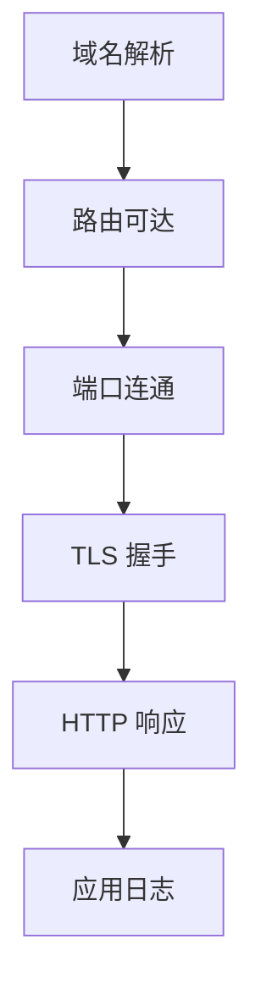

抓包不是第一步。先用廉价命令确认问题在哪一层，再决定要不要抓包。抓包的价值是回答“请求有没有到达这台机器、对端有没有回包”。



## 逐层验证

```bash
dig api.example.com +short
ping -c 3 1.2.3.4
nc -vz 1.2.3.4 443
curl -v https://api.example.com/health
```

- `dig` 确认解析；
- `ping` 确认网络层（部分云主机禁 ICMP，不能作为唯一依据）；
- `nc -vz` 确认端口；
- `curl -v` 一次看到 DNS、连接、TLS 与 HTTP 全过程。

## TLS 单独验证

```bash
openssl s_client -connect api.example.com:443 -servername api.example.com
```

关注：

- 证书链是否完整；
- 证书域名是否匹配；
- 握手使用的协议与加密套件；
- 是否因为系统时间偏差导致证书“未生效”。

SNI 必须带 `-servername`，否则多域名服务器可能返回默认证书。

## tcpdump

```bash
tcpdump -i eth0 -nn -A port 8080
tcpdump -i any -nn host 10.0.0.12 and port 3306 -c 20
tcpdump -i eth0 -nn -w /tmp/cap.pcap 'tcp[tcpflags] & tcp-syn != 0'
```

- `-nn` 不解析域名与端口名；
- `-A` 以文本显示载荷，`-w` 存 pcap 供 Wireshark 分析；
- 抓包需要 root 或 `CAP_NET_RAW`；
- 先缩小过滤条件，再扩大范围，避免把磁盘写满。

判断要点：

- 只有 SYN 没有 SYN-ACK：请求到了但对端没回，查后端监听与防火墙；
- 有 SYN-ACK 但客户端没 ACK：回程路由或防火墙问题；
- 三次握手完成但没有 HTTP 数据：应用层卡住；
- 大量 RST：端口未监听或被中间设备重置。

## 代理与 TLS 拦截

- 应用配置了代理，`curl` 直连正常、应用失败，检查 `HTTP_PROXY`/`NO_PROXY`；
- 公司网络做 TLS 拦截时，证书链会变成内部 CA，需要把 CA 装进信任库；
- 容器内证书与宿主机不同，排查时进入容器验证。

## 常见现象对照

| 现象 | 可能原因 |
| --- | --- |
| `Connection refused` | 端口未监听或被拒绝 |
| `Connection timed out` | 安全组、路由、包被丢弃 |
| `SSL certificate problem` | 证书链、域名或时间问题 |
| 502 Bad Gateway | 代理连不上后端 |
| 504 Gateway Timeout | 后端处理超时 |
| 偶发超时 | 丢包、backlog、连接池耗尽 |

## 排查顺序

1. 解析与端口，排除低级问题；
2. `curl -v` 看失败发生在哪个阶段；
3. TLS 问题用 `openssl s_client`；
4. 需要确认包流向时再抓包；
5. 抓包结论要结合应用日志与后端监听状态。

## 小结

- 先分层验证，再抓包；
- `curl -v` 是覆盖 DNS、连接、TLS 与 HTTP 的一条命令；
- `tcpdump` 回答“包有没有到、对端有没有回”；
- RST 与超时指向不同的网络问题；
- 代理与证书拦截是“本机正常、应用失败”的常见原因。
