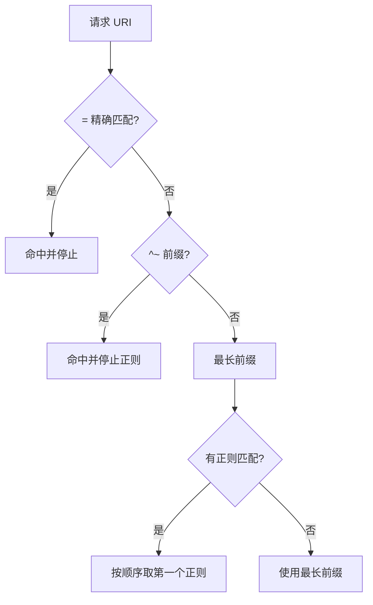

Nginx 的配置问题多数不是语法错误，而是请求落到了错误的 location：静态文件被代理走、SPA 路由 404、`alias` 与 `root` 混用。先把匹配顺序弄清楚。



## 层级

```nginx
events {}

http {
    server {
        listen 80;
        server_name example.com;

        location / {
            root /var/www/site;
        }
    }
}
```

- `main`：全局指令；
- `events`：连接处理；
- `http`：HTTP 相关、可包含 upstream 与 include；
- `server`：一个虚拟主机；
- `location`：按 URI 分流。

## 静态站点

```nginx
server {
    listen 80;
    server_name example.com;
    root /var/www/site;
    index index.html;

    location /assets/ {
        expires 7d;
        add_header Cache-Control "public";
    }

    location / {
        try_files $uri $uri/ /index.html;
    }
}
```

`try_files` 依次尝试文件、目录，最后回退到 `index.html`，这是 SPA 路由的标准写法。没有它，刷新子路由会 404。

`root` 与 `alias` 的区别：`root` 拼接完整 URI，`alias` 替换 location 前缀。`alias` 末尾是否带 `/` 会影响拼接结果，容易出错。

## 反向代理

```nginx
upstream app {
    server 10.0.0.11:3000;
    server 10.0.0.12:3000;
    keepalive 32;
}

server {
    listen 80;
    server_name api.example.com;

    location / {
        proxy_pass http://app;
        proxy_http_version 1.1;
        proxy_set_header Host $host;
        proxy_set_header X-Real-IP $remote_addr;
        proxy_set_header X-Forwarded-For $proxy_add_x_forwarded_for;
        proxy_set_header X-Forwarded-Proto $scheme;
        proxy_set_header Connection "";
    }
}
```

- `proxy_pass` 末尾带 `/` 会替换 location 前缀，不带则原样转发；
- `Host`、`X-Forwarded-*` 要传给后端，否则应用拿不到真实域名与客户端 IP；
- `keepalive` 配合 `Connection ""` 复用后端连接；
- WebSocket 需要 `Upgrade` 与 `Connection` 头。

## 常见配置

- 请求体大小：`client_max_body_size 20m;`
- 超时：`proxy_connect_timeout`、`proxy_read_timeout`；
- 压缩：`gzip on; gzip_types ...;`
- 限流：`limit_req_zone` 与 `limit_req`；
- 访问日志格式：`log_format` 加 `$request_time` 与 `$upstream_response_time`。

## 常见坑

- **`root` 与 `alias` 混用**：路径多一层或找不到文件；
- **`location` 顺序误解**：正则按出现顺序，前缀按最长匹配；
- **`proxy_pass` 斜杠**：路径被截断或重复；
- **没有 `try_files`**：SPA 刷新 404；
- **`server_name` 未匹配**：请求落到默认站点；
- **配置改完未测试**：`nginx -t` 必须先执行。

## 小结

- 配置按 main/events/http/server/location 分层；
- location 匹配有明确优先级，精确与前缀优先于正则；
- SPA 用 `try_files` 回退，反向代理要传 Host 与转发头；
- `root` 与 `alias` 语义不同，路径拼接要核对；
- 每次改配置先 `nginx -t`，再平滑重载。
