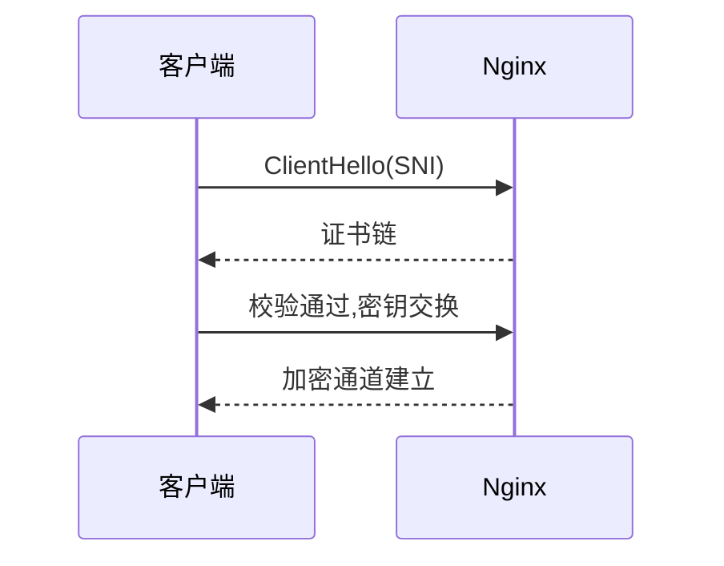

HTTPS 配好之后仍然可能握手失败：证书链缺中间证书、域名不匹配、协议版本过旧。浏览器与 `curl` 的报错信息比 Nginx 日志更直接。



## 证书文件

- `fullchain.pem`：服务器证书 + 中间证书，必须完整；
- `privkey.pem`：私钥，权限 600；
- 只配服务器证书、缺中间证书时，部分客户端会报“证书链不完整”。

```nginx
server {
    listen 443 ssl;
    http2 on;
    server_name example.com;

    ssl_certificate     /etc/nginx/certs/fullchain.pem;
    ssl_certificate_key /etc/nginx/certs/privkey.pem;

    ssl_protocols TLSv1.2 TLSv1.3;
    ssl_session_cache shared:SSL:10m;
    ssl_session_timeout 1d;
}
```

TLS 1.0/1.1 已不应启用；TLS 1.3 的套件由 OpenSSL 管理，不需要在 Nginx 里单独列。

## 80 跳转到 443

```nginx
server {
    listen 80;
    server_name example.com;
    return 301 https://$host$request_uri;
}
```

如果前面还有负载均衡或 CDN，跳转要用外部协议判断，避免在后端又跳一次造成循环：

```nginx
if ($http_x_forwarded_proto = "http") {
    return 301 https://$host$request_uri;
}
```

`if` 在 location 之外使用要谨慎，简单跳转可以接受。

## HSTS

```nginx
add_header Strict-Transport-Security "max-age=31536000; includeSubDomains" always;
```

HSTS 让浏览器在有效期内强制 HTTPS。启用前确认所有子域都已支持 HTTPS，否则会把子域锁死。首次上线建议先用较短 `max-age`，稳定后再延长。

## 证书续期

Let's Encrypt 证书有效期 90 天，续期后要重载 Nginx：

```bash
certbot renew --deploy-hook "systemctl reload nginx"
```

- 续期失败通常来自 80 端口验证被防火墙拦截；
- 使用 DNS 验证时注意 TXT 记录传播；
- 续期后确认证书生效：`openssl s_client -connect example.com:443 -servername example.com`。

## 常见握手问题

| 现象 | 原因 |
| --- | --- |
| `certificate has expired` | 证书过期或系统时间错误 |
| `unable to verify the first certificate` | 证书链缺中间证书 |
| `certificate is not valid for this domain` | 域名不匹配或 SNI 缺失 |
| `wrong version number` | 用 HTTP 访问了 HTTPS 端口 |
| 混合内容告警 | 页面内仍有 http 资源 |

## 小结

- 证书必须用完整链，私钥权限收紧；
- 只启用 TLS 1.2/1.3，80 明确跳转 443；
- HSTS 先短周期再延长，避免锁死未支持 HTTPS 的子域；
- 续期自动化并配置 reload；
- 握手失败先用 `openssl s_client` 核对链、域名与时间。
