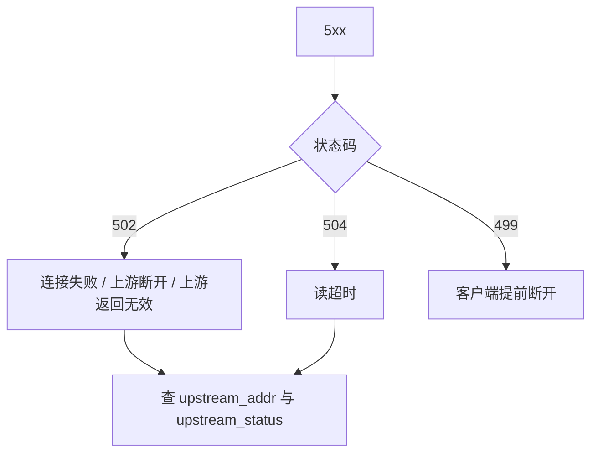

502 与 504 都出现在 Nginx 作为反向代理时，但含义不同：502 表示没拿到有效的上游响应，504 表示等上游响应超时。先看日志，再看后端。



## 先看日志

```nginx
log_format main '$remote_addr - $request '
  '$status $request_time $upstream_addr '
  '$upstream_status $upstream_response_time';
```

关键字段：

- `upstream_addr`：实际转到的后端地址；
- `upstream_status`：后端返回的状态码，`-` 表示没拿到响应；
- `upstream_response_time`：后端处理耗时；
- `request_time`：Nginx 视角的总耗时。

如果 `upstream_addr` 是多个地址，说明重试过；`upstream_status` 为 `-` 通常是连接失败或超时。

## 502 的常见原因

- 后端进程没启动或已崩溃；
- 后端监听 `127.0.0.1`，Nginx 通过容器或另一台机器访问不到；
- 端口被防火墙拦截；
- 后端主动断开连接（应用异常、超时）；
- 上游返回的响应不符合 HTTP 规范；
- upstream 连接数耗尽。

```bash
ss -lntp | grep ':3000'
curl -v http://10.0.0.11:3000/health
```

先在 Nginx 所在机器直接访问上游，排除应用问题。

## 504 的常见原因

- 后端处理确实超过 `proxy_read_timeout`；
- 数据库慢查询、锁等待、外部接口阻塞；
- 连接池耗尽，请求排队；
- `proxy_read_timeout` 设置过短，正常长任务被切断。

```nginx
proxy_connect_timeout 5s;
proxy_send_timeout 30s;
proxy_read_timeout 60s;
```

超时要与业务匹配。把读超时调到很大只是把问题推迟，不能解决慢查询。

## 499

499 是 Nginx 自定义状态码：客户端在 Nginx 返回响应前关闭了连接。常见于：

- 用户刷新或关闭页面；
- 前端请求超时时间短于后端处理时间；
- 移动网络抖动。

大量 499 通常说明后端响应太慢，用户等不及。

## 排查顺序

1. 从 access log 取一条 502/504 的 `upstream_addr` 与 `upstream_status`；
2. 在 Nginx 机器上 `curl` 上游健康检查接口；
3. 查后端进程、端口、线程与连接池；
4. 查后端日志与慢查询；
5. 核对 Nginx 超时配置与后端实际耗时；
6. 需要时抓包确认连接是否建立。

## 常见坑

- **只看状态码不看 upstream 字段**：无法区分是 Nginx 还是后端；
- **后端只监听回环地址**：跨机或容器访问失败；
- **upstream 没有 keepalive**：高频请求下端口耗尽；
- **超时全部调大**：慢请求堆积，故障扩大；
- **健康检查接口依赖数据库**：数据库抖动导致全部节点被摘除。

## 小结

- 502 是连接或响应无效，504 是等待超时；
- 先看 `upstream_addr`、`upstream_status`、`upstream_response_time`；
- 在 Nginx 机器直接访问上游，快速区分网络与应用；
- 超时要与业务耗时匹配；
- 499 多说明后端慢，用户提前放弃。
