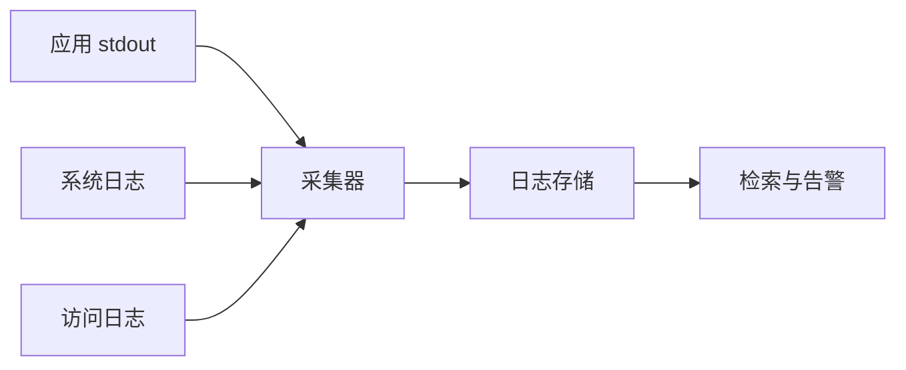

日志的价值不在“写得多”，而在“出问题时能查到”。可检索的前提是结构一致：时间、级别、来源、请求标识与消息分开存，而不是一整行自由文本。



## 结构化日志

```json
{
  "ts": "2026-11-26T01:30:00Z",
  "level": "error",
  "service": "order-api",
  "trace_id": "4f1c...",
  "msg": "payment failed",
  "order_id": 1024,
  "err": "timeout"
}
```

字段约定：

- `ts` 统一 UTC 与 ISO 8601；
- `level` 用固定枚举，避免 `ERR`、`Error` 混用；
- `service` 与实例标识，便于按来源过滤；
- `trace_id` 关联同一次请求的多个服务；
- 业务字段单独列出，不要塞进 `msg`。

## stdout 与文件

容器与 systemd 场景优先输出到 stdout，由平台收集：

- Docker：`docker logs` 或日志驱动；
- systemd：journal；
- 传统虚机：应用写文件，采集器 tail。

写文件时要配置轮转：

```text
/var/log/app/*.log {
  daily
  rotate 14
  compress
  missingok
  notifempty
  copytruncate
}
```

`copytruncate` 适合不支持重新打开文件的应用，但可能丢失切割瞬间的日志。

## 检索

小规模先在本机：

```bash
grep -h '"level":"error"' /var/log/app/*.log | tail -50
jq -r 'select(.level=="error") | [.ts,.service,.msg] | @tsv' app.log
```

大规模用集中式日志（Loki、Elasticsearch 等），按 `service`、`level`、`trace_id` 建索引。索引字段不宜过多，否则存储成本上升。

## 日志与指标的分工

- 指标回答“有没有异常、异常多大”；
- 日志回答“具体哪条请求、什么错误”；
- 链路回答“耗时花在哪个服务”。

告警应基于指标，日志用于定位。用日志做高频告警会被噪声淹没，也会放大存储成本。

## 脱敏与保留

- 密码、令牌、身份证、银行卡号不能进日志；
- 请求体只记录必要字段，或做掩码；
- 保留周期按合规与排障需求确定，常见 7–30 天；
- 审计类日志单独存储，权限更严；
- 日志平台本身也要备份与访问控制。

## 常见坑

- **时间格式不统一**：跨服务无法按时间排序；
- **日志里拼接大对象**：磁盘与采集带宽被占满；
- **没有请求标识**：只能按时间猜；
- **文件不轮转**：磁盘写满导致服务不可用；
- **脱敏只在入口做**：内部服务又把敏感字段打出来；
- **日志级别全开**：生产 DEBUG 产生海量数据。

## 小结

- 结构化日志是检索与关联的基础；
- 统一时间、级别、服务与 trace_id；
- 容器优先 stdout，文件必须轮转；
- 指标负责发现，日志负责解释；
- 脱敏与保留策略要和合规一起定。
