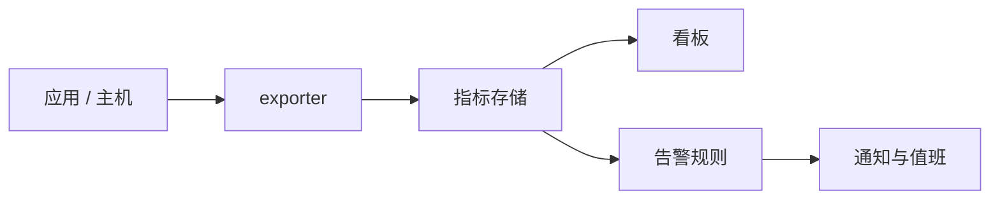

日志告诉你“发生了什么”，指标告诉你“影响有多大、是否在恶化”。没有指标的告警只能靠用户投诉触发，故障发现永远滞后。



## 指标类型

| 类型 | 含义 | 示例 |
| --- | --- | --- |
| Counter | 只增不减的累计值 | 请求总数、错误总数 |
| Gauge | 可增可减的瞬时值 | 连接数、内存使用 |
| Histogram | 分桶统计分布 | 请求耗时、响应大小 |
| Summary | 客户端分位数 | 延迟分位（较少用） |

Counter 用 `rate()` 看速率，不要直接展示累计值。Histogram 才能算 P95/P99，平均值会掩盖长尾。

## 黄金指标

- **延迟**：P50/P95/P99，区分成功与失败请求；
- **流量**：QPS、并发连接；
- **错误**：错误率、按状态码与依赖分类；
- **饱和度**：CPU、内存、连接池、磁盘、队列长度。

这四个指标能覆盖大多数服务。业务指标（下单数、支付成功率）与它们并列，用于判断真实影响。

## 采集

主机层用 node_exporter，应用层暴露 `/metrics`：

```text
http_requests_total{method="GET",status="500"} 12
http_request_duration_seconds_bucket{le="0.5"} 1024
```

标签要有边界：`status`、`method`、`route` 可以，用户 ID、订单号不能做标签，否则时间序列数量爆炸。

## 告警设计

```yaml
- alert: HighErrorRate
  expr: |
    sum(rate(http_requests_total{status=~"5.."}[5m]))
    / sum(rate(http_requests_total[5m])) > 0.05
  for: 10m
  labels:
    severity: critical
```

原则：

- 基于症状（错误率、延迟）而不是原因（CPU 高）；
- 设置 `for` 持续时间，避免瞬时抖动；
- 阈值与业务 SLO 对齐；
- 分级：P1 立即通知，P2 工作时间内处理；
- 抑制：上游故障时不再重复通知下游；
- 每条告警都要有处理手册。

## 看板分层

1. **总览**：核心服务可用性、错误率、延迟；
2. **服务**：单服务的黄金指标与依赖；
3. **主机/容器**：CPU、内存、磁盘、网络；
4. **业务**：订单、支付、注册等转化指标。

看板不是越多越好，值班时需要一屏看到“是否正常、哪里异常”。

## 常见坑

- **只监控 CPU**：CPU 正常但错误率飙升；
- **平均延迟**：长尾被平均掉；
- **告警无持续时间**：网络抖动触发半夜电话；
- **标签基数过高**：存储与查询被拖垮；
- **告警风暴**：一次故障触发几十条通知；
- **看板无业务指标**：技术上正常，业务已受损。

## 小结

- Counter、Gauge、Histogram 各有用途，延迟用直方图分位；
- 黄金指标覆盖延迟、流量、错误与饱和度；
- 告警基于症状与 SLO，配持续时间与抑制；
- 看板按总览、服务、主机、业务分层；
- 标签基数与告警噪声是长期治理重点。
