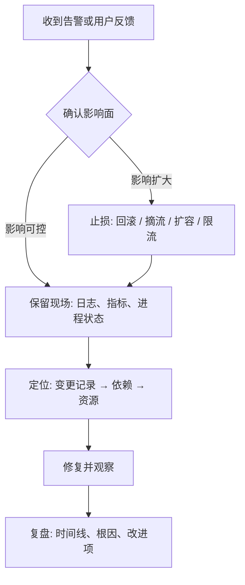

运维（Operations）的职责是维持生产环境可用：服务能够启动、请求能够返回、数据能够恢复、变更能够回退。它与开发的分工不在于“谁写代码”，而在于关注点不同——开发对功能正确性负责，运维对运行环境与变更过程负责。

随着系统规模扩大，这一职责通常以 SRE（Site Reliability Engineering）的形式组织：用可量化的指标（可用性、延迟、错误率）描述服务质量，并以错误预算约束发布节奏。

## 工作对象

运维处理的对象可以归为四类：

| 对象 | 关注点 | 典型工作 |
| --- | --- | --- |
| 主机 | 资源、内核、磁盘、网络 | 扩容、系统升级、内核参数、磁盘清理 |
| 服务 | 进程、端口、配置、依赖 | 部署、重启、扩缩容、限流 |
| 数据 | 备份、恢复、一致性 | 备份校验、恢复演练、主从切换 |
| 变更 | 发布、配置、权限 | 灰度、回滚、变更审批 |

这四类对象相互影响。例如磁盘写满会同时表现为服务不可写、日志中断和备份失败，排查时不能只看服务本身。

## 工作类型

日常运维工作大致分为四类：

- **交付**：部署新版本、调整配置、开通资源。要求可回滚、可观测。
- **巡检**：检查磁盘、证书有效期、备份结果、告警状态。要求有固定清单与自动化。
- **响应**：处理告警与故障。要求先止损，再定位。
- **优化**：容量评估、成本控制、性能调优。要求有数据支撑。

四类工作的紧急程度不同，但都依赖同一套基础数据：监控指标、日志、变更记录。缺少变更记录的团队，故障定位时间通常会显著增加。

## 故障处理顺序

故障发生时，正确的顺序是先控制影响面，再寻找原因：

几个容易被忽略的点：

- 止损与定位可以并行，但不能颠倒优先级。线上不可用时，先恢复服务，再分析原因。
- 保留现场。重启进程会丢失内存状态与部分日志上下文，非必要不要第一步就重启。
- 复盘针对流程与系统，不针对个人。没有改进项的复盘等同于记录了一次事故。

## 变更管理

多数线上故障与变更相关。变更管理并不要求流程繁琐，而是要求三件事可回答：

1. **改了什么**：版本、配置项、影响范围；
2. **如何验证**：健康检查、关键接口、监控指标；
3. **如何回退**：回退命令、数据兼容性、回退耗时。

发布应尽量满足：低峰执行、分批灰度、可观测、可回滚。一次性全量替换且没有回退方案，是风险最高的发布方式。

## 能力结构

入门阶段需要建立的能力，按使用频率排列大致是：

- Linux 基础：文件、权限、进程、端口、日志；
- 网络基础：DNS、TCP、HTTP、代理与防火墙；
- Shell 与脚本：把重复操作自动化；
- 服务管理：systemd、进程守护、开机自启；
- 中间件：Nginx、Redis、数据库的基本运维；
- 监控与日志：指标、告警、检索；
- 容器与发布：镜像、编排、灰度与回滚。

这些能力不是并列关系。Linux 与网络是底座，服务管理与中间件建立在底座之上，监控与发布则贯穿所有环节。

## 常见误区

- **把运维等同于重启服务。** 重启能暂时恢复，但会掩盖根因，且丢失现场。
- **只看 CPU 使用率。** 磁盘 IO、内存回收、连接数、文件句柄都可能先于 CPU 成为瓶颈。
- **备份存在即认为可恢复。** 未验证的备份不能算备份，恢复演练应定期执行。
- **变更不做记录。** 没有变更记录，故障定位只能靠猜。
- **权限给到最大。** 生产环境的权限应按角色最小化，尤其是删除与重启类操作。

## 要点

- 运维对可用性、数据安全与变更过程负责，而非仅负责“让服务跑起来”；
- 工作对象分为主机、服务、数据与变更四类，排查时要考虑它们的相互影响；
- 故障处理先止损、再定位，过程中尽量保留现场；
- 变更必须可验证、可回滚，并保留记录；
- 入门阶段以 Linux、网络、脚本为底座，再逐步扩展到服务、中间件与监控。

下一篇进入 Linux 基础，从文件、权限与目录结构开始。
