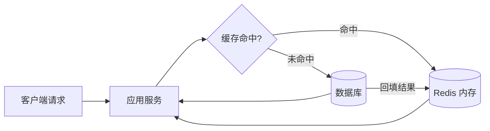

后端服务引入 Redis，通常始于一个明确的性能问题：某接口在一次请求中多次访问数据库，响应时间集中在磁盘 IO 上。将查询结果写入 Redis 后，后续请求可以直接从内存读取，数据库压力随之下降。随着使用范围扩大，会话状态、计数器、排行榜和轻量队列也会逐步迁移到 Redis。

本文覆盖三部分：单机部署、客户端连接与基本命令、适用场景与使用边界。持久化和高可用分别在后续两篇讨论。



## 部署

开发环境使用 Docker 部署最为直接：

```bash
docker run -d --name redis -p 6379:6379 redis:8
docker logs -f redis
```

镜像标签应跟随官方发布版本。日志出现 `Ready to accept connections`，表示实例已就绪。`docker logs -f` 会持续占用终端，退出使用 `Ctrl+C`。

Linux 发行版也可以通过包管理器安装：

```bash
sudo apt install redis-server        # Debian / Ubuntu
sudo systemctl enable --now redis    # 设置开机自启并立即启动
```

Windows 没有官方长期维护的服务端发行版，开发环境建议使用 Docker 或 WSL。生产部署以 Linux 为主。

## 连接与基本命令

使用内置客户端连接实例：

```bash
redis-cli -h 127.0.0.1 -p 6379
127.0.0.1:6379> PING
PONG
```

`PONG` 表示网络与进程均正常。基本读写与过期操作：

```bash
127.0.0.1:6379> SET site "flowdash"
OK
127.0.0.1:6379> GET site
"flowdash"
127.0.0.1:6379> EXPIRE site 60
(integer) 1
127.0.0.1:6379> TTL site
(integer) 57
```

`EXPIRE` 以秒为单位设置键的存活时间，到期后键被自动删除。`TTL` 返回剩余秒数：`-1` 表示未设置过期时间，`-2` 表示键不存在。缓存类数据应普遍设置过期时间，否则内存占用只增不减。

`KEYS` 可以列出当前所有键：

```bash
127.0.0.1:6379> KEYS *
```

该命令一次性扫描整个键空间，键数量较多时会阻塞其他命令。生产环境应改用 `SCAN`，它分批返回游标，不会长时间占用事件循环。

## 典型使用场景

Redis 的定位是数据结构服务器，而非仅提供字符串缓存。常见用途包括：

- 缓存：数据库查询结果、页面片段、接口响应，配合过期时间；
- 会话：token 与用户身份的映射，利用键过期实现自动清理；
- 计数：阅读量、调用次数，`INCR` 为原子操作；
- 排行榜：有序集合按分数排序，范围查询效率高；
- 轻量队列：列表两端进出，或使用 Stream 的消费组模型；
- 限流与去重：集合判重，计数器配合过期实现窗口限流。

这些场景的共同特征是：数据量可控、访问频繁、允许驻留内存。

## 使用边界

以下情况不适合由 Redis 承担：

- **作为唯一数据源。** 订单、账务等不可丢失的数据应以关系型数据库为主库，Redis 只能作为缓存或加速层。
- **复杂查询。** 多条件过滤、联表、聚合属于关系型数据库的能力范围。Redis 擅长按键取值，或按分数、范围取值。
- **超大 value。** 单个键达到数 MB 时，网络传输与删除都会变慢，并占用主线程。大文件应存入对象存储，Redis 仅保存引用地址。
- **跨键强一致事务。** Redis 事务与 Lua 脚本保证一段命令连续执行，但不提供关系数据库的隔离级别，不适合作为分布式事务的协调者。

## 上线前的最小配置

默认配置面向本地开发，直接暴露到公网存在未授权访问风险。上线前至少确认以下配置：

```conf
# redis.conf
bind 127.0.0.1 -::1
protected-mode yes
requirepass 使用足够长的随机密码
maxmemory 2gb
maxmemory-policy allkeys-lru
```

- `bind` 限制监听地址，外网访问应经由内网或跳板机；
- `requirepass` 启用密码认证，客户端通过 `AUTH` 或连接串提供密码；
- `maxmemory` 必须设置。缺少上限时，Redis 会持续占用内存直至被系统 OOM 终止。淘汰策略按业务选择，纯缓存场景常用 `allkeys-lru`。

配置可以通过 `CONFIG SET` 热更新，但需再执行 `CONFIG REWRITE` 写回配置文件，否则重启后恢复旧值。

## 要点

- Redis 是内存键值数据库，持久化为可选项；
- Docker 部署最快，`redis-cli` 连接后以 `PING` 验证；
- 缓存键应设置过期时间，遍历键使用 `SCAN` 而非 `KEYS`;
- 适合缓存、会话、计数、排行与轻量队列，不适合作为唯一数据源或承担复杂查询；
- 上线前必须配置 `bind`、`requirepass` 与 `maxmemory`。

下一篇讨论 Redis 的五种基础数据结构及其选型。
