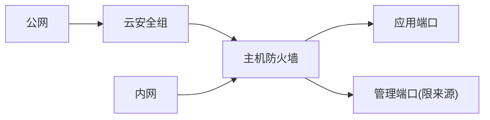

暴露面越大，被扫描与利用的概率越高。最小暴露不是“装个防火墙”，而是明确哪些端口必须对哪些来源开放，其余默认拒绝。



## 两层防火墙

- **云安全组/网络 ACL**：在实例外层，先决定哪些流量能到达主机；
- **主机防火墙**（ufw、firewalld、iptables）：在操作系统内再收一层。

两层都要配置。只配安全组，主机迁移或换网络后规则失效；只配主机防火墙，公网扫描仍会到达主机。

## 默认拒绝

```bash
# ufw
ufw default deny incoming
ufw default allow outgoing
ufw allow 22/tcp
ufw allow 80,443/tcp
ufw enable
```

```bash
# firewalld
firewall-cmd --set-default-zone=public
firewall-cmd --permanent --add-service=http
firewall-cmd --permanent --add-service=https
firewall-cmd --reload
```

入站默认拒绝，出站按需限制。数据库、缓存、管理端口不要对 `0.0.0.0/0` 开放。

## 管理面收口

- SSH 只允许跳板机或办公网段；
- 禁用密码登录，使用密钥；
- 修改默认端口只能减少扫描噪声，不能替代访问控制；
- 管理后台走内网或 VPN，不直接暴露公网；
- 云控制台开启多因素认证。

```text
# /etc/ssh/sshd_config
PermitRootLogin no
PasswordAuthentication no
AllowUsers ops
```

改完先用新连接验证，再关闭旧会话，避免把自己锁在外面。

## 暴露面核查

```bash
ss -lntp
nmap -sT -p- 127.0.0.1
```

- `ss` 看本机监听，`0.0.0.0` 与 `127.0.0.1` 的可达范围不同；
- 从外网用 `nmap` 或在线端口检测核对实际开放；
- 容器端口映射 `-p 3306:3306` 会把数据库暴露到宿主机，按需改为 `127.0.0.1:3306:3306`；
- 定期清理不再使用的端口与规则。

## 出站与内网

- 出站限制能降低被利用后的横向移动与数据外传风险；
- 允许必要的包源、对象存储与回调地址；
- 内网同样需要认证，不要假设“内网可信”；
- 数据库只允许应用网段访问，禁止办公网直连。

## 常见坑

- **规则加了但没生效**：未 reload 或被云安全组覆盖；
- **数据库对公网开放**：扫描与爆破的首要目标；
- **临时规则忘记删除**：调试端口长期开着；
- **只限制端口不限制来源**：任何 IP 都能访问；
- **锁死 SSH**：改配置前没有保留会话。

## 小结

- 最小暴露 = 默认拒绝 + 白名单 + 管理面收口；
- 云安全组与主机防火墙两层都要配；
- 数据库与管理端口不直接暴露公网；
- 用 `ss` 与外部扫描核对实际暴露面；
- 规则变更要验证，并清理临时放行。
