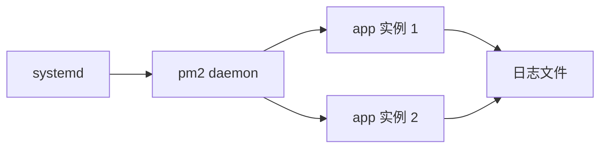

PM2 解决 Node 进程的守护、多实例与日志，但它本身也是普通进程。服务器重启后要让 PM2 恢复，通常还要 systemd 或 `pm2 startup` 配合。



## ecosystem 配置

```javascript
module.exports = {
  apps: [
    {
      name: 'web',
      script: './dist/server.js',
      instances: 2,
      exec_mode: 'cluster',
      env_production: {
        NODE_ENV: 'production',
        PORT: 3000,
      },
      max_memory_restart: '512M',
      out_file: '/var/log/web/out.log',
      error_file: '/var/log/web/err.log',
      merge_logs: true,
      time: true,
    },
  ],
}
```

```bash
pm2 start ecosystem.config.js --env production
pm2 save
pm2 startup
```

`instances` 与 `cluster` 让 Node 利用多核；单实例应用不需要开 cluster，否则会多占内存。

## 常用命令

```bash
pm2 status
pm2 logs web --lines 100
pm2 reload web          # 平滑重启
pm2 restart web
pm2 stop web
pm2 delete web
pm2 monit
pm2 save
```

- `reload` 在 cluster 模式下逐个替换实例，减少中断；
- `restart` 直接重启，短时不可用；
- `save` 把当前进程列表写入 dump，开机恢复依赖它；
- `pm2 startup` 生成开机脚本，但容器内通常无效。

## 日志与轮转

PM2 默认把日志写到 `~/.pm2/logs`，不会自动切割。生产应安装轮转插件或交给外部日志系统：

```bash
pm2 install pm2-logrotate
pm2 set pm2-logrotate:max_size 50M
pm2 set pm2-logrotate:retain 14
```

日志路径与权限要确认，应用用户与 PM2 守护进程用户不一致时可能写不进去。

## 与 systemd 的分工

两种常见组合：

1. **PM2 管应用，systemd 管 PM2**：`pm2 startup` 生成 systemd 单元，开机拉起 PM2，再由 PM2 恢复应用；
2. **systemd 直接管 Node**：不使用 PM2，unit 里 `ExecStart=node dist/server.js`，日志进 journal。

多实例与平滑 reload 是 PM2 的价值；如果只需要单进程常驻，systemd 更简单，也少一层守护。

## 常见坑

- **PM2 以 root 运行，应用文件属主是普通用户**：日志与缓存权限错乱；
- **cluster 模式端口冲突**：应用自己监听固定端口且未处理共享；
- **`pm2 save` 忘记执行**：重启后进程列表恢复不了；
- **内存重启频繁**：`max_memory_restart` 太小或存在泄漏，重启只是掩盖；
- **日志未轮转**：磁盘被写满；
- **容器内用 `pm2 startup`**：容器没有 systemd，开机脚本无效。

## 小结

- PM2 负责 Node 进程守护、多实例与日志；
- ecosystem 文件把配置固化，避免命令行参数漂移；
- 日志必须轮转或外送；
- 开机恢复要么 `pm2 startup`，要么由 systemd 管理；
- 内存重启只能兜底，泄漏仍需修代码。
