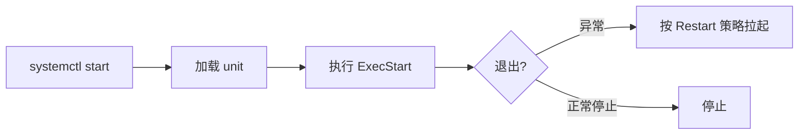

把进程交给 systemd，解决的不只是“后台运行”：开机自启、异常拉起、日志归集与资源限制都在同一份单元文件里声明。



## 一个最小单元

```ini
# /etc/systemd/system/myapp.service
[Unit]
Description=My application
After=network-online.target
Wants=network-online.target

[Service]
Type=simple
User=app
WorkingDirectory=/opt/myapp
EnvironmentFile=/etc/myapp/env
ExecStart=/opt/myapp/bin/start
Restart=on-failure
RestartSec=5
LimitNOFILE=65535

[Install]
WantedBy=multi-user.target
```

```bash
systemctl daemon-reload
systemctl enable --now myapp
systemctl status myapp
journalctl -u myapp -f
```

## Type 的选择

| Type | 适用 |
| --- | --- |
| `simple` | 前台运行的进程，默认值 |
| `forking` | 自身 daemon 化、父进程退出 |
| `oneshot` | 一次性任务，执行完即退出 |
| `notify` | 支持 sd_notify，启动完成后再算就绪 |

用错 Type 会导致 systemd 误判启动完成或直接超时。大多数现代应用是 `simple`。

## 重启策略

```ini
Restart=on-failure
RestartSec=5
StartLimitIntervalSec=60
StartLimitBurst=5
```

- `on-failure` 只在非 0 退出或信号异常时重启；
- `always` 任何退出都重启，适合必须常驻的进程；
- 启动过快会触发限流，`StartLimitBurst` 防止无限重启；
- 配置错误导致启动即退出时，先看 `journalctl`，不要靠重启策略硬撑。

## 环境与权限

```ini
Environment=APP_ENV=prod
EnvironmentFile=/etc/myapp/env
User=app
Group=app
ProtectSystem=strict
ReadWritePaths=/var/lib/myapp
```

- 密钥放 `EnvironmentFile`，文件权限 600；
- 用专用用户运行，避免 root；
- `ProtectSystem` 与 `ReadWritePaths` 限制可写范围；
- 需要端口 <1024 时用 `AmbientCapabilities=CAP_NET_BIND_SERVICE`，而不是直接给 root。

## 日志

```bash
journalctl -u myapp --since '10 min ago'
journalctl -u myapp -p err
journalctl --disk-usage
journalctl --vacuum-time=14d
```

systemd 自动收集标准输出与错误，不需要在应用里重定向。注意设置日志保留策略，避免 journal 占满磁盘。

## 常见坑

- **改了 unit 不 daemon-reload**：systemd 仍用旧配置；
- **ExecStart 用相对路径**：工作目录不符合预期；
- **环境变量只在交互 shell 生效**：服务没有加载 `.bashrc`；
- **User 没有目录权限**：启动失败但报错在应用日志里；
- **Restart=always 掩盖崩溃**：进程反复重启，业务实际不可用；
- **开机顺序写错**：依赖数据库却没声明 `After`。

## 小结

- unit 文件同时声明启动、重启、权限与日志；
- Type 要与进程的前台/后台行为匹配；
- 专用用户 + EnvironmentFile + 资源限制是生产基线；
- 排障先看 `systemctl status` 与 `journalctl`，再谈重启策略。
