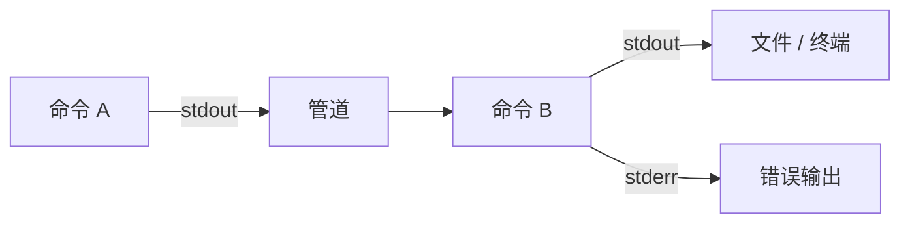

服务器上的排障往往从一条组合命令开始：取日志、过滤、排序、统计。Shell 的价值不在于背命令，而在于把标准输入输出接成一条数据流。



## 管道

```bash
cat access.log | grep ' 500 ' | wc -l
```

管道把前一个命令的标准输出交给后一个命令的标准输入。实际排障更常用“减少进程”的写法：

```bash
grep -c ' 500 ' access.log
```

统计访问量最高的 IP：

```bash
awk '{print $1}' access.log \
  | sort \
  | uniq -c \
  | sort -nr \
  | head -10
```

这条链路的每一步都只做一件事，组合起来就是一次完整的日志分析。

## 重定向

| 写法 | 作用 |
| --- | --- |
| `> file` | 覆盖标准输出 |
| `>> file` | 追加标准输出 |
| `2> err.log` | 标准错误写入文件 |
| `&> all.log` | 标准输出与错误一起写入 |
| `2>&1` | 把错误合并到标准输出 |
| `< file` | 从文件读标准输入 |

```bash
./deploy.sh > deploy.log 2>&1
```

顺序很重要：`2>&1 > file` 与 `> file 2>&1` 结果不同，前者错误仍指向终端。

`tee` 同时写文件与终端：

```bash
./build.sh 2>&1 | tee build.log
```

## 引号与展开

- 单引号：原样保留，适合正则与包含 `$` 的文本；
- 双引号：允许变量与命令替换，但保留空格；
- 不加引号：会做分词与通配符展开，变量为空时参数消失。

```bash
file="my file.txt"
rm $file        # 错：被拆成两个参数
rm "$file"      # 对
```

写脚本时，变量一律加双引号，除非明确需要分词。

## 退出码

```bash
grep -q 'ERROR' app.log && echo 'found'
```

`0` 表示成功，非 `0` 表示失败。管道默认返回最后一个命令的退出码：

```bash
set -o pipefail   # 管道中任一命令失败即返回非 0
```

`&&` 与 `||` 按退出码决定是否执行后续命令，是脚本里最常用的短路写法。

## 常用命令的分工

| 命令 | 用途 |
| --- | --- |
| `grep` | 按行过滤 |
| `awk` | 按列提取与统计 |
| `sed` | 行内替换与删除 |
| `sort` / `uniq` | 排序与去重计数 |
| `head` / `tail` | 取头尾，`tail -f` 跟踪日志 |
| `xargs` | 把输入转成命令参数 |
| `find` | 按条件找文件 |

```bash
find /data/logs -name '*.log' -mtime +7 -print
find . -name '*.log' -mtime +7 -delete   # 删除前先 -print 核对
```

## 常见坑

- **管道吞掉错误**：只看最后一条命令的退出码，配合 `pipefail`；
- **`rm $var` 未加引号**：路径含空格时误删；
- **`find -delete` 直接执行**：先用 `-print` 确认范围；
- **`tail -f` 跟丢轮转**：日志切割后要重新打开，或用 `tail -F`；
- **通配符在无匹配时原样传入**：`rm *.log` 在没有匹配时可能报错，脚本里先判断。

## 小结

- 管道连接标准输出，重定向决定输出去向；
- 变量加引号，避免分词与空值展开；
- 退出码决定脚本分支，管道配合 `pipefail`；
- 日志分析由“过滤 → 提取 → 排序 → 统计”组合完成；
- 删除类命令先用 `-print` 核对。
