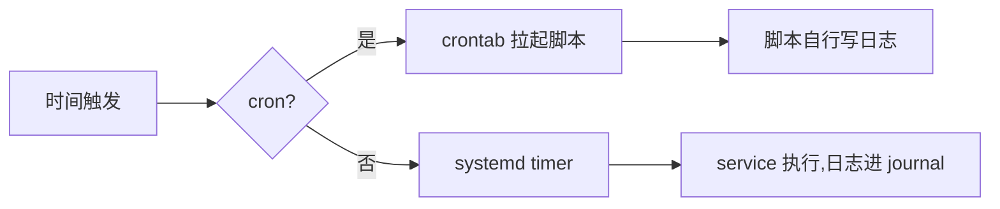

定时任务把脚本从“人记得执行”变成“系统按时执行”。选择 cron 还是 systemd timer，取决于是否需要日志、依赖关系与错过补偿。



## cron

```bash
crontab -e
```

```text
# 分 时 日 月 周
0 2 * * * /opt/ops/backup.sh >> /var/log/ops/backup.log 2>&1
*/5 * * * * /opt/ops/check.sh
```

- 五个字段分别是分钟、小时、日、月、星期；
- `*/5` 表示每 5 个单位；
- 命令输出默认以邮件形式发给用户，服务器上通常没有邮件服务，必须显式重定向到日志；
- cron 使用最小环境，`PATH` 很短，脚本里的命令最好用绝对路径或在脚本内设置 `PATH`。

查看与清理：

```bash
crontab -l
crontab -r          # 谨慎：会清空当前用户的全部任务
```

## systemd timer

```ini
# /etc/systemd/system/backup.service
[Unit]
Description=Nightly backup

[Service]
Type=oneshot
ExecStart=/opt/ops/backup.sh
User=ops
```

```ini
# /etc/systemd/system/backup.timer
[Unit]
Description=Run backup every day at 02:00

[Timer]
OnCalendar=*-*-* 02:00:00
Persistent=true
RandomizedDelaySec=10min
Unit=backup.service

[Install]
WantedBy=timers.target
```

```bash
systemctl daemon-reload
systemctl enable --now backup.timer
systemctl list-timers
journalctl -u backup.service -n 50
```

- `Persistent=true`：机器在计划时间关机，开机后补跑一次；
- `RandomizedDelaySec`：避免多台机器同一时刻打满下游；
- 日志自动进 journal，不需要手动重定向；
- 可以声明依赖与资源限制，适合生产任务。

## 并发与超时

```ini
[Service]
ExecStart=/opt/ops/job.sh
TimeoutStartSec=30min
```

cron 没有超时控制，脚本卡住会一直占用。用 `timeout` 包裹：

```bash
timeout 1800 /opt/ops/job.sh
```

防止重叠执行：

```bash
flock -n /var/lock/job.lock /opt/ops/job.sh
```

## 常见失败原因

- **PATH 不完整**：cron 找不到 `node`、`python`，脚本在终端能跑、定时失败；
- **工作目录不同**：脚本用相对路径，cron 从 `/` 启动；
- **环境变量缺失**：密钥、代理配置没有加载；
- **输出未重定向**：日志进邮件或丢失；
- **任务重叠**：上一次没跑完，下一次又启动；
- **时区**：服务器 UTC，业务按本地时间预期执行；
- **权限**：cron 用户与手动执行用户不同，文件不可写。

## 选型

| 需求 | 选择 |
| --- | --- |
| 简单周期任务、临时脚本 | cron |
| 需要日志、依赖、资源限制 | systemd timer |
| 错过要补跑 | systemd timer |
| 多机避免同时执行 | timer + RandomDelay |
| 容器环境 | 外部调度器，容器内 cron 不是好实践 |

## 小结

- cron 简单但环境最简，必须写绝对路径与日志重定向；
- systemd timer 自带日志、补跑与依赖，适合生产任务；
- 并发用 flock，超时用 timeout 或 TimeoutStartSec；
- 定时任务失败先查 PATH、工作目录、权限与时区。
