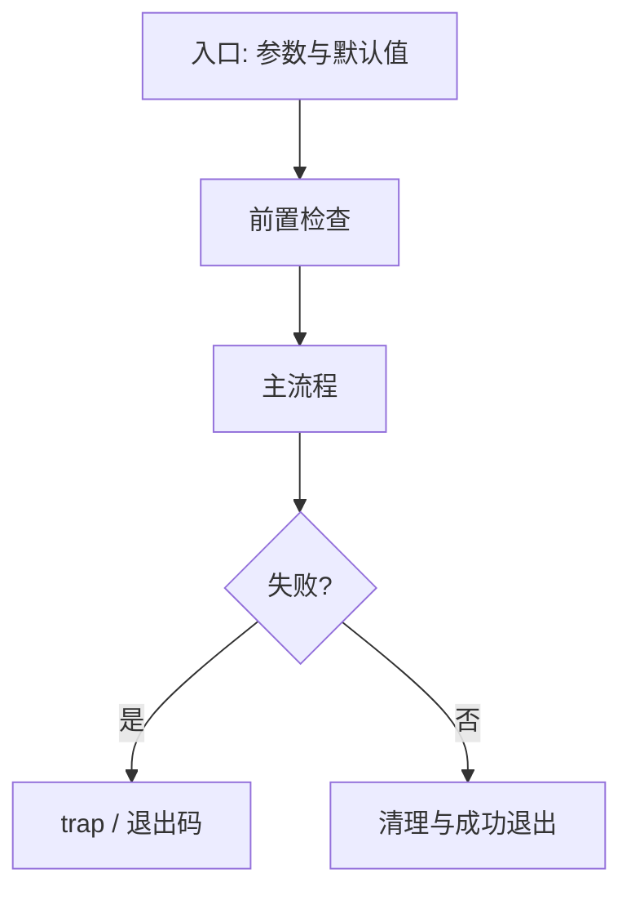

一次性命令可以随手写，运维脚本不行：它会在凌晨被定时任务调用，出问题时没人盯着终端。可维护性体现在失败能停、错误能查、重复执行不出事。



## 骨架

```bash
#!/usr/bin/env bash
set -euo pipefail

readonly SCRIPT_NAME="$(basename "$0")"
readonly LOG_DIR="/var/log/ops"
readonly LOCK_FILE="/var/lock/${SCRIPT_NAME}.lock"

log() {
  printf '%s [%s] %s\n' "$(date '+%F %T')" "$1" "$2"
}

cleanup() {
  rm -f "$LOCK_FILE"
}
trap cleanup EXIT
```

`set -euo pipefail` 的含义：命令失败即退出、未定义变量报错、管道任一环节失败即失败。它可以避免“错误被忽略后继续执行”。

## 参数与默认值

```bash
target="${1:-}"
days="${2:-7}"

if [[ -z "$target" ]]; then
  log ERROR "用法: $SCRIPT_NAME <目录> [天数]"
  exit 2
fi

if [[ ! -d "$target" ]]; then
  log ERROR "目录不存在: $target"
  exit 2
fi
```

- `${1:-}` 避免未定义变量触发 `set -u`；
- 参数校验放在主流程之前，错误直接退出；
- 退出码有语义：2 表示用法错误，1 表示执行失败。

## 幂等

脚本要能重复执行而不产生副作用：

- 创建目录用 `mkdir -p`；
- 写文件先写临时文件再 `mv`；
- 启动服务前检查是否已在运行；
- 删除前判断存在性；
- 用锁避免并发执行。

```bash
exec 9>"$LOCK_FILE"
if ! flock -n 9; then
  log WARN "已有实例在运行，退出"
  exit 0
fi
```

## 日志

```bash
exec >>"$LOG_DIR/${SCRIPT_NAME}.log" 2>&1
log INFO "开始处理: $target"
```

- 统一格式，包含时间、级别与消息；
- 关键步骤前后都写日志，失败时能定位到哪一步；
- 日志按天轮转，避免无限增长；
- 不要在日志里输出密码与令牌。

## 函数与错误处理

```bash
backup() {
  local src="$1"
  local dst="$2"
  tar -czf "$dst" "$src" || {
    log ERROR "备份失败: $src"
    return 1
  }
}
```

`local` 限制变量作用域；函数返回非 0 时，`set -e` 会让脚本退出，除非调用处显式处理。

## 静态检查

```bash
shellcheck deploy.sh
```

ShellCheck 能发现未加引号的变量、不可移植写法、错误的条件判断。把它放进 CI 或提交前检查，比线上出事后再排查成本低得多。

## 常见坑

- **不写 shebang**：用 `sh` 执行，`[[ ]]` 与数组不可用；
- **`set -e` 与 `|| true` 混用**：错误被吞，脚本继续；
- **在管道里 `cd`**：只影响子 shell，父 shell 目录不变；
- **临时文件用固定名**：并发时互相覆盖，用 `mktemp`；
- **忘记清理**：临时目录、锁文件、后台进程残留。

## 小结

- 严格模式 + 参数校验 + trap 是脚本的基本盘；
- 写操作要幂等，重复执行不制造副作用；
- 日志格式统一，关键步骤可定位；
- 用 flock 防止并发执行；
- ShellCheck 提前发现语法与可移植性问题。
