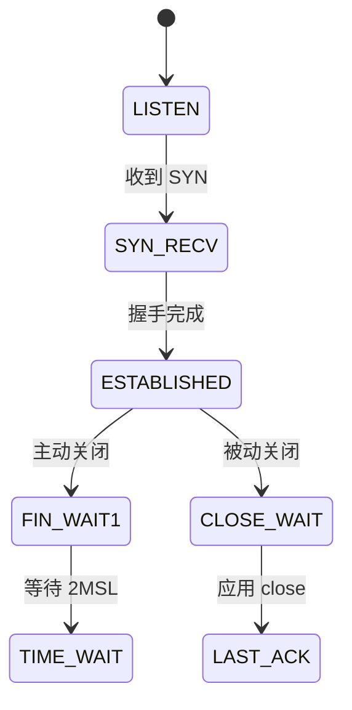

“服务连不上”最常见的误判是只看 `ping`。ICMP 能通只说明网络层可达，端口有没有监听、握手有没有完成，要看 TCP 层。



## 查看监听与连接

```bash
ss -lntp
ss -tnp state established
ss -s
```

- `-l` 只看监听，`-t` 是 TCP，`-n` 不解析域名，`-p` 显示进程；
- `state established` 过滤已建立连接；
- `ss -s` 给出各状态汇总。

老系统用 `netstat -lntp`，新系统优先 `ss`，输出更快。

## 常见状态

| 状态 | 含义 | 关注点 |
| --- | --- | --- |
| LISTEN | 端口在监听 | 没有则服务未启动或监听地址不对 |
| ESTABLISHED | 连接已建立 | 正常通信 |
| TIME_WAIT | 主动关闭后的等待 | 大量出现通常是短连接过多 |
| CLOSE_WAIT | 被动关闭，等待应用关闭 | 持续增长说明应用没有正确 close |
| FIN_WAIT2 | 主动关闭等待对方确认 | 对方迟迟不关 |
| SYN_RECV | 收到 SYN，握手未完成 | 可能是 SYN Flood 或半开连接 |

### TIME_WAIT

主动关闭方在 TIME_WAIT 停留 2MSL（通常 60 秒），确保最后一个 ACK 能重传。大量 TIME_WAIT 的常见原因：

- 短连接频繁创建，未使用连接池；
- 代理层与后端之间每次请求新建连接；
- 客户端端口耗尽。

处理方向是复用连接，而不是简单调小 `tcp_tw_reuse`。`tcp_tw_recycle` 在新内核已移除，不要使用。

### CLOSE_WAIT

CLOSE_WAIT 持续增长，说明对端已关闭，本端应用没有调用 `close()`：

- 代码里连接泄漏；
- 线程阻塞导致没有执行清理；
- 连接池配置错误。

这是应用问题，改内核参数无效。

## 端口不通的排查

```bash
ss -lntp | grep ':8080'
nc -vz 10.0.0.12 8080
curl -v telnet://10.0.0.12:8080
```

- 本机监听正常，远程不通：防火墙、安全组或监听地址只绑了 `127.0.0.1`；
- 本机也没有监听：服务未启动、启动失败或端口被占用；
- 连接被拒绝（RST）：端口没有监听，或被防火墙拒绝；
- 连接超时：包被丢弃，检查安全组与路由。

## backlog 与半连接

```bash
ss -lnt | awk '{print $2, $4}'
sysctl net.core.somaxconn
```

`Send-Q` 在 LISTEN 状态表示 backlog 上限。瞬时高并发下，backlog 过小会导致握手被丢弃，表现为偶发连接超时。应用服务器与内核的 backlog 要一起调。

## 小结

- `ping` 只验证网络层，端口与连接状态要看 `ss`；
- LISTEN 缺失查服务与监听地址，ESTABLISHED 异常查应用；
- TIME_WAIT 多通常是短连接，CLOSE_WAIT 多是连接泄漏；
- 端口不通按“本机监听 → 防火墙 → 路由”顺序排查；
- backlog 与连接数要结合业务峰值评估。
