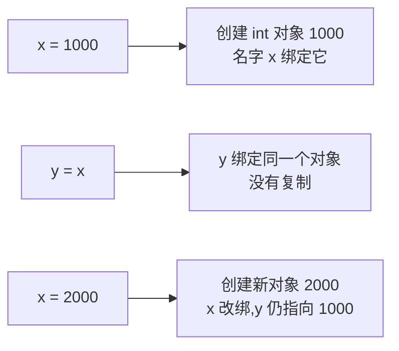

多数语言把变量讲成"盒子":声明一个 int 盒子,往里写值。Python 不是这个模型。理解**名字绑定**是理解后面拷贝、默认参数、闭包的全部前提。

## 赋值是绑定,不是写入

```python
x = 1000
y = x
x = 2000
print(y)   # 1000
```

`x = 1000` 做的事:创建整数对象 1000,把名字 x 绑定到它。`y = x` 把 y 绑定到**同一个对象**。`x = 2000` 创建新对象并把 x **改绑**过去,y 仍绑着原来的 1000。

没有"把 2000 写进 x 的盒子"这一步。名字只是标签,对象才是实体。



## 类型在对象上

```python
a = 1
a = "text"     # 合法:名字改绑到字符串对象
type(a)        # <class 'str'>
```

名字本身无类型,类型是对象的属性。这就是**动态类型**:同一个名字可先后绑定不同类型的对象,检查发生在运行时。

观察类型:`type(obj)` 返回类型对象;`isinstance(obj, T)` 判断是否属于 T(含子类),后者是推荐写法,因为它尊重继承。

## 身份与值:is 与 ==

- `==` 比**值**(调用对象的 __eq__);
- `is` 比**身份**(是否同一个对象,即 id() 相同)。

```python
a = [1, 2]
b = [1, 2]
a == b    # True,值相等
a is b    # False,两个对象
c = a
a is c    # True,同一对象
```

注意:is 只用于 None/单例等身份判断(`x is None`),不要用它比数值或字符串——小整数与部分字符串有缓存,intern 机制会让 is 偶尔"碰巧"为 True,那是实现细节而非语义保证。

## 可变与不可变的第一印象

- 不可变:int、float、str、tuple。"修改"它们实际产生新对象再改绑;
- 可变:list、dict、set。可以就地改内容,所有绑定到它的名字都看见变化。

```python
s = "ab"
s += "c"      # 新字符串对象,s 改绑
lst = [1]
lst.append(2) # 就地修改,别名可见
```

这条分歧是第 3 章拷贝与第 4 章默认参数问题的根源,此处先建立印象。

## 动态类型的代价与对策

灵活:无需声明、可改绑、鸭子类型(第 5 章)。
代价:类型错误到执行才暴露;重构时缺少编译期保护。
对策:类型提示 + mypy/pyright 把部分检查提前(第 8 章);测试覆盖边界(第 11 章)。

## 小结

- 赋值 = 名字绑定到对象;改绑不影响其它名字;
- 类型属于对象,名字无类型,检查在运行时;
- == 比值,is 比身份;is 只用于 None/单例;
- 不可变"修改"产生新对象,可变就地修改别名可见;
- 动态类型的错误后移用类型提示与测试弥补。

下一篇讲最常用的两类对象:数字与字符串。
