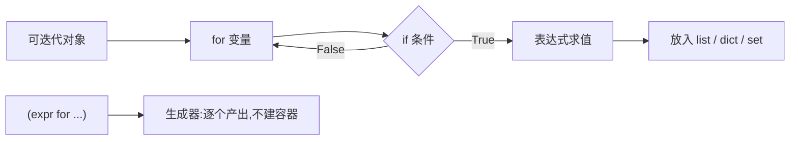

推导式把"建空容器 → 循环 → 条件 → append"四步压缩成一行声明式表达。它是 Python 最常用的构造容器方式,但滥用会牺牲可读性。这一篇讲三种形式、求值时机与边界。

## 列表推导式

```python
squares = [x * x for x in range(10)]
evens   = [x for x in range(20) if x % 2 == 0]
pairs   = [(x, y) for x in range(3) for y in range(3) if x != y]
```

结构:`[表达式 for 变量 in 可迭代对象 if 条件]`,可多层 for(顺序与嵌套循环一致:外层在前)。等价于循环 append,但更快(字节码层面专用指令,省去 append 调用)。

**立即求值**:整批算完,占 O(n) 内存。数据量大或只需部分时改用生成器表达式。



## 字典与集合推导式

```python
{name: len(name) for name in names}          # 字典
{x % 5 for x in range(20)}                   # 集合,自动去重
{k: v for k, v in items if v > 0}            # 筛选
```

字典推导键冲突时**后写覆盖**;集合推导去重。两者同样立即求值。

## 生成器表达式:圆括号版本

```python
total = sum(x * x for x in range(10_000_000))   # 不建列表,峰值内存 O(1)
```

`(expr for …)` 返回生成器,惰性逐次求值,只能遍历一次(第 6 章)。作为函数唯一实参时可省外层括号:sum(…) / any(…) / all(…) / max(…)。

选型:要完整容器/多次遍历/索引 → 推导式;只要聚合/流式/超大 → 生成器表达式。

## 条件的位置

- `if` 在 for 后:**筛选**,决定元素是否进入;
- 条件表达式在表达式位:**变换**,决定元素取什么值。

```python
[x if x > 0 else 0 for x in xs]          # 变换:负数归零,全保留
[x for x in xs if x > 0]                 # 筛选:只留正数
```

两者可组合。混淆位置是推导式最常见的语义错误。

## 作用域与可读性边界

推导式有自己的作用域:循环变量不泄漏到外层(3.x);但表达式可引用外层名字。 walrus 可在推导式内绑定供条件复用:`[y for x in data if (y := f(x)) > 0]`。

可读性边界:**超过两层 for 或条件复杂时改回显式循环**。推导式是"一眼能读懂的循环"的简写,不是炫技工具;嵌套三层以上几乎必然难维护。

## 小结

- 列表/字典/集合推导式:一行完成循环+筛选+变换,立即求值 O(n);
- 多层 for 顺序同嵌套循环;字典键冲突后写覆盖;
- 生成器表达式惰性 O(1) 峰值,一次性,聚合函数首选;
- if 在 for 后是筛选,条件表达式在表达式位是变换;
- 循环变量不泄漏;超过两层改回循环保可读性。

下一篇讲可变性与拷贝:本章所有"共享引用"问题的总根源。
