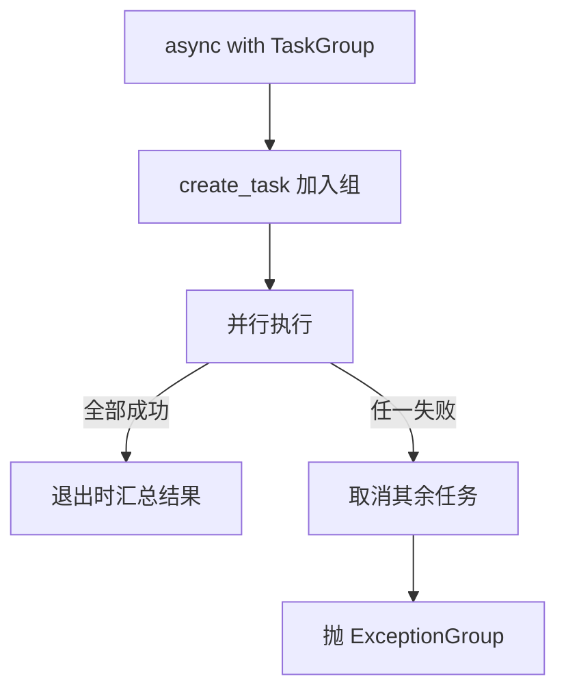

并发只是起点,真正难的是"一批任务里有的慢、有的失败、有的要中途停止"。asyncio 提供了 gather、TaskGroup、超时与取消四组机制,它们解决的是任务的生命周期管理。

## gather 与 return_exceptions

```python
results = await asyncio.gather(fetch("a"), fetch("b"))

async def safe():
    return await asyncio.gather(fetch("a"), fetch("b"), return_exceptions=True)
```

默认行为:任一任务抛异常,`gather` 立即把该异常抛给调用方,其余任务**不会自动取消**,仍在后台运行。这是一个容易漏掉的细节:主流程已失败,后台任务还在消耗资源。

`return_exceptions=True` 把异常作为结果返回,结果列表里混着值与异常对象,调用方需要逐个判断:

```python
for r in await asyncio.gather(*tasks, return_exceptions=True):
    if isinstance(r, Exception):
        log.warning("任务失败: %s", r)
```

## TaskGroup:结构化并发

3.11 起提供 `TaskGroup`,它在退出 `async with` 时等待所有任务结束,并保证:

- 任一任务失败,其余任务被取消;
- 多个异常合并成 ExceptionGroup 抛出;
- 不会留下"孤儿任务"。

```python
async def main():
    async with asyncio.TaskGroup() as tg:
        t1 = tg.create_task(fetch("a"))
        t2 = tg.create_task(fetch("b"))
    # 这里所有任务已结束
    print(t1.result(), t2.result())
```



TaskGroup 的语义比 gather 更严格:要么全部成功,要么整体失败并清理干净。需要"部分成功也要继续"时用 gather(return_exceptions=True)。

## 超时

```python
try:
    data = await asyncio.wait_for(fetch("slow"), timeout=2.0)
except TimeoutError:
    data = None
```

3.11 起更推荐 `asyncio.timeout` 上下文:

```python
async with asyncio.timeout(2.0):
    data = await fetch("slow")
```

两者在超时后会取消内部任务并抛 `TimeoutError`(内置类型)。区别:上下文形式可以覆盖多条 await,且不需要为每个调用包 `wait_for`。

超时必须真正取消底层任务,而不是"返回后让它继续跑"。用 `wait_for` 或 `timeout` 包住的协程会被取消;自己用 `create_task` 起任务再放弃等待,任务仍在运行。

## 取消

```python
task = asyncio.create_task(fetch("x"))
task.cancel()

try:
    await task
except asyncio.CancelledError:
    log.info("任务已取消")
    raise                        # 通常应继续向上传播
```

- `cancel()` 只是请求取消,任务在下一次 `await` 处收到 CancelledError;
- `CancelledError` 继承 BaseException,`except Exception` 接不住;
- 协程可以捕获它做清理,但**原则上要重新抛出**,否则取消失效;
- 用 `asyncio.shield` 保护"不可取消"的关键段,例如提交订单的最后一步。

```python
async with asyncio.timeout(3):
    await asyncio.shield(commit())
```

`shield` 让被包裹的协程不被外层取消打断,但外层仍会收到超时;要拿到结果需要额外持有任务引用。

## 背压:Semaphore

一次创建几千个任务,会把连接数、内存、对端限流全部打满。用信号量限制并发数:

```python
sem = asyncio.Semaphore(20)

async def limited(url):
    async with sem:
        return await fetch(url)

results = await asyncio.gather(*(limited(u) for u in urls))
```

`Semaphore(n)` 保证同时最多 n 个任务进入临界区,其余在 `async with` 处排队。这是"生产者速度远大于消费者"时最基本的背压手段。

需要固定大小的队列时用 `asyncio.Queue(maxsize=...)`,`put` 在满时等待,`get` 在空时等待,同样能形成背压。

## 桥接阻塞调用

```python
import asyncio

data = await asyncio.to_thread(blocking_read, path)
cpu = await loop.run_in_executor(process_pool, heavy, data)
```

- `to_thread` 把同步函数放到默认线程池,适合短小的阻塞调用;
- `run_in_executor(ProcessPoolExecutor, ...)` 把 CPU 任务放到进程池,绕开 GIL;
- 线程池大小有限,长时间阻塞会耗尽线程,优先换异步库而不是无脑桥接。

## 常见错误

- **gather 默认失败后不管其余任务**:后台任务泄漏,资源不释放;
- **`except Exception` 吞掉 CancelledError 之外的东西**:取消失效,任务永远停不下来;
- **超时后继续使用旧任务的结果**:任务已被取消,结果不存在;
- **无限制 `create_task`**:连接与内存被打满,对端限流;
- **在取消处理里再做长耗时 await**:取消会再次到来,清理逻辑要短且幂等;
- **混用同步与异步客户端**:一个同步调用就让并发退化为串行。

## 小结

- gather 默认遇错即抛且不取消其余任务,需要部分成功用 `return_exceptions`;
- TaskGroup 提供结构化并发,失败时取消其余任务并抛异常组;
- 超时用 `wait_for` 或 `asyncio.timeout`,必须真正取消底层任务;
- CancelledError 要重新抛出,关键段可用 `shield` 保护;
- 并发要有上限,Semaphore 与有界队列提供背压。
