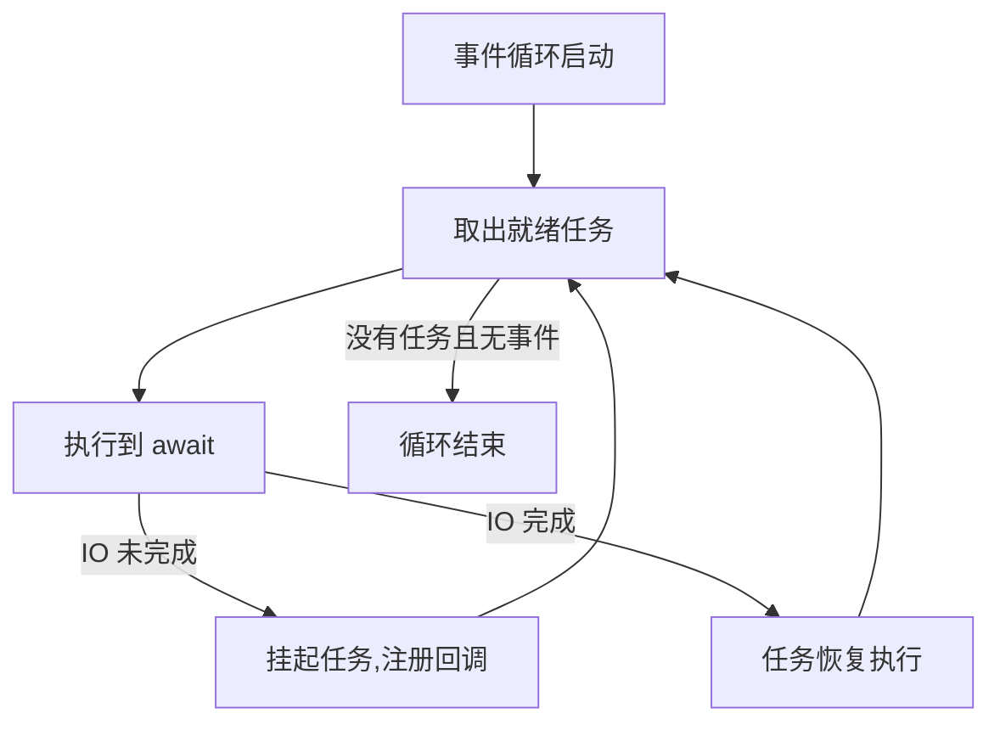

asyncio 用单线程事件循环调度大量协程:协程在等待 IO 时主动让出控制权,循环转而执行其他就绪任务。它解决的是"同时管理成千上万个连接",不是"用多核算得更快"。

## 事件循环



循环本身只做三件事:执行就绪任务、监听 IO 事件、把完成的事件对应的回调重新排入就绪队列。所有协程共享同一个线程,任何一段同步阻塞代码都会卡住整个循环。

## 定义与调用

```python
import asyncio

async def fetch(url):
    await asyncio.sleep(1)          # 模拟 IO 等待
    return f"ok:{url}"

async def main():
    result = await fetch("https://a.dev")
    print(result)

asyncio.run(main())                 # 创建事件循环并运行到结束
```

- `async def` 定义协程函数,调用它只返回协程对象,不执行函数体;
- `await` 等待一个可等待对象(协程、Task、Future),期间让出控制权;
- `asyncio.run` 是程序入口,负责创建循环、运行主协程、收尾;一个进程通常只调用一次。

```python
c = fetch("x")          # 只是协程对象,一行都没跑
asyncio.run(c)          # 这样也能跑,但入口应是一个 main 协程
```

忘记 `await` 会出现 `RuntimeWarning: coroutine ... was never awaited`,协程体永远不执行。

## 并发:create_task 与 gather

顺序 `await` 是串行;要并发,先把协程包装成任务:

```python
async def main():
    t1 = asyncio.create_task(fetch("a"))
    t2 = asyncio.create_task(fetch("b"))
    r1, r2 = await t1, await t2

    # 或一次等待多个
    results = await asyncio.gather(fetch("c"), fetch("d"))
```

`create_task` 立即把协程排进事件循环,返回 Task;`await` 只是等待结果。所以先创建多个任务,再逐个等待,它们就在并行等待 IO。直接 `await fetch("a"); await fetch("b")` 总耗时是两者之和。

`gather` 接受多个可等待对象,并发运行并收集结果,顺序与传入顺序一致。

## 不要在协程里调用阻塞函数

```python
async def bad():
    time.sleep(5)          # 阻塞整个事件循环,其他协程全部停摆

async def good():
    await asyncio.sleep(5)         # 让出控制权
    data = await asyncio.to_thread(blocking_read)   # 阻塞调用放到线程
```

`time.sleep`、同步 HTTP 客户端、同步数据库驱动、CPU 重计算,都会独占线程。要么换成对应的异步库,要么用 `asyncio.to_thread`(3.9+)或 `loop.run_in_executor` 把阻塞调用挪到线程池。

判断标准:函数调用期间,事件循环还能不能处理其他任务?不能,就是阻塞。

## 可等待对象

| 类型 | 说明 |
| --- | --- |
| 协程对象 | `async def` 调用后的返回值 |
| Task | `create_task` 包装,已被调度 |
| Future | 底层结果容器,通常由库返回 |
| 实现了 `__await__` 的对象 | 自定义可等待对象,少见 |

`await` 只能用于这些对象。把普通函数返回值拿去 await 会报 TypeError。

## 与生成器的关系

协程在历史上由生成器演进而来:`yield` 提供挂起能力,`send` 提供恢复。`async def` + `await` 是它的现代形态,由事件循环驱动,语义更清晰:

- 生成器:调用方主动 `next`/`send`;
- 协程:调度器在 IO 就绪时恢复。

`async for`、`async with` 分别对应异步迭代与异步上下文管理器,语法与同步版本同构。

## 适用边界

- 适合:高并发网络 IO、Web 服务、爬虫、消息消费;
- 不适合:纯 CPU 计算(用多进程)、少量任务的简单脚本(线程更直接);
- 需要生态支持:数据库、HTTP 客户端、缓存都要有异步实现,否则一个同步调用就退化成串行。

选 asyncio 之前先确认:依赖链路上有没有同步阻塞点?有的话,改造范围可能比预期大。

## 小结

- 事件循环在单线程里调度协程,等待 IO 时切换任务;
- `async def` 定义协程,`await` 让出控制权,`asyncio.run` 是入口;
- 并发用 `create_task` 或 `gather`,顺序 await 是串行;
- 协程里禁止同步阻塞调用,用异步库或 `to_thread` 桥接;
- asyncio 适合高并发 IO,不适合 CPU 密集任务。
