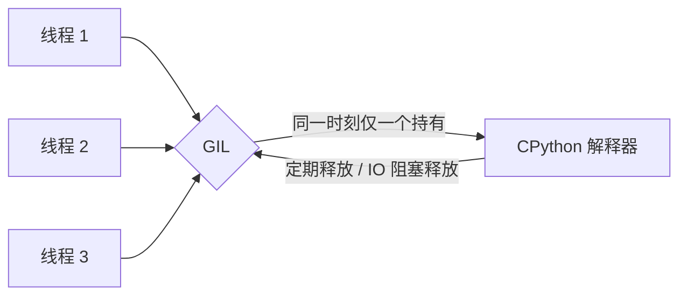

Python 的多线程常被一句话概括为"假并发",这个说法不准确。对 IO 密集任务,多线程依然能显著提速;对 CPU 密集任务,标准 CPython 下多个线程无法同时执行字节码。差别来自 GIL。

## GIL 是什么

GIL(Global Interpreter Lock)是 CPython 解释器内的一把全局互斥锁:同一时刻只允许一个线程执行 Python 字节码。



它不是 Python 语言规范的一部分,而是 CPython 实现的产物。Jython、IronPython 没有 GIL;PyPy 有,但它的 JIT 让单线程更快。

## 为什么需要 GIL

CPython 用引用计数管理内存:每个对象记录被引用的次数,归零即回收。多线程同时修改同一对象的引用计数,需要原子操作或细粒度锁;后者会带来巨大的开销与死锁风险。用一把全局锁把整个解释器串起来,实现简单、单线程性能好,是当年的工程取舍。

代价就是多核 CPU 上,纯 Python 代码的多线程无法并行。GIL 保护和引用计数相关的数据结构,不保护你的业务数据。

## IO 密集为什么仍有效

线程在以下情况会释放 GIL:

- 执行阻塞式 IO(文件、网络、`time.sleep`);
- 调用 C 扩展中显式释放 GIL 的函数(如 `numpy` 的向量化运算、`zlib` 压缩);
- 解释器按时间片切换,等待锁的线程可以拿到 GIL。

所以爬虫、Web 请求、数据库查询这类"大部分时间在等"的任务,多线程能把等待时间重叠起来:

```python
from concurrent.futures import ThreadPoolExecutor
import urllib.request

def fetch(url):
    with urllib.request.urlopen(url, timeout=5) as r:
        return r.status

urls = [...]
with ThreadPoolExecutor(max_workers=8) as pool:
    results = list(pool.map(fetch, urls))     # 8 个请求并发等待
```

这里提速来自"等待重叠",不是"计算并行"。

## CPU 密集的三种出路

```python
# 1. 多进程:真正并行,代价是进程开销与数据传递
from concurrent.futures import ProcessPoolExecutor

with ProcessPoolExecutor() as pool:
    results = list(pool.map(cpu_task, data))

# 2. 把计算交给释放 GIL 的 C 扩展
import numpy as np
total = np.dot(a, b)          # 大数组运算期间释放 GIL

# 3. 换实现或等 free-threading
```

| 场景 | 推荐 |
| --- | --- |
| 大量网络请求、文件读写 | 线程池或 asyncio |
| 纯 Python 的 CPU 计算 | 多进程 |
| 数值计算、图像处理 | numpy 等 C 扩展 + 线程/进程 |
| 高并发连接(数千) | asyncio |
| 少量任务、需要共享状态 | 线程 + 锁,注意临界区 |

多进程绕开 GIL,但进程间不能直接共享可变对象,参数与结果要序列化(pickle),启动与内存开销也更大。小任务用进程池可能得不偿失。

## 线程安全与 GIL 的误解

GIL 只保证"一条字节码"的执行不被打断,不保证复合操作原子:

```python
counter = 0

def bump():
    global counter
    for _ in range(100_000):
        counter += 1        # 读 - 加 - 写,三步之间可能切换线程
```

`counter += 1` 对应多条字节码,线程切换可能发生在中间,结果小于预期。需要原子计数时用 `threading.Lock`,或者 `itertools.count`、队列、数据库自增等天然同步的手段。

同样,`dict` 的单次操作在 CPython 下是原子的,但"先检查再写入"不是。GIL 不能替代锁,它只是把问题缩小到字节码粒度。

## free-threading 的现状

PEP 703 提出可选的"无 GIL"构建,3.13 起提供实验性版本(`python3.13t`)。它用偏向锁、延迟引用计数等机制替代 GIL,代价是单线程性能下降、C 扩展需要适配。

生产环境暂时不建议切换;标准构建仍是默认。理解 GIL 的意义在于选对并发模型,不在于等待它消失。

## 小结

- GIL 是 CPython 的全局互斥锁,同一时刻只有一个线程执行字节码;
- IO 阻塞与部分 C 扩展会释放 GIL,所以 IO 密集的多线程仍有效;
- CPU 密集用多进程、C 扩展或异步以外的方案;
- GIL 不保证复合操作原子,共享可变状态仍要加锁;
- free-threading 仍是实验特性,生产以标准构建为准。
