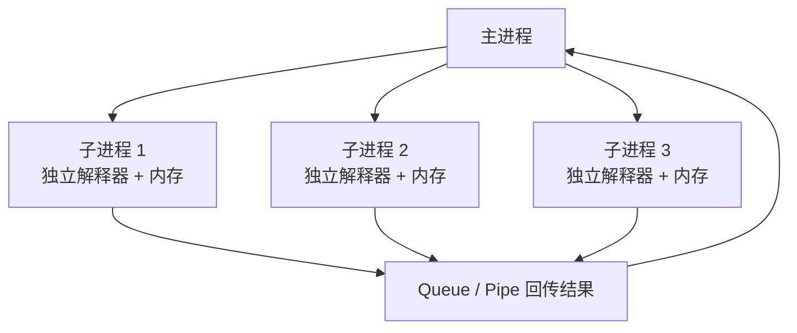

多进程是标准 CPython 下绕开 GIL 做 CPU 并行的手段。每个进程有独立解释器与内存空间,可以真正同时运行;代价是启动开销、内存占用与数据传递成本。

## 进程与线程的差别

| | 线程 | 进程 |
| --- | --- | --- |
| 内存 | 共享地址空间 | 独立地址空间 |
| 并行 | 受 GIL 限制 | 真正并行 |
| 启动开销 | 小 | 大(解释器初始化) |
| 数据共享 | 直接读写,需加锁 | 需要队列/管道/共享内存 |
| 崩溃影响 | 整个进程 | 通常只影响子进程 |



选择原则:**任务在等 IO,用线程或 asyncio;任务在烧 CPU,用进程。**

## 三种接口

```python
import multiprocessing as mp

# 1. Process:手动管理单个进程
def worker(q, n):
    q.put(n * n)

q = mp.Queue()
p = mp.Process(target=worker, args=(q, 5))
p.start()
print(q.get())
p.join()
```

```python
# 2. Pool:老式进程池,支持 map / apply_async
with mp.Pool(processes=4) as pool:
    results = pool.map(square, range(10))
```

```python
# 3. ProcessPoolExecutor:与线程池同接口,推荐
from concurrent.futures import ProcessPoolExecutor

with ProcessPoolExecutor(max_workers=4) as pool:
    results = list(pool.map(square, range(10)))
```

`ProcessPoolExecutor` 与 `ThreadPoolExecutor` 同属 `concurrent.futures`,接口一致(都返回 Future),切换并发模型时改动小。新代码优先它,需要精细控制单个进程生命周期时再用 `Process`。

## Windows 与 spawn

Windows 与 macOS 默认用 spawn 启动子进程:重新导入主模块、重新执行模块顶层代码。没有入口守卫时,子进程会再次启动新进程,形成递归:

```python
from concurrent.futures import ProcessPoolExecutor

def work(x): ...

if __name__ == "__main__":            # 必须
    with ProcessPoolExecutor() as pool:
        print(list(pool.map(work, range(5))))
```

Linux 默认 fork,没有这个问题,但为了跨平台,`__main__` 守卫是必须的。同理,传给子进程的函数与被处理的数据都要能被 pickle:lambda、局部函数、不可序列化的句柄(数据库连接、文件对象)都不行。

## 进程间通信

```python
from multiprocessing import Queue, Pipe, Value, Array, Manager

q = Queue()
parent, child = Pipe()
counter = Value("i", 0)          # 共享内存中的整数,需加锁
manager = Manager()
shared = manager.dict()          # 由管理进程代理的共享字典
```

| 方式 | 适用 |
| --- | --- |
| `Queue` | 多生产者多消费者,最常用 |
| `Pipe` | 两个进程之间的双向/单向通道 |
| `Value` / `Array` | 简单的共享内存标量与数组,需同步 |
| `Manager` | 共享 dict/list 等复杂对象,开销较大 |
| 共享内存 `shared_memory` | 大块数值数据,避免复制 |

数据跨进程要序列化,大对象反复传递会成为瓶颈。能"每个子进程独立处理一份数据"就不要"频繁交换中间结果";必须交换时,考虑批量传输或共享内存。

## 任务粒度与开销

进程启动要重新初始化解释器与导入模块,单个任务几毫秒时,进程池的开销可能超过收益。

- 任务耗时至少几十毫秒才值得并行;
- `chunksize` 让 `map` 成批分发任务,减少调度次数;
- 子进程数量不要超过 CPU 核心数太多,`os.cpu_count()` 可作上限参考;
- 子进程要重新导入模块,入口逻辑与重依赖会拖慢启动,必要时把重导入放进任务函数内。

```python
with ProcessPoolExecutor() as pool:
    results = list(pool.map(work, data, chunksize=50))
```

## 与线程、异步的分工

| 需求 | 工具 |
| --- | --- |
| 大量 HTTP 请求 | asyncio 或线程池 |
| 图片/视频编码、数值计算 | 进程池 |
| 爬虫 + 解析(IO + CPU 混合) | 进程内起线程/异步拉取,进程池算 CPU |
| 共享状态的实时更新 | 线程 + 锁,或用队列解耦 |

混合场景常见做法:用 `asyncio` 负责 IO,把 CPU 段交给 `ProcessPoolExecutor`(通过 `run_in_executor` 或 `asyncio.to_thread` 之外的进程池)。不要让进程池承担本该异步的等待。

## 常见问题

- **忘记 `__main__` 守卫**:Windows 下递归启动子进程;
- **传 lambda 或局部函数**:pickle 失败,报 `Can't pickle`;
- **传数据库连接/文件对象**:不可序列化,也跨不了进程;
- **子进程里修改全局变量**:进程隔离,主进程看不到;
- **进程数开得太多**:上下文切换与内存压力让总吞吐下降;
- **用多进程做 IO 等待**:进程开销远大于 IO 等待,应该用线程或异步。

## 小结

- 多进程提供真正的 CPU 并行,代价是启动开销与数据传递;
- 优先 `ProcessPoolExecutor`,需要单进程控制时用 `Process`;
- Windows 必须写 `__main__` 守卫,函数与数据都要可 pickle;
- 进程间用 Queue/Pipe/共享内存通信,避免频繁传大对象;
- 任务粒度太小时,进程池的收益可能为负。
