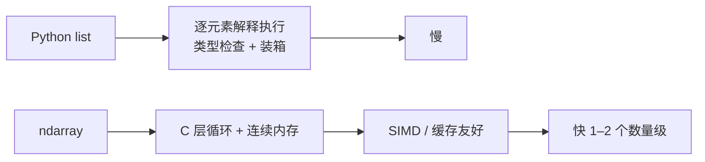

numpy 的核心是 ndarray:一块连续的、同类型元素的内存,加上形状与步长信息。它把循环从 Python 层移到 C 层,并允许 SIMD 与并行指令参与计算,这是数值处理性能的基础。

## ndarray 的形状与类型

```python
import numpy as np

a = np.array([[1, 2, 3], [4, 5, 6]])
a.shape        # (2, 3)
a.dtype        # dtype('int64')
a.ndim         # 2
a.size         # 6
```

- `shape` 是每个维度的长度;
- `dtype` 是元素类型,整个数组必须统一;
- ndarray 与 list 的关键差别:内存连续、类型固定、运算按元素进行。

```python
np.zeros((2, 3))          # 全 0
np.ones(5)                # 全 1
np.arange(10)             # 0..9
np.linspace(0, 1, 5)      # 等距 5 个点
np.random.default_rng(0).normal(size=1000)
```

## 向量化

```python
xs = list(range(1_000_000))
loop = [x * 2 + 1 for x in xs]            # Python 循环

arr = np.arange(1_000_000)
vec = arr * 2 + 1                          # 向量化
```

同样的运算,向量化版本通常快一到两个数量级。原因不在于"写法短",而在于:

- 循环在 C 层执行,省去每条字节码的解释开销;
- 元素类型统一,内存连续,缓存命中率高;
- 可被编译为 SIMD 指令,一次处理多个元素。



原则:能用数组运算表达,就不要写 `for`。确实需要逐元素复杂逻辑时,先看能否用 `np.where`、`np.select`、`np.vectorize`(仅便利,不加速)或 `numba` 等工具。

## 广播

形状不同但兼容的数组可以直接运算,规则是从尾部维度开始对齐:

```python
a = np.array([[1, 2, 3], [4, 5, 6]])      # (2, 3)
b = np.array([10, 20, 30])                 # (3,)
a + b
# [[11, 22, 33],
#  [14, 25, 36]]
```

b 的形状 (3,) 被扩展成 (2, 3),每一行都加同一组值。规则:

1. 从最后一维开始比较;
2. 维度相等,或其中一个为 1,则可广播;
3. 不足的维度在前面补 1;
4. 不满足规则时抛 ValueError。

```python
col = np.array([[1], [2]])       # (2, 1)
a + col                          # (2, 3),每列加对应值
```

广播不复制数据,只改变步长,所以内存开销很小。但结果数组本身仍会分配,超大广播可能撑爆内存。

## 索引与切片

```python
a[0]            # 第一行
a[:, 1]         # 第二列
a[1, 2]         # 单个元素
a[a > 3]        # 布尔索引,返回一维
a[[0, 1], [1, 2]]   # 花式索引,取 (0,1) 与 (1,2)
```

布尔索引返回副本,不是视图。切片返回视图,修改视图会影响原数组,这一点在第 3 篇详细展开。

## dtype 与精度

```python
np.array([1, 2]).dtype           # int64
np.array([1.0]).dtype            # float64
arr.astype(np.float32)           # 显式转换
```

- 默认整型是平台相关的 `int64`(Windows 上可能不同,通常仍是 64 位);
- 默认浮点是 `float64`,精度约 15–17 位有效数字;
- `float32` 省一半内存,适合图像与大模型推理,但精度只有约 7 位;
- 整型溢出不会报错,numpy 按位截断,做累加时注意用足够宽的 dtype。

```python
np.array([2**62], dtype=np.int64) * 4     # 溢出,结果错误且无异常
```

涉及金额与精确小数,不要用浮点数组,改用 `decimal` 或整数分单位存储。numpy 擅长的是科学计算与批量数值运算,不擅长精确的十进制金融计算。

## 常见操作

```python
a.sum(axis=0)          # 按列求和
a.mean(axis=1)         # 按行求均值
a.reshape(3, 2)        # 改变形状,元素总数不变
a.T                    # 转置
np.concatenate([a, a]) # 拼接
np.where(a > 3, a, 0)  # 条件选择
```

`axis` 是"被压缩掉的维度":二维数组 `axis=0` 沿行方向压缩,得到每列的结果。初学时容易记反,记住"axis 是结果里消失的那个轴"。

## 常见问题

- **用循环处理数组**:性能损失最大的一类写法;
- **忽略广播的形状**:`(n,)` 与 `(n,1)` 结果完全不同;
- **把切片当副本**:修改视图污染原数据;
- **dtype 溢出**:整型运算静默截断;
- **用 float 做金额计算**:精度问题;
- **在循环里不断 `np.append`**:每次都重新分配,应该预分配或用列表收集后一次转换。

## 小结

- ndarray 是连续内存 + 统一类型 + 形状元数据;
- 向量化把循环下沉到 C 层,是性能的主要来源;
- 广播从尾部维度对齐,不复制数据但会分配结果;
- 切片是视图、布尔索引是副本;
- dtype 决定精度与内存,整型溢出不会报错。
