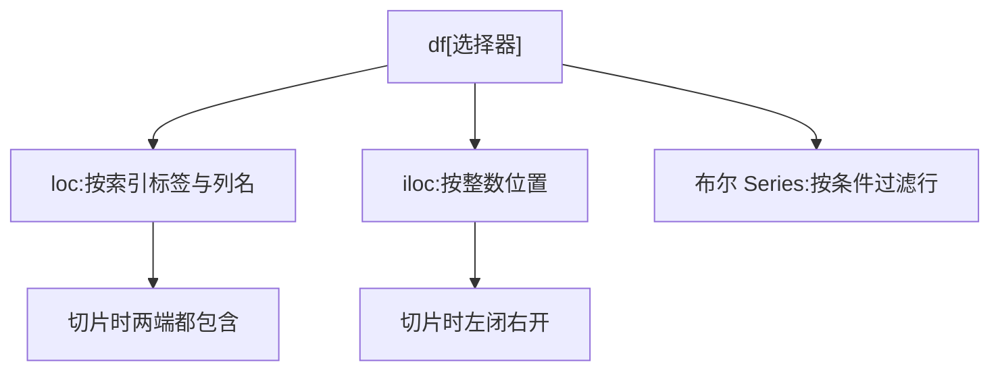

pandas 在 numpy 之上加了"带标签的二维表":行索引、列名、异构列类型与缺失值语义。它适合中小规模的表格分析与清洗,不适合作为数据库或超大数据集的存储引擎。

## Series 与 DataFrame

```python
import pandas as pd

s = pd.Series([10, 20, 30], index=["a", "b", "c"])
df = pd.DataFrame({
    "name": ["Ada", "Bob", "Cy"],
    "score": [97, 82, 91],
})
```

- Series 是一维带索引的数组;
- DataFrame 是二维表,每列是一个 Series,共享行索引;
- 行索引默认是 0..n-1,也可以指定业务键(如订单号)。

## 读取与写出

```python
df = pd.read_csv("users.csv", encoding="utf-8")
df = pd.read_csv("users.csv", dtype={"id": str}, parse_dates=["created_at"])

df.to_csv("out.csv", index=False, encoding="utf-8")
```

常用参数:`dtype` 指定列类型(避免 ID 被推断成数字而丢前导零)、`parse_dates` 解析时间列、`usecols` 只读需要的列、`na_values` 指定缺失值标记。写出时 `index=False` 通常必须,否则会多一列行号。

其他格式:`read_excel`、`read_json`、`read_parquet`、`read_sql`。Parquet 是列式存储,读取大表比 csv 快很多。

## loc 与 iloc

```python
df.loc[0, "name"]          # 按标签:第 0 行(索引值)、name 列
df.iloc[0, 1]              # 按位置:第 0 行、第 1 列
df.loc[df["score"] > 90]   # 布尔过滤
df.loc[:, ["name", "score"]]
```



关键差别:`loc` 的切片包含终点,`iloc` 的切片不包含终点,与 Python 列表一致。索引是字符串时,`df[0]` 的行为与 `loc`/`iloc` 都不相同,所以明确场景一律用 `loc`/`iloc`,不要用裸 `[]` 猜。

## 派生列与赋值

```python
df["passed"] = df["score"] >= 60
df["level"] = df["score"].map(lambda x: "A" if x >= 90 else "B")
df = df.assign(total=df["price"] * df["qty"])
```

- 直接赋一列:按位置对齐;
- `map`/`apply` 做逐元素转换,`apply` 作用于列时较慢,能向量化就向量化;
- `assign` 返回新对象,便于链式调用,不修改原表。

需要修改原表时用 `df.loc[条件, 列] = 值`,这是最稳妥的写法;直接对切片赋值可能触发 SettingWithCopy 警告,下一篇专门讲。

## 聚合与分组

```python
df.groupby("city")["score"].mean()
df.groupby("city").agg(
    avg=("score", "mean"),
    cnt=("score", "size"),
    top=("score", "max"),
)

result = df.groupby(["city", "level"], as_index=False)["score"].sum()
```

`groupby` 遵循"拆分—应用—合并":按键分组,对每组算聚合,再拼回结果。`agg` 用命名聚合同时产出多列,列名清晰。`as_index=False` 让分组键回到普通列,便于后续合并与导出。

`transform` 返回与原表同长度的结果,适合"组内标准化"这类需要广播回去的场景;`filter` 按组条件筛掉整组。

## 合并与连接

```python
pd.merge(orders, users, on="user_id", how="left")
pd.concat([df1, df2], ignore_index=True)
```

- `merge` 类似 SQL join,`how` 取 `inner`/`left`/`right`/`outer`;
- 两表同名列但含义不同时用 `left_on`/`right_on` 显式指定;
- `concat` 沿行或列拼接,`ignore_index=True` 重建行索引;
- 连接后行数可能变多(一对多),先用 `df[key].is_unique` 检查键的唯一性。

## 缺失值

```python
df.isna().sum()                 # 每列缺失数量
df.dropna(subset=["id"])        # 按列判断
df.fillna({"score": 0})         # 按列填充
df["score"].fillna(df["score"].mean())
```

pandas 用 `NaN` 表示浮点缺失,用 `pd.NA` 或 `None` 表示其他类型缺失。整数列一旦有缺失会自动变成 float,这是常见困惑:ID 列出现 `.0` 往往是缺失值导致的类型提升。

## 索引对齐

pandas 的运算按**索引对齐**,不是按位置:

```python
a = pd.Series([1, 2], index=["x", "y"])
b = pd.Series([10, 20], index=["y", "x"])
a + b          # x: 21, y: 12,按标签相加
```

这是 pandas 的强大之处,也是 bug 来源:两份数据行序不同但标签相同,结果是对的;标签不同则产生 NaN。合并前统一索引,或明确用 `.values` 做位置运算。

## 常见问题

- **用链式赋值改原表**:触发 SettingWithCopy,改动可能不生效;
- **忘记 `index=False`**:导出的 csv 多一列行号;
- **ID 被推断成数字**:前导零丢失,读入时指定 `dtype=str`;
- **对 DataFrame 逐行 `iterrows`**:极慢,优先向量化或 `apply`;
- **分组后忘记重置索引**:后续合并对不上;
- **混合使用 loc 与裸 []**:语义不一致,容易取错数据。

## 小结

- Series 是一维带索引数组,DataFrame 是共享索引的二维表;
- 选择用 `loc`(标签)与 `iloc`(位置),不要用裸 `[]` 猜语义;
- 派生列优先向量化,修改原表用 `loc[条件, 列] = 值`;
- `groupby().agg()` 做分组聚合,`merge`/`concat` 做连接;
- 运算按索引对齐,合并前统一索引与类型。
