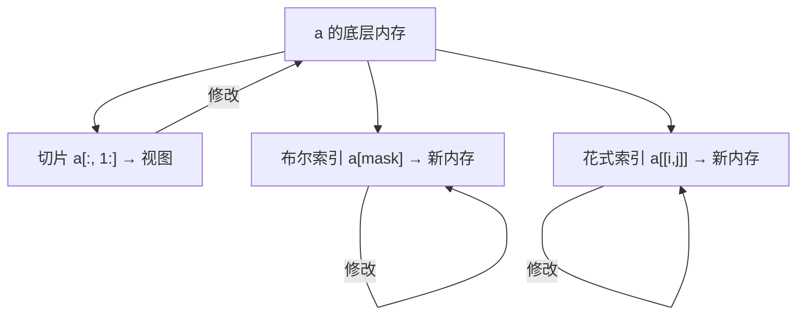

"改了这个变量,为什么另一个变量也变了"以及"明明赋值了,为什么原数据没变",这两类问题的根源都是视图与副本。numpy 的规则相对明确,pandas 更隐晦,还有一条专门的警告。

## numpy:切片是视图

```python
import numpy as np

a = np.arange(6).reshape(2, 3)
b = a[:, 1:]          # 切片,视图
b[0, 0] = 99
a                     # a 也被改了

c = a[a > 3]          # 布尔索引,副本
c[0] = -1
a                     # a 不受影响

d = a[[0, 1]]         # 花式索引,副本
```

判断规则:

- 基本切片(连续、等步长)返回视图,共享底层内存;
- 布尔索引、花式索引返回副本;
- `copy()` 显式复制;`a.base is not None` 说明它是某个数组的视图。



视图省内存,但修改会互相影响;副本安全,但占双倍内存。大数组做只读分析时用视图,需要独立修改时显式 `copy()`。

## pandas:边界更隐晦

pandas 的选择操作结果可能是视图,也可能是副本,取决于操作类型与内部块的布局。最典型的问题链:

```python
subset = df[df["score"] > 90]     # 可能是副本
subset["level"] = "A"             # SettingWithCopyWarning
```

警告的含义是:pandas 无法确定 `subset` 是视图还是副本,你这次的赋值可能只改到临时对象,没写回原表。它不一定错,但不可靠。

正确做法一:**单步定位并赋值**,不产生中间对象:

```python
df.loc[df["score"] > 90, "level"] = "A"
```

正确做法二:**明确复制**,后续操作只影响副本:

```python
subset = df[df["score"] > 90].copy()
subset["level"] = "A"
```

```python
df.copy(deep=True)      # 复制数据,修改互不影响
df.copy(deep=False)     # 浅复制:新对象共享底层数据,仍可能联动
```

日常用 `deep=True`(默认);只有在明确"只读共享、节省内存"时才用浅复制,并且要清楚 Pandas 的 Copy-on-Write 行为。

## Copy-on-Write

pandas 2.x 起逐步引入 Copy-on-Write:任何一方修改共享数据时,才真正复制。它让"视图"与"副本"的边界更可预测,并计划在 3.0 成为默认行为。

在此之前,可靠的做法只有两条:单步 `loc` 赋值,或显式 `.copy()`。不要依赖"这次是视图"的偶然结果。

## 常见误用

- **对切片赋值后以为改了原表**:视图与副本行为不同,显式 copy 或单步 loc;
- **链式索引赋值**:`df[df.a > 1]["b"] = 0` 一定不可靠,拆成一条 `loc`;
- **对分组结果赋值**:`groupby` 的结果是新对象,改它不会回写原表;
- **反复 deep copy 大表**:内存翻倍,能单步修改就不要复制整表;
- **把 `deep=False` 当默认**:后续修改可能联动原表,排查成本高。

## 与数据库、文件的类比

数据处理的层次里,"取一份数据"和"引用一份数据"必须分开考虑:

| 操作 | 语义 |
| --- | --- |
| SQL 查询 | 通常返回结果集副本(或惰性视图) |
| 数据库视图 | 引用原表,修改有约束 |
| numpy 切片 | 视图 |
| pandas 选择 | 不确定,取决于实现 |
| 显式 copy | 副本 |

不确定性本身就是风险。在 pandas 里,规则的可靠版本是:要么单步 `loc`,要么 `.copy()`,不要猜。

## 小结

- numpy 基本切片是视图,布尔与花式索引是副本;
- pandas 选择结果不确定,链式赋值会触发 SettingWithCopyWarning;
- 修改原表用单步 `df.loc[条件, 列] = 值`,处理副本先 `.copy()`;
- Copy-on-Write 让边界更可预测,但过渡期仍按显式规则写;
- 视图省内存,副本保安全,按"是否要独立修改"选择。
