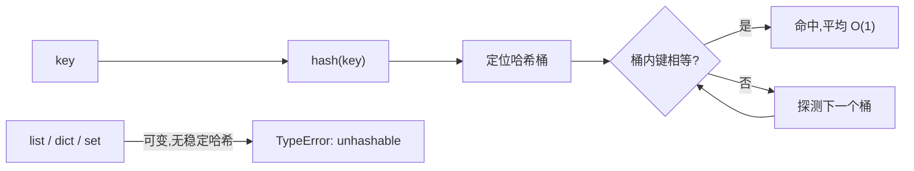

字典与集合都建立在**哈希表**上:平均 O(1) 的查找/插入/删除。代价是对键(或元素)有要求:**可哈希**,且哈希与相等语义一致。这一篇讲操作、键要求与性能。

## 字典:键到值的映射

```python
d = {"a": 1, "b": 2}
d["c"] = 3            # 插入/更新
d["a"]                # 1;键不存在抛 KeyError
d.get("x", 0)         # 0;不存在返回默认,不抛
d.setdefault("x", []) # 不存在则插入并返回;存在返回现值
del d["b"]
"a" in d              # True,查键
```

遍历:`for k in d`(键)、`d.values()`、`d.items()`。这三个返回**视图对象**,随字典变化而变化,不是快照;需要快照用 list(d.items())。

**3.7+ 字典保证插入顺序**(语言规范),可依赖;但"有序"不等于"排序",要排序用 sorted(d.items())。

兜底三件套:get(读兜底)、setdefault(读+插兜底)、collections.defaultdict(工厂自动建值,第 9 章)。计数用 Counter 更直接。

## 键的要求:可哈希

可哈希 = 有 __hash__ 且生命周期内哈希值不变,且与 __eq__ 一致:**相等的对象必须哈希相等**(与 Java 的 hashCode/equals 契约同构)。

- 可作键:int、str、tuple(元素也可哈希)、frozenset、自定义不可变值对象;
- 不可作键:list、dict、set —— 可变,哈希无法稳定,直接 TypeError: unhashable;
- 自定义类默认按身份哈希/相等;若覆写 __eq__ 而不覆写 __hash__,实例变为不可哈希(第 5 章)。

注意:tuple 含列表则不可哈希;元组"不可变"只保证引用不变,哈希要求的是**内容语义稳定**。

## 集合:去重与集合运算

```python
s = {1, 2, 3}
s.add(4); s.discard(9)      # discard 不存在不抛,remove 会抛
{1, 2} | {2, 3}             # 并 {1,2,3}
{1, 2} & {2, 3}             # 交 {2}
{1, 2} - {2, 3}             # 差 {1}
{1, 2} ^ {2, 3}             # 对称差 {1,3}
```

空集合必须 `set()`,`{}` 是空字典。去重:`list(dict.fromkeys(xs))` 保序去重,`set(xs)` 不保序。成员判断 `x in s` 平均 O(1),大列表成员判断应转集合。

frozenset 是不可变集合,可作字典键/集合元素。

## 性能与冲突



哈希表平均 O(1),最坏 O(n)(大量冲突)。Python 用开放寻址 + 扰动函数分散冲突;键的 __hash__ 质量差(如恒返回常数)会退化成线性。负载因子超阈值自动扩容(rehash),大字典预估容量无直接 API,但避免反复小步插入大量键可减扩容次数。

注意:哈希随机化(str/bytes 默认带随机盐,防哈希碰撞攻击)使跨进程哈希值不同;不要持久化 hash() 结果。

## 小结

- dict 哈希映射,O(1);get/setdefault/defaultdict 兜底;视图随动;
- 3.7+ 保插入序,不等于排序;
- 键必须可哈希且 eq/hash 一致;可变对象不可作键;
- set 去重与并交差对称差;空集合 set();保序去重 dict.fromkeys;
- 冲突最坏 O(n),hash 质量决定;hash() 带随机盐不可持久化。

下一篇讲切片与解包:序列操作里最易错的两块。
