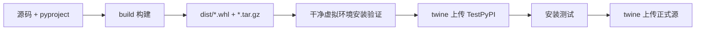

发布一个包要经过四步:声明元数据、构建产物、在干净环境里验证、上传到索引。任何一步省略,都会出现"本地能装、别人装不上"或"装上了但少文件"的问题。

## 两种产物

| 产物 | 内容 | 用途 |
| --- | --- | --- |
| sdist(`.tar.gz`) | 源码 + 构建配置 | 源码分发,安装时本地构建 |
| wheel(`.whl`) | 预构建的安装包 | 大多数安装直接解压,无需编译 |

纯 Python 包对两者都无差别,但 wheel 安装更快、更稳定。带 C 扩展的包应为每个平台与 Python 版本构建对应 wheel,否则用户要本地编译。

## 版本号

遵循 `主版本.次版本.修订号`:

- **主版本**:不兼容的变更;
- **次版本**:向后兼容的新功能;
- **修订号**:向后兼容的修复。

预发布用 `1.0.0rc1`、开发版用 `1.1.0.dev3`。索引上的版本不可覆盖也不可删除,发错了只能 yank 再发新版本,所以发布前要确认版本号。

`requires-python` 声明解释器范围:

```toml
[project]
name = "shop-tools"
version = "0.3.1"
requires-python = ">=3.9"
```

pip 会据此判断能否安装。写低了会在低版本上装成功但运行失败,写高了会挡住本来可用的用户。

## 构建

```bash
uv build                 # 生成 dist/*.whl 与 dist/*.tar.gz
python -m build          # 无 uv 时的等价方式
```

```text
dist/
├── shop_tools-0.3.1-py3-none-any.whl
└── shop_tools-0.3.1.tar.gz
```

wheel 文件名编码了包名、版本、Python 标签与平台标签。`py3-none-any` 表示纯 Python、任意平台。



## 上传

```bash
pip install twine

twine upload --repository testpypi dist/*
twine upload dist/*
```

凭据通过 `~/.pypirc` 或环境变量 `TWINE_USERNAME`/`TWINE_PASSWORD` 提供,不要写进仓库。先在 TestPyPI 上传并实际安装一遍:

```bash
pip install --index-url https://test.pypi.org/simple/ shop-tools
```

这一步能发现"元数据写错、依赖名拼错、缺文件"等只在索引环境下暴露的问题。

## 包数据

非 `.py` 文件(模板、配置、数据文件)默认可能不被打进 wheel,需要在构建配置里声明:

```toml
[tool.hatch.build.targets.wheel]
packages = ["src/shop"]

[tool.setuptools.package-data]
shop = ["templates/*.html", "py.typed"]
```

`py.typed` 是让类型检查器知道"这个包自带类型信息"的标记文件,发布类型化库时必须包含它。

验证方式不是看源码目录,而是安装产物后检查:

```python
import shop
print(shop.__file__)          # 确认来自 site-packages
```

## 私有源与镜像

- 企业内部包上传到私有索引(DevPi、Artifactory、Nexus 等);
- 安装时用 `--index-url` 指定私有源,或用 `pip config` 写进配置;
- 公共依赖走镜像加速时,注意私有源与公共源的优先级;
- 依赖声明里不要写死内部源 URL,应通过环境配置注入,否则外部用户无法安装。

## 发布检查清单

1. 版本号已更新,符合语义化规则;
2. `pyproject.toml` 的 `name`、`description`、`license`、`requires-python` 完整;
3. 依赖范围正确,没有写死本地路径;
4. 在干净虚拟环境里安装 sdist 与 wheel 各一次;
5. 包数据与 `py.typed` 已包含;
6. README 能正常渲染(索引页显示的就是它);
7. 先在 TestPyPI 走通,再发正式源。

## 常见问题

- **重复上传同一版本**:索引拒绝覆盖,必须升版本;
- **漏了包数据**:源码目录能跑,装完缺模板;
- **依赖写成本地路径或 git 分支**:外部环境无法安装;
- **README 里的相对图片链接**:索引页图片全部失效;
- **在项目目录里 `pip install .` 后忘了更新**:装的是旧副本,验证要用构建产物;
- **凭据提交进仓库**:泄露风险,改用环境变量或密钥管理。

## 小结

- sdist 是源码包,wheel 是预构建安装包,纯 Python 两者等价;
- 版本号遵循语义化规则,已发布版本不可覆盖;
- `uv build`/`python -m build` 生成产物,twine 负责上传;
- 包数据与 `py.typed` 要在构建配置里声明,并在产物中验证;
- 发布前在干净环境安装测试,先走 TestPyPI 再发正式源。
