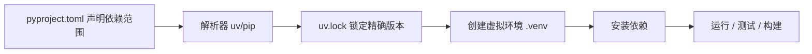

项目一多,`requirements.txt` 加散落的配置文件就不够用了:元数据、依赖范围、构建方式、工具配置需要一个统一入口。`pyproject.toml` 就是那个入口,`uv` 则把依赖解析与锁定做成了快且完整的工作流。

## pyproject.toml 的结构

```toml
[project]
name = "shop"
version = "0.1.0"
description = "订单服务"
requires-python = ">=3.11"
dependencies = [
  "httpx>=0.27",
  "pydantic>=2.7,<3",
]

[project.optional-dependencies]
dev = ["pytest>=8", "ruff>=0.6", "mypy>=1.10"]

[project.scripts]
shop = "shop.__main__:main"

[build-system]
requires = ["hatchling"]
build-backend = "hatchling.build"

[tool.ruff]
line-length = 100

[tool.pytest.ini_options]
testpaths = ["tests"]
```

- `[project]`:名称、版本、描述、Python 版本约束与运行时依赖;
- `optional-dependencies`:开发、文档、数据库驱动等按需安装的组;
- `[project.scripts]`:安装后生成命令行入口,指向"模块:函数";
- `[build-system]`:声明用什么后端构建 wheel 与 sdist;
- `[tool.*]`:ruff、mypy、pytest 等工具的统一配置位置。

依赖写范围(`>=`、`<`),不写精确版本。精确版本由锁文件负责,声明文件只表达"兼容哪些版本"。

## src 布局

```text
shop/
├── pyproject.toml
├── src/
│   └── shop/
│       ├── __init__.py
│       └── orders.py
├── tests/
│   └── test_orders.py
└── uv.lock
```

把包放进 `src/`,可以让"未安装的源码"不会被当前目录直接导入,强制测试与运行都走安装后的包。这能提前暴露"忘了打包某个文件"的问题,也是多数现代项目的默认布局。



三类文件分工明确:声明写范围,锁文件写精确版本,虚拟环境装实际产物。仓库提交前两者,不提交后者。

## uv 的常用命令

```bash
uv init shop                 # 初始化项目(生成 pyproject 与 .venv)
uv add httpx pydantic        # 添加依赖,自动更新 pyproject 与 uv.lock
uv add --dev pytest ruff     # 开发依赖
uv remove httpx              # 移除
uv sync                      # 按锁文件安装,缺依赖时补齐
uv lock                      # 重新解析并更新锁文件
uv run python -m pytest      # 在项目环境里运行命令
uv run --with httpx python -c "..."   # 临时依赖,不写入项目
```

`uv sync` 与 `pip install -r` 的区别:前者会删除锁文件之外的多余包,让环境严格等于锁文件;后者只保证装上了清单里的包,环境可能有残留。

`uv run` 自动使用项目的 `.venv`,不必手动激活,CI 与脚本里更可靠。

## 构建后端

| 后端 | 特点 |
| --- | --- |
| `hatchling` | 配置少,适合纯 Python 包 |
| `setuptools` | 兼容老项目,生态最广 |
| `poetry-core` | 与 poetry 配合 |
| `flit-core` | 极简,适合单模块包 |
| `maturin` | Rust 扩展 |

纯 Python 项目首选 `hatchling`;已有 `setup.py` 的老项目可以继续用 `setuptools`,迁移时再换。构建命令:

```bash
uv build                    # 生成 dist/ 下的 wheel 与 sdist
```

## 常见问题

- **依赖写死精确版本**:升级要手动改每一条,改用范围加锁文件;
- **不提交锁文件**:不同人装出不同版本,线上与本地不一致;
- **把 `.venv` 提交进仓库**:平台相关且体积大,`.gitignore` 排除;
- **在 pyproject 里重复配置工具**:ruff、pytest 的配置各写一份到独立文件,容易出现两处不一致;
- **忘了 `requires-python`**:包在低版本上安装成功但运行失败;
- **脚本入口指向不存在的函数**:`shop.__main__:main` 必须真实存在,安装后才会生成命令。

## 小结

- pyproject.toml 统一元数据、依赖、脚本入口与工具配置;
- src 布局强制走安装后的包,提前暴露打包遗漏;
- `uv add`/`sync`/`lock`/`run` 覆盖依赖全流程,锁文件保证复现;
- 声明写范围、锁文件写精确、环境装产物,三者分工;
- 纯 Python 包用 hatchling,老项目可继续 setuptools。
