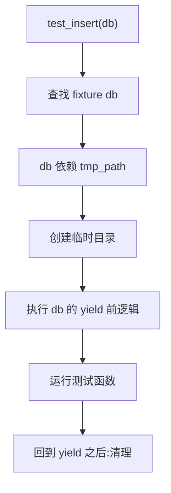

pytest 的核心优势不是"找到测试文件",而是三点:普通 `assert` 就能给出详细失败信息、fixture 用依赖注入替代初始化代码、参数化让同一逻辑覆盖多组输入。掌握这三件,测试代码会明显短于 unittest。

## 发现规则与 assert

默认规则:

- 文件名匹配 `test_*.py` 或 `*_test.py`;
- 函数名以 `test_` 开头;
- 类名以 `Test` 开头,且不能有 `__init__`;
- 在 `pyproject.toml` 的 `[tool.pytest.ini_options]` 里可改 `testpaths` 与匹配模式。

```python
def add(a, b):
    return a + b

def test_add():
    assert add(2, 3) == 5
```

```text
$ pytest -q
E       assert 6 == 5
E        +  where 6 = add(2, 3)
```

pytest 重写了 `assert`,失败时会把表达式拆开显示中间值。与其写大量 `self.assertEqual`,不如直接用 assert。

## fixture:依赖注入

```python
import pytest

@pytest.fixture
def db(tmp_path):
    conn = create_db(tmp_path / "test.db")
    try:
        yield conn
    finally:
        conn.close()

def test_insert(db):
    db.execute("insert ...")
    assert db.count() == 1
```

要点:

- fixture 是一个函数,测试函数的**参数名**等于 fixture 名时自动注入;
- `yield` 之前是准备,之后是清理,即使测试失败也会执行;
- fixture 可以依赖其他 fixture(`db` 依赖 `tmp_path`),形成依赖图;
- fixture 不必在同一个文件,放 `conftest.py` 可被同目录及子目录共享。



## 作用域

| 作用域 | 生命周期 |
| --- | --- |
| `function`(默认) | 每个测试函数一次 |
| `class` | 每个测试类一次 |
| `module` | 每个测试文件一次 |
| `session` | 整个测试会话一次 |

```python
@pytest.fixture(scope="session")
def app():
    return create_app()
```

昂贵资源(数据库连接、容器、启动服务)用 session 或 module 作用域;有状态的资源用 function 作用域,避免测试间互相污染。作用域越大,隔离越差,收益与风险要权衡。

## 参数化

```python
@pytest.mark.parametrize("a,b,expected", [
    (1, 2, 3),
    (-1, 1, 0),
    (0, 0, 0),
])
def test_add(a, b, expected):
    assert add(a, b) == expected
```

每个参数组合生成一个独立用例,失败时能定位到具体一组。`ids=` 可以给每组起可读名字:

```python
@pytest.mark.parametrize("text", ["", " ", "\t"], ids=["empty", "space", "tab"])
```

多个 `parametrize` 叠加会做笛卡尔积,组合数要控制,否则用例爆炸。异常路径用 `pytest.raises`:

```python
def test_reject_negative():
    with pytest.raises(ValueError, match="必须为正"):
        withdraw(-1)
```

`match` 用正则匹配异常消息,能防止"抛了同类型但原因不对"的假通过。

## 常用内置 fixture

| fixture | 用途 |
| --- | --- |
| `tmp_path` | 每个用例独立的临时目录(Path) |
| `monkeypatch` | 临时改环境变量、属性、字典项,自动还原 |
| `capsys` | 捕获 stdout/stderr |
| `caplog` | 捕获日志记录 |
| `request` | 访问当前用例的元信息与参数 |

```python
def test_config(monkeypatch):
    monkeypatch.setenv("MODE", "test")
    assert load_mode() == "test"

def test_output(capsys):
    greet()
    assert "hello" in capsys.readouterr().out
```

`monkeypatch` 的修改在用例结束时自动撤销,比手写 try/finally 更安全。不要把全局状态改动用 `os.environ` 直接写死,否则测试之间的顺序会影响结果。

## 组织与运行

```bash
pytest                       # 跑全部
pytest tests/test_orders.py::test_add -q
pytest -k "order and not slow"     # 按名字过滤
pytest -x                    # 首个失败即停
pytest -m "not slow"         # 按标记过滤
```

标记在 `pyproject.toml` 里注册,避免未知标记警告:

```toml
[tool.pytest.ini_options]
markers = ["slow: 慢速集成测试"]
```

把"单元测试"与"需要外部服务的集成测试"用标记分开,本地默认跑快的,CI 里跑全量。

## 常见问题

- **测试之间共享可变全局状态**:顺序一变就失败,用 fixture 重新构造;
- **fixture 里没有清理**:连接、临时文件泄漏,用 yield 或 `addfinalizer`;
- **断言写得太宽**:`assert result` 无法定位问题,断言具体值与结构;
- **异常测试只断言类型**:加上 `match` 校验消息;
- **参数化组合过多**:几十组以上的笛卡尔积应拆成多个测试;
- **依赖真实网络与数据库**:单元测试要能离线、可重复,外部依赖用 fixture 或标记隔离。

## 小结

- pytest 用普通 assert 与重写机制给出详细失败信息;
- fixture 通过参数名注入,`yield` 之后做清理,`conftest.py` 提供共享;
- 作用域决定生命周期,昂贵资源用 session,状态资源用 function;
- parametrize 生成独立用例,异常用 `pytest.raises(..., match=)`;
- `tmp_path`、`monkeypatch`、`capsys` 覆盖最常见的测试辅助需求。
