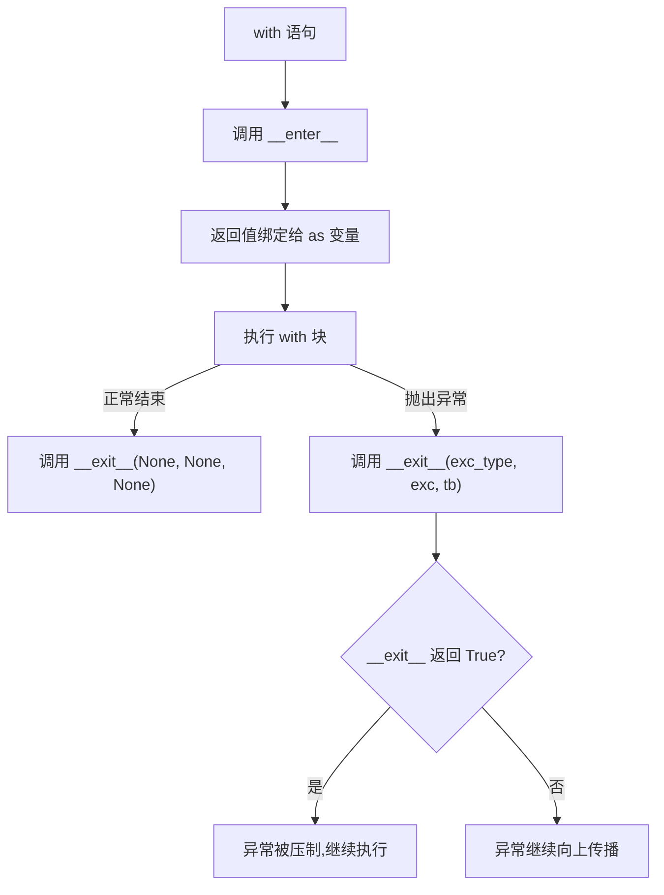

打开文件、拿数据库连接、加锁,都是"获取资源—使用—释放"的结构。手写 try/finally 能保证释放,但代码重复;`with` 把这套结构抽象成协议,资源对象自己声明如何进入与退出。

## with 协议

```python
class Timer:
    def __enter__(self):
        self.start = time.perf_counter()
        return self                     # as 绑定的值

    def __exit__(self, exc_type, exc, tb):
        print(f"耗时 {time.perf_counter() - self.start:.3f}s")
        return False                    # 不压制异常

with Timer() as t:
    work()
```

执行流程:



`__exit__` 接收异常三元组:类型、实例、traceback。没有异常时三者都是 None。返回真值表示"异常已处理,不要再抛";返回 None 或 False 则照常传播。

压制异常要谨慎:它会让调用方看不到失败。只有在确实"已恢复"的语义下才返回 True,例如重试成功、资源替代成功。

## 生成器版上下文管理器

`contextlib.contextmanager` 用生成器写,不必定义类:

```python
from contextlib import contextmanager

@contextmanager
def opened(path, mode="r", encoding=None):
    f = open(path, mode, encoding=encoding)
    try:
        yield f                      # 进入 with 时执行到这里
    finally:
        f.close()                    # 退出时执行,异常路径也覆盖
```

`yield` 之前是 `__enter__` 阶段,之后是 `__exit__` 阶段。必须用 try/finally 包住 yield,否则 with 块里抛异常时,`f.close()` 不会执行。

如果 with 块里抛异常,异常会在 `yield` 处被重新抛出,生成器里可以捕获:

```python
@contextmanager
def suppressed():
    try:
        yield
    except ValueError:
        pass                          # 等价于 __exit__ 返回 True
```

`contextmanager` 适合"获取—交出一段逻辑—释放"的模式;需要保存复杂状态、支持多次进入、或需要在 `__exit__` 里做类型判断时,写类更清楚。

## 多个资源

```python
with open(src, encoding="utf-8") as f, open(dst, "w", encoding="utf-8") as g:
    g.write(f.read())
```

多个上下文用逗号写在一条 with 里,退出时按**相反顺序**调用 `__exit__`:先关 g,再关 f。这样依赖关系正确(后获取的先释放)。

资源数量在运行时才确定时,用 `ExitStack`:

```python
from contextlib import ExitStack

with ExitStack() as stack:
    files = [stack.enter_context(open(p, encoding="utf-8")) for p in paths]
    process(files)
```

`ExitStack` 统一登记每个上下文,退出时逆序释放。它还有 `callback` 方法,可以登记任意清理函数:

```python
with ExitStack() as stack:
    conn = connect()
    stack.callback(conn.close)
    ...
```

异常发生在登记之后、块结束之前,回调依然会执行。

## 常用内置上下文管理器

| 工具 | 用途 |
| --- | --- |
| `open(...)` | 文件句柄 |
| `threading.Lock()` | 加锁,退出时释放 |
| `contextlib.suppress(Exc)` | 忽略指定异常 |
| `contextlib.redirect_stdout` | 临时重定向输出 |
| `contextlib.nullcontext` | 条件分支里占位 |
| `tempfile.TemporaryDirectory()` | 临时目录,退出时删除 |
| `decimal.localcontext()` | 临时修改精度与舍入 |

`suppress` 比裸 try/except 更简洁:

```python
from contextlib import suppress

with suppress(FileNotFoundError):
    os.remove(path)
```

`nullcontext` 解决"有时需要上下文、有时不需要"的分支:

```python
ctx = open(path) if path else nullcontext()
with ctx as f:
    ...
```

## 可重入与线程安全

上下文管理器默认不保证可重入:同一个锁对象重复 `with` 会死锁,同一个文件对象两次进入会共享游标。需要支持重复进入时,在 `__enter__` 里维护计数,或者每次进入返回新对象。

线程安全与 with 无关:`with` 只保证当前线程按序执行退出逻辑,多个线程共享同一对象的 `__enter__`/`__exit__` 仍需对象自身加锁。

## 小结

- `with` 依赖 `__enter__` 返回进入值、`__exit__` 负责释放;
- `__exit__` 返回真值会压制异常,除非确实已恢复,否则不要这么做;
- `@contextmanager` 用生成器实现,`yield` 前后分别对应进入与退出;
- 多资源用一条 with 或 `ExitStack`,退出顺序与进入相反;
- `suppress`、`nullcontext` 覆盖"忽略异常"与"可选上下文"两类常见需求。
