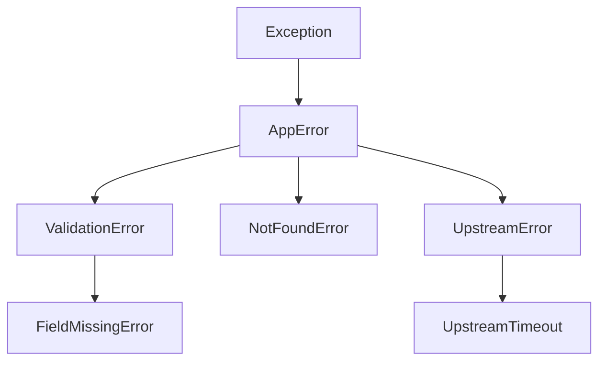

内置异常描述的是语言层面的错误。业务层面的失败(库存不足、权限被拒、上游超时)需要自己的异常类型,让调用方能按语义捕获,而不是靠解析错误字符串。

## 建立异常层次

先定义业务基类,再按失败类别派生子类:

```python
class AppError(Exception):
    """所有业务异常的基类。"""

class ValidationError(AppError):
    """输入不合法。"""

class NotFoundError(AppError):
    """目标资源不存在。"""

class UpstreamError(AppError):
    """依赖服务失败。"""
```



好处有三层:

- 调用方可以只捕获 `AppError` 处理所有业务失败,也可以精确捕获子类;
- 非业务异常(编程错误)不会被业务代码误接;
- 异常名本身说明了失败类别,日志与监控可以按类型聚合。

基类不要继承 SystemExit、KeyboardInterrupt 所在的直接分支;业务异常继承 Exception 或自定义基类即可。

## 携带结构化字段

异常对象可以保存失败相关的数据,让上层不需要解析消息就能做决策:

```python
class QuotaExceeded(AppError):
    def __init__(self, used, limit):
        super().__init__(f"配额已用 {used}/{limit}")
        self.used = used
        self.limit = limit

try:
    reserve(n)
except QuotaExceeded as e:
    backoff(e.limit - e.used)
```

消息给人看,字段给程序用。API 层可以把 `e.used`、`e.limit` 直接序列化成错误响应,不必再拼字符串。`super().__init__(message)` 要调用,否则 `str(e)` 为空。

## 异常链

在捕获一个异常后抛出另一个,应该保留原因:

```python
try:
    resp = client.get(url, timeout=3)
except TimeoutError as e:
    raise UpstreamTimeout(f"调用 {url} 超时") from e
```

traceback 会显示:

```text
TimeoutError: ...
The above exception was the direct cause of the following exception:
UpstreamTimeout: 调用 ... 超时
```

`__cause__` 是显式原因(`from`);没有 `from` 时,原异常进 `__context__`,显示为"处理上述异常时又发生"。两种都保留原始堆栈,不要用 `raise X(str(e))` 把原异常丢掉。

需要切断上下文时用 `raise X(...) from None`,通常只用于"底层异常是内部实现细节、对调用方没有意义"的场合。

## add_note:补充而非替换

3.11 起,异常可以附加多条说明:

```python
try:
    load_config(path)
except json.JSONDecodeError as e:
    e.add_note(f"配置文件: {path}")
    raise
```

`add_note` 不改变异常类型与原因链,只在 traceback 里追加说明。适合补充"在哪个文件、哪个批次、哪个用户"这类上下文,比拼接消息更清晰。

## ExceptionGroup 与 except*

并发任务同时失败时,逐个抛出会丢失其余错误。3.11 引入 ExceptionGroup 把多个异常打包:

```python
errors = [ValueError("a"), TypeError("b")]
raise ExceptionGroup("批量处理失败", errors)

try:
    process_all(tasks)
except* ValueError as eg:
    handle_value(eg.exceptions)
except* TypeError:
    handle_type()
```

`except*` 按类型拆分异常组,每个分支拿到同类型的子组。它适合 `asyncio.TaskGroup`、批量导入、并行校验等"多个失败同时发生"的场景。单个异常仍用普通 `except`,不要为了统一而滥用异常组。

## 记录与重新抛出

```python
import logging

log = logging.getLogger(__name__)

try:
    handle(job)
except AppError:
    log.exception("任务 %s 失败", job.id)   # 带完整堆栈
    raise
```

- `log.exception` 只能在 except 块里用,它自动带上 `exc_info`;
- 记录后要么恢复,要么重新抛出,不要两者都不做;
- 不要 `log.error(str(e))`,那会丢掉堆栈与异常类型;
- 同一异常只记录一次:底层记录了,上层就只做转换与抛出,避免重复刷屏。

## 设计约定

- 一个包一个异常基类,名字以 Error 结尾;
- 子类按"调用方会分别处理"的粒度拆分,不要为每行代码建一个类;
- 异常类尽量无副作用,构造时只保存数据;
- 对外的 API 只抛文档里列出的异常类型,内部异常统一转换;
- 不要用异常做正常控制流(循环退出、找不到就用异常),那会让调用方难以区分"预期分支"与"故障"。

## 小结

- 业务异常建基类再派生子类,调用方可按层次捕获;
- 异常携带结构化字段,消息给人、字段给程序;
- 转换异常时用 `raise ... from e` 保留原因链;
- `add_note` 补充上下文,`ExceptionGroup` 聚合并发失败;
- 记录用 `log.exception` 并重新抛出,同一异常只记录一次。
