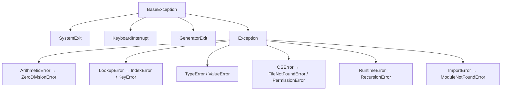

Python 把错误统一成异常对象:出错时抛出,调用栈逐层向上传递,直到被 `except` 接住。理解异常的层级与传播规则,才能决定"在哪里接、接哪些、接住之后做什么"。

## 异常树

所有异常都继承 BaseException。日常业务只处理 Exception 这一支:



`except Exception` 不会接住 SystemExit、KeyboardInterrupt、GeneratorExit,这是刻意的:进程退出、用户中断不该被普通业务代码吞掉。反过来,`except BaseException` 会把这些也接住,几乎总是错误的写法。

## 常见内置异常

| 异常 | 触发场景 |
| --- | --- |
| `ValueError` | 类型对但值不合法,如 `int("abc")` |
| `TypeError` | 类型不支持该操作,如 `"a" + 1` |
| `KeyError` | 字典缺少键 |
| `IndexError` | 序列下标越界 |
| `AttributeError` | 对象没有该属性 |
| `FileNotFoundError` | 路径不存在,OSError 的子类 |
| `StopIteration` | 迭代器耗尽 |
| `ZeroDivisionError` | 除数为零 |

异常类型本身就是信息:抛 `ValueError` 表示"输入错了",抛 `TypeError` 表示"调用方式错了",两者给调用方的修复方向不同。自定义异常也应按这个粒度设计(本篇第 3 节)。

## raise 的两种用法

```python
raise ValueError("数量必须为正")          # 抛出实例

try:
    int(text)
except ValueError as e:
    raise ConfigError("配置格式错误") from e   # 保留原异常
```

`raise ... from e` 建立**异常链**:新异常成为当前异常,`e` 记录在 `__cause__` 里,traceback 会显示"直接原因"。不加 `from` 时,若在 except 块里抛出,原异常进 `__context__`,显示为"在处理上述异常时又发生了……"。

需要明确切断上下文(比如用异常做控制流,不想显示底层细节)时写 `raise ... from None`。

## except 的匹配规则

- 匹配异常类型及其子类:`except OSError` 能接住 FileNotFoundError;
- 多个类型用元组:`except (ValueError, TypeError) as e`;
- 子类必须写在父类前面,否则父类分支会先命中,子类分支永远不执行;
- 裸 `except:` 等价于 `except BaseException:`,还会吞掉 Ctrl+C,禁止使用;
- `except Exception` 只应出现在"顶层兜底"位置,并记录完整 traceback。

```python
try:
    ...
except FileNotFoundError:      # 子类在前
    ...
except OSError:                # 父类在后
    ...
```

## EAFP 与 LBYL

两种风格:

- **EAFP**(Easier to Ask Forgiveness than Permission):先做,出错再处理;
- **LBYL**(Look Before You Leap):先用条件判断排除错误。

```python
# EAFP
try:
    value = mapping[key]
except KeyError:
    value = default

# LBYL
value = mapping[key] if key in mapping else default
```

Python 更倾向 EAFP:容器操作直接尝试通常比"先检查再操作"更快,也没有检查与使用之间的竞态。但文件、网络这类外部资源,检查本身不可靠,更应直接操作并捕获具体异常。

`dict.get`、`getattr(obj, name, default)` 这类带默认值的 API 是两者的折中,能用就用。

## 哪些异常不该接

- 编程错误:TypeError、AttributeError、NameError,接住只会掩盖 bug;
- 自己不会处理的:接住后既不恢复也不记录,等于吞掉;
- KeyboardInterrupt 与 SystemExit:除非在明确的清理逻辑里,否则放行;
- 循环里的异常:一次失败不代表整个批次失败,要接就明确"跳过并记录"。

接住异常的最低要求是:知道怎么恢复,或者能附加上下文再抛出去。两者都做不到,就不要接。

## 小结

- 异常树以 BaseException 为根,业务只处理 Exception 分支;
- 异常类型传递错误性质,选错类型会让调用方修错方向;
- `raise ... from e` 保留原因链,`from None` 显式切断;
- `except` 按类型与子类匹配,子类分支在前,禁止裸 except;
- EAFP 是 Python 的惯用风格,但编程错误与中断信号应放行。
