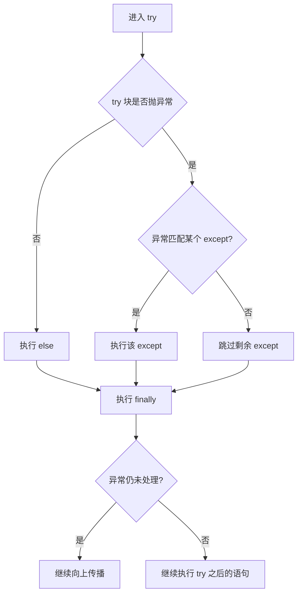

`try` 语句有四个子句,各管一段职责:`try` 放可能出错的代码,`except` 处理特定异常,`else` 放"没出错才执行"的逻辑,`finally` 无条件收尾。很多人只用前两个,结果把成功路径也塞进了 try,或忘了清理资源。

## 执行顺序



要点:

- `else` 只在 try 块**没有**异常时执行;
- `finally` 无论是否异常、是否 return、是否 break,都会执行;
- `except` 只匹配一个分支,匹配后其余分支跳过;
- 没有被任何分支接住的异常,在 finally 结束后继续向上抛。

## else 的价值

`else` 解决的是"避免误捕"的问题:

```python
try:
    value = int(text)
except ValueError:
    value = 0
else:
    print("解析成功:", value)     # 这里出错不会被上面的 except 误接
```

如果把 `print` 放进 try,它抛出的 ValueError 会被当成解析失败处理,错误被掩盖。原则是:**try 里只放你打算捕获其异常的那几句**,成功后的后续逻辑放 else。

## finally 与 return

`finally` 中的 `return` 会覆盖 try 或 except 里的返回值:

```python
def f():
    try:
        return 1
    finally:
        return 2        # 实际返回 2

def g():
    try:
        return 1
    finally:
        print("清理")   # 打印后仍返回 1
```

不要在 finally 里写 return、break、continue:它会吞掉异常,也让返回值难以预测。finally 只做清理与收尾。

## 顺序与粒度

```python
try:
    data = load(path)
except FileNotFoundError:
    data = []
except PermissionError:
    raise                 # 接住后附加上下文再抛出
except OSError as e:
    log.error("读取失败: %s", e)
    raise
else:
    validate(data)
finally:
    close_if_open()
```

- 具体异常在前,宽泛异常在后;
- `raise` 单独使用会重新抛出当前异常,保留 traceback;写 `raise e` 会重置 traceback 起点,通常不要;
- 顶层兜底才用 `except Exception`,并记录完整堆栈;
- 清理逻辑放 finally,或用 `with`(下一篇)代替手写 finally。

## 嵌套 try 与异常传播

内层 try 没有匹配的异常时,会先执行内层的 finally,再继续向外传播:

```python
def outer():
    try:
        inner()
    except ValueError:
        print("外层接住")

def inner():
    try:
        raise ValueError("x")
    finally:
        print("内层清理")     # 先打印,再交给外层
```

如果内层 finally 又抛出新异常,它会替换原异常继续传播,原异常只留在 `__context__` 里。这也是 finally 里不要做可能失败的操作的原因。

## 资源清理:finally 与 with 的取舍

```python
f = open(path, encoding="utf-8")
try:
    process(f)
finally:
    f.close()
```

这段代码正确但冗长,`with open(...) as f:` 是等价且更短的写法。手写 finally 适合以下情况:

- 资源的获取与释放不在同一个对象上(比如两个锁、临时目录);
- 需要根据执行结果决定释放方式;
- 老代码或第三方 API 没有提供上下文管理器。

其余场景优先 `with`,它把"获取—使用—释放"绑成一个结构,异常路径也覆盖。

## 常见错误

- **把整段业务代码包进 try**:误捕内部 bug,错误被降级成"失败分支";
- **except 里 pass**:异常被静默吞掉,线上排查没有任何线索;
- **except 里 return 默认值**:调用方分不清"真的没有数据"与"读取失败";
- **finally 里 return**:覆盖异常与返回值;
- **捕获后不再抛出**:没有恢复能力时,至少记录堆栈并抛出。

## 小结

- try 只放打算捕获异常的语句,成功路径用 else;
- finally 无条件执行,只做清理,不要在其中 return;
- except 具体在前宽泛在后,重新抛出用裸 `raise`;
- 内层未处理的异常经 finally 后继续向外传播;
- 资源释放优先用 `with`,手写 finally 用于无法用 with 的场景。
