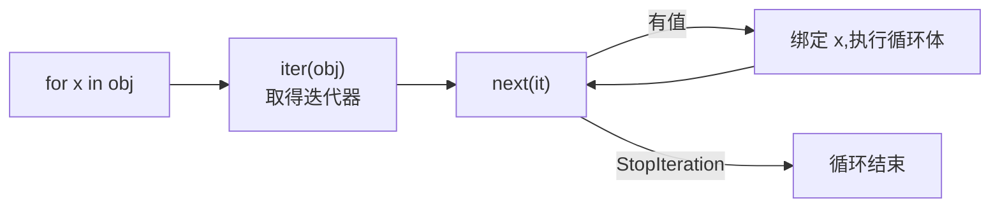

分支与循环决定代码的执行路径。Python 的 for 与 C 系语言不同:它不计数,而是**遍历一个可迭代对象**。理解这一点,range/enumerate/zip 才用得对。

## 分支:if / elif / else

```python
if score >= 90:
    grade = "A"
elif score >= 60:
    grade = "B"
else:
    grade = "C"
```

条件可以是任何真值表达式(第 2.3 篇)。单行赋值用条件表达式更简洁:`grade = "A" if score >= 90 else "B"`。多分支且是对**同一值的结构/字面量**匹配时,用 match(见下)。

## for:遍历而非计数

```python
for ch in "abc":          # 字符串
    print(ch)
for i in range(3):        # 0,1,2
    print(i)
for i, name in enumerate(names):      # 带索引
    print(i, name)
for k, v in pairs.items():            # 字典键值
    print(k, v)
for a, b in zip(xs, ys):              # 并行遍历,以最短为准
    print(a + b)
```

for 背后是迭代协议:先 iter(obj) 拿迭代器,反复 next() 直到 StopIteration(第 6 章细讲)。所以任何可迭代对象都能进 for,包括文件、生成器。



需要索引时用 enumerate,不要 `for i in range(len(xs))` 再 xs[i];需要并行用 zip,不要手动对齐下标。zip 严格长度用 `zip(xs, ys, strict=True)`(3.10+),长度不等抛异常而非静默截断。

## while 与 break / continue / else

```python
n = 0
while n < 5:
    n += 1
    if n == 3:
        continue      # 跳过本轮剩余
    if n == 4:
        break         # 跳出循环
else:
    print("正常结束")  # 仅当未被 break 时执行
```

循环的 **else** 子句在"循环正常耗尽/条件变假"时执行,被 break 则跳过。典型用途:搜索循环,"没找到"的分支放 else,比额外标志变量清晰。

注意:while 条件若永真且无 break 即死循环;循环体内修改循环变量要小心语义。

## match:结构化模式匹配(3.10+)

```python
match command.split():
    case ["go", direction]:
        move(direction)
    case ["drop", *items]:
        drop(items)
    case ["quit"]:
        quit_game()
    case _:
        print("未知命令")
```

match 不只是 switch:它能**解构**序列/映射/类实例并绑定变量。case 按序匹配,`_` 通配。守卫用 if:`case [x, y] if x == y:`。注意 case 里的裸名字是**捕获**而非比较常量,比较常量需用点号(如 Color.RED)或字面量。

## 循环内改容器

遍历列表时增删元素会跳过或重复(索引错位)。正确做法:遍历副本 `for x in xs[:]`,或构建新列表(推导式),或用倒序索引删除。字典遍历中改键集抛 RuntimeError。第 3 章展开。

## 小结

- if/elif/else 按真值分支;单行用条件表达式;
- for 遍历可迭代对象,背后是迭代协议;
- enumerate 带索引、zip 并行(strict=True 防截断)、items 键值;
- break/continue 控制流;循环 else 表"未被 break";
- match 解构匹配,裸名字是捕获,通配 _;
- 循环内改容器会错位,遍历副本或建新列表。

下一篇讲函数入门。
