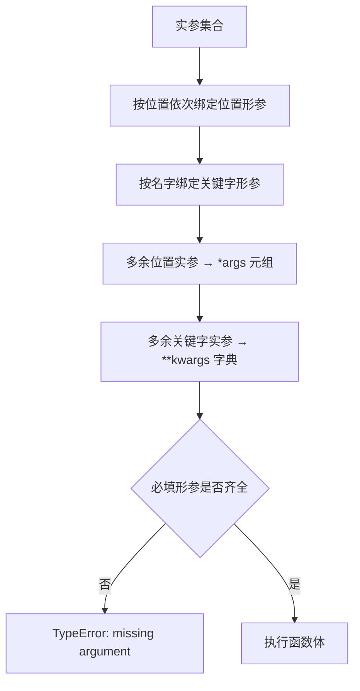

函数的参数是调用方与实现方之间的契约。Python 把这套契约拆成五种形参,再用两种调用方式组合,规则比多数语言细。这一篇按"定义侧 → 调用侧 → 绑定规则 → 实践取舍"的顺序讲。

## 定义侧:五种形参

| 写法 | 名称 | 接收什么 |
| --- | --- | --- |
| `a` | 位置或关键字参数 | 按序或按名传入的单个值 |
| `a, /` | 仅限位置参数 | 只能用位置传入(3.8+) |
| `b=1` | 带默认值的参数 | 未传时取默认值 |
| `*args` | 可变位置参数 | 多余的**位置**实参,收成元组 |
| `c`(在 `*` 之后) | 仅限关键字参数 | 只能用 `c=...` 传入 |
| `**kwargs` | 可变关键字参数 | 多余的**关键字**实参,收成字典 |

一个定义里通常同时出现几种:

```python
def request(url, /, method="GET", *paths, timeout=None, **headers):
    print(url, method, paths, timeout, headers)

request("https://a.dev", "POST", "/v1", "/v2", timeout=3, X_Trace="t1")
# https://a.dev POST ('/v1', '/v2') 3 {'X_Trace': 't1'}
```

规则只有一条:定义顺序必须是 `仅限位置 → 普通 → *args → 仅限关键字 → **kwargs`。`*args` 之后、`**kwargs` 之前的形参自动变成仅限关键字;不想要 `*args` 又要声明仅限关键字,写一个孤立的 `*` 占位即可:

```python
def connect(host, *, retries=3, timeout=5.0): ...
```

## 调用侧:两种方式

- **位置实参**:按顺序绑定,`f(1, 2)`;
- **关键字实参**:按名字绑定,`f(b=2, a=1)`,顺序无关。

两种可以混用,但位置实参必须在前。同一个形参不能既按位置又按名字传:

```python
f(1, a=2)     # TypeError: 形参 a 收到多个值
```

## 绑定顺序

调用发生时,解释器按固定顺序分配实参:



这张图解释了两类常见报错:`f()` 少传必填参数会走到 G;给一个只收位置参数的函数传了它不认识的关键字,会在 E 阶段发现无处安放。

## 默认值只在定义时求值一次

默认值表达式属于函数定义的一部分,`def` 执行时求值一次,之后每次调用复用同一个对象。不可变默认值没有影响,可变默认值会被跨调用共享:

```python
def append_to(item, bucket=[]):     # 错:bucket 只创建一次
    bucket.append(item)
    return bucket

append_to(1)   # [1]
append_to(2)   # [1, 2],不是 [2]
```

正确写法是用 `None` 占位,在函数体内新建:

```python
def append_to(item, bucket=None):
    if bucket is None:
        bucket = []
    bucket.append(item)
    return bucket
```

这条规则对 `{}`、`set()`、`datetime.now()` 这类默认值同样成立。需要"每次调用取当前时间"时,默认值必须写 `None`,再在体内求值。

## 解包调用

序列和字典可以在调用时展开成实参:

```python
args = (1, 2)
kwargs = {"sep": ",", "end": "!"}
print(*args, **kwargs)          # 等价于 print(1, 2, sep=",", end="!")
```

`*` 展开可迭代对象,`**` 展开映射的键值对。两者可以和普通实参混用,但一个位置只能解包一次(3.5+ 放宽了部分位置):

```python
nums = [1, 2, 3]
print(*nums, 4)                  # 1 2 3 4
```

## 实践:API 怎么设计

- **必填参数放前面,可选参数给默认值**,调用方读起来才知道哪些必须给;
- **布尔开关和配置项用仅限关键字**,`def run(task, *, verbose=False)`,调用处 `run(t, verbose=True)` 比 `run(t, True)` 含义清楚;
- **`*args`/`**kwargs` 只用于转发**,例如装饰器包装原函数:`wrapper(*args, **kwargs)` 保持被包装函数的签名;自己写的业务函数堆一堆 `**kwargs` 会失去可读性与静态检查;
- **参数超过四五个**时,改用 dataclass 或 `TypedDict` 打包(第 5 章、第 8 章),避免调用处出现一长串位置实参。

转发时要注意:被包装函数的签名在 `inspect.signature` 里会变成 `(*args, **kwargs)`,想保留原签名用 `functools.wraps`,它在第 4 篇还会出现。

## 小结

- 五种形参按固定顺序声明,`/` 和 `*` 分别标记仅限位置与仅限关键字;
- 调用侧位置、关键字可混用,位置必须在前,同一形参不能收两次;
- 绑定顺序:位置 → 关键字 → `*args` → `**kwargs` → 检查必填;
- 默认值只在定义时求值一次,可变对象与"实时值"都要用 `None` 占位;
- 解包用 `*`/`**`;业务函数少用可变参数,把签名写清楚。
