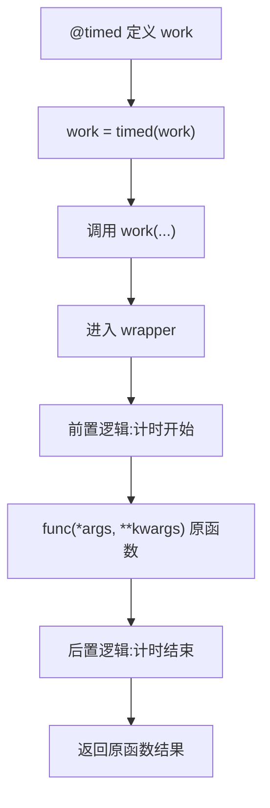

装饰器是 Python 里最常用的元编程手段之一:不修改函数体,就给函数加上日志、计时、缓存、权限校验等横切逻辑。它的实现只依赖一个事实:函数是一等对象,可以作为参数传入,也可以作为返回值传出。

## 从手动包装开始

先看不用语法糖的写法。包装函数 `timed` 接收原函数,返回一个新函数:

```python
import time

def timed(func):
    def wrapper(*args, **kwargs):
        start = time.perf_counter()
        result = func(*args, **kwargs)
        cost = time.perf_counter() - start
        print(f"{func.__name__} 耗时 {cost:.3f}s")
        return result
    return wrapper

def work(n):
    time.sleep(n)

work = timed(work)
work(0.1)      # work 耗时 0.100s
```

`timed(work)` 返回 `wrapper`,`work` 这个名字随后被重新绑定到 `wrapper`。原函数仍然存在,只是不再由 `work` 指向。调用 `work(0.1)` 实际执行的是 `wrapper`,由它在前后插入计时逻辑,再调用原函数。

## @ 语法糖

`@timed` 放在 `def work` 上方,等价于上面最后那两行:

```python
@timed
def work(n):
    time.sleep(n)
```



装饰器在**定义时**执行一次,把函数替换掉;包装逻辑在**每次调用时**执行。这两件事要分清,否则会误以为装饰器里的代码每调一次跑一次。

## functools.wraps:别丢掉元数据

上面的 `wrapper` 把原函数的 `__name__`、`__doc__`、`__module__`、`__annotations__` 都盖掉了。`work.__name__` 会变成 `wrapper`,日志和 `help()` 都失真。标准做法是加 `functools.wraps`:

```python
from functools import wraps

def timed(func):
    @wraps(func)
    def wrapper(*args, **kwargs):
        start = time.perf_counter()
        try:
            return func(*args, **kwargs)
        finally:
            print(f"{func.__name__} 耗时 {time.perf_counter() - start:.3f}s")
    return wrapper
```

`@wraps(func)` 本身是一个带参数的装饰器,作用在 `wrapper` 上,把 `func` 的元数据复制过去,并设置 `__wrapped__` 属性,让 `inspect.signature` 能找到原函数签名。包装函数一律加 `wraps`,`inspect`、`pytest`、文档生成、框架路由都依赖这些属性。

计时用 `try/finally` 更稳:原函数抛异常时也能记录耗时,不会把异常吞掉。

## 带参数的装饰器

`@retry(times=3)` 这样带参数的写法,需要三层函数:

```python
def retry(times):
    def decorator(func):
        @wraps(func)
        def wrapper(*args, **kwargs):
            for attempt in range(1, times + 1):
                try:
                    return func(*args, **kwargs)
                except Exception:
                    if attempt == times:
                        raise
        return wrapper
    return decorator

@retry(times=3)
def fetch(): ...
```

执行顺序:`retry(times=3)` 先返回 `decorator`,再用 `decorator` 去装饰 `fetch`,等价于 `fetch = retry(times=3)(fetch)`。三层结构依次是"配置 → 装饰 → 包装",少一层就会把参数当成函数。

## 叠加顺序

多个装饰器从下往上装饰:

```python
@a
@b
def f(): ...

# 等价于 f = a(b(f))
```

调用时从上往下进入:先执行 `a` 的包装,再进入 `b` 的包装,最后到原函数。理解顺序的关键是"装饰由内向外、调用由外向内",和洋葱一样。

## 内置装饰器

标准库与语言本身也提供了一批:

- `@staticmethod` / `@classmethod`:改变方法绑定方式,前者不传 self,后者传类;
- `@property`:把方法包装成属性访问,第 5 章细讲;
- `@functools.lru_cache`:按参数缓存结果,参数必须可哈希;
- `@functools.cached_property`:第一次访问后把结果写进实例 `__dict__`;
- `@contextlib.contextmanager`:把生成器函数变成上下文管理器,第 7 章细讲。

这些装饰器的共同点仍是"接受可调用对象、返回可调用对象",只是实现方式不同(有的是描述符,有的是 C 实现)。

## 装饰器的边界

装饰器能改的只有"函数对象本身"以及"调用它时的行为"。它不能改变函数内部的执行逻辑,也无法在编译期做任何事。把业务规则塞进装饰器之前,先想清楚:

- 装饰器适合与业务无关的横切关注点:计时、日志、重试、缓存、鉴权;
- 依赖参数状态、需要访问局部变量的逻辑,留在函数里;
- 多个装饰器叠加时,异常处理、返回值变换的先后顺序要写进文档,否则接手的人只能翻源码。

## 小结

- 装饰器是接受函数、返回函数的高阶函数,`@` 等价于重新绑定;
- 装饰在定义时执行,包装逻辑在调用时执行;
- 包装函数用 `functools.wraps` 保留元数据,并用 `try/finally` 保证异常路径也执行收尾;
- 带参数的装饰器是三层嵌套:`配置 → 装饰 → 包装`;
- 多个装饰器由内向外装饰、由外向内调用。
