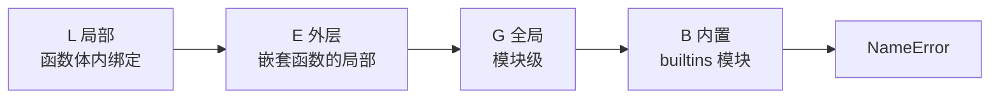

作用域决定一个名字到哪去找它的绑定。Python 是**词法作用域**:找哪一层由代码书写的位置决定,与运行时的调用链无关。函数在哪儿定义,就向上找哪一层的名字。

## 四层查找:LEGB

名字解析按固定顺序穿过四层命名空间:



```python
x = "global"

def outer():
    x = "enclosing"
    def inner():
        print(x)          # 找到 E 层的 enclosing
    inner()

outer()
```

`inner` 里没有 `x`,于是向外层函数找,命中 `outer` 的局部 `x`。把 `outer` 里的赋值删掉,才会继续向外找到模块级的 `global`。

模块级和函数内的行为不同:模块里对名字赋值就是在当前命名空间新建或覆盖;函数里对名字赋值则**整个函数内该名字都算局部**,除非显式声明 `global`/`nonlocal`。这条规则是 UnboundLocalError 的来源:

```python
count = 0

def bump():
    print(count)     # UnboundLocalError:先引用后赋值
    count += 1       # 这行让 count 成为局部名字
```

## global 与 nonlocal

- `global name`:声明这个名字来自模块命名空间,函数内的赋值写回模块;
- `nonlocal name`:声明这个名字来自最近的外层函数作用域,赋值写回那个外层变量(不能跨越到模块级)。

```python
def make_counter():
    count = 0
    def bump():
        nonlocal count
        count += 1
        return count
    return bump

c = make_counter()
c(); c()      # 1, 2
```

没有 `nonlocal`,`count += 1` 会在 `bump` 里新建一个局部名字,并在读取时报 UnboundLocalError。

## 闭包

内层函数引用了外层函数的局部变量,并被返回或保存下来,这个"函数 + 它引用的外层变量"整体就是闭包。外层函数返回后,这些变量不会随栈帧销毁,而是被移到 cell 对象里,由闭包引用:

```python
def multiplier(factor):
    def times(n):
        return n * factor      # factor 是自由变量
    return times

double = multiplier(2)
double(10)                     # 20
```

`factor` 是自由变量:既不是 `times` 的参数,也不是它的局部名字。`multiplier(2)` 返回时,`factor=2` 被放进 cell,`times` 的函数对象持有这个 cell。再次调用 `multiplier(3)` 会创建另一个 cell,两份闭包互不影响。

要查看被捕获的变量,可以读 `times.__closure__`;修改则必须用 `nonlocal`,因为赋值会重新绑定名字,而 cell 需要显式指向。

## 晚绑定:循环里的 lambda

闭包捕获的是**变量**,不是变量当时的值。循环中创建的多个闭包共享同一个变量,循环结束后它们看到的是同一个终值:

```python
funcs = [lambda: i for i in range(3)]
[f() for f in funcs]        # [2, 2, 2],不是 [0, 1, 2]
```

要固定每一轮的值,用默认参数在定义时就绑定:

```python
funcs = [lambda i=i: i for i in range(3)]
[f() for f in funcs]        # [0, 1, 2]
```

默认参数在 `def`/`lambda` 创建时求值,正好把当前 `i` 的值复制进闭包。同理,回调里引用循环变量、`for` 里注册事件处理器,都要检查是否踩到这条规则。

## 类作用域不属于闭包链

类体内定义的名字不会成为方法的作用域。方法里直接引用类属性名会走 LEGB 而跳过类体,只能通过 `self.attr` 或 `ClassName.attr` 访问。这条在继承与 MRO 那篇还会提到。

## 小结

- Python 按定义位置查找名字,顺序 L → E → G → B;
- 函数内赋值会让名字成为局部,除非 `global` / `nonlocal`;
- 闭包捕获外层变量本身,存进 cell,外层返回后仍可用;
- 循环里的闭包共享终值,需要固定时用默认参数;
- 类体不是方法的外层作用域。
