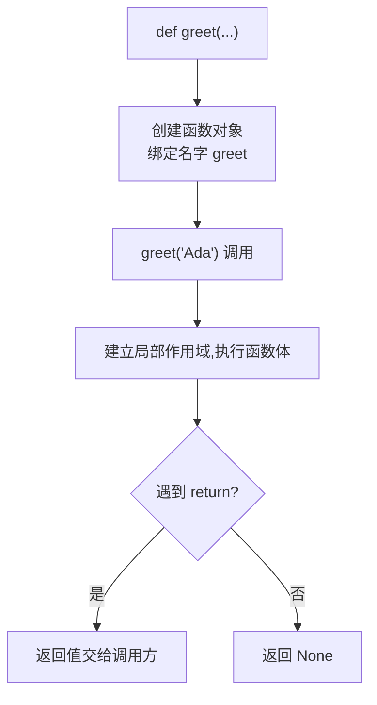

函数把一段逻辑命名并复用。Python 函数的参数传递语义常被误称为"引用传递"或"值传递",准确说法是**按对象引用传递**(call by sharing)。这一篇讲定义、参数、返回值与一等对象。

## 定义与调用

```python
def greet(name: str, greeting: str = "你好") -> str:
    """返回一句问候。"""
    return f"{greeting}, {name}"

greet("Ada")             # '你好, Ada'
greet("Ada", "Hi")       # 'Hi, Ada'
greet(greeting="Hi", name="Ada")   # 关键字参数,顺序可换
```

- def 创建函数对象并绑定到名字;函数体在**调用时**才执行;
- 注解(`: str`、`-> str`)与文档字符串不强制类型,供工具与阅读使用(第 8 章);
- 无 return 或 return 无值时返回 **None**。



## 参数传递:改绑与就地

```python
def rebind(x):
    x = 99            # 改绑局部名字,外部不受影响

def mutate(lst):
    lst.append(4)     # 就地修改,外部可见

n = 1; rebind(n); print(n)        # 1
a = [1]; mutate(a); print(a)      # [1, 4]
```

传进去的是**对象引用的副本**:函数内改绑名字不影响外部名字;但通过引用就地修改对象,外部所有别名都看见。这与 Java 的"值传递(引用值)"语义一致,与 C++ 引用参数不同。

需要"输出参数"效果时,优先**返回新值**而非就地改入参;确需就地(如排序 sort vs sorted)要在文档里写明。

## 多返回值:元组解包

```python
def divmod_pair(a, b):
    return a // b, a % b     # 实际返回元组

q, r = divmod_pair(7, 2)     # 解包
```

return 多个值本质是返回一个元组,调用侧解包。超过三个值建议返回 dataclass/NamedTuple(第 5 章),避免位置含义不清。

## 位置与关键字

- 位置参数按序;关键字参数按名,可乱序;
- 调用时位置必须在关键字前;
- 默认值参数必须放在无默认值参数之后(定义侧);
- 默认值只在定义时求值一次,**可变默认值是经典陷阱**(第 4 篇细讲,此处先记:用 None 占位)。

```python
def bad(item, bucket=[]):      # 错:bucket 跨调用共享
    bucket.append(item); return bucket
def good(item, bucket=None):   # 对:每次新建
    if bucket is None: bucket = []
    bucket.append(item); return bucket
```

## 函数是一等对象

函数可赋值、可作参数、可作返回值:

```python
ops = {"add": lambda a, b: a + b, "sub": lambda a, b: a - b}
ops["add"](2, 3)     # 5
```

这是高阶函数与装饰器(第 4 章)的基础。lambda 是单表达式匿名函数,复杂逻辑仍用 def。

## 小结

- def 创建函数对象,调用时才执行;无 return 得 None;
- 按对象引用传递:改绑不影响外部,就地修改影响;
- 多返回值是元组解包,超过三个用 dataclass;
- 位置在前关键字在后;默认值定义时求值一次,可变默认用 None 占位;
- 函数是一等对象,可传递可返回,支撑高阶与装饰器。

第 2 章到此。下一章进入容器:列表/元组/字典/集合与拷贝。
