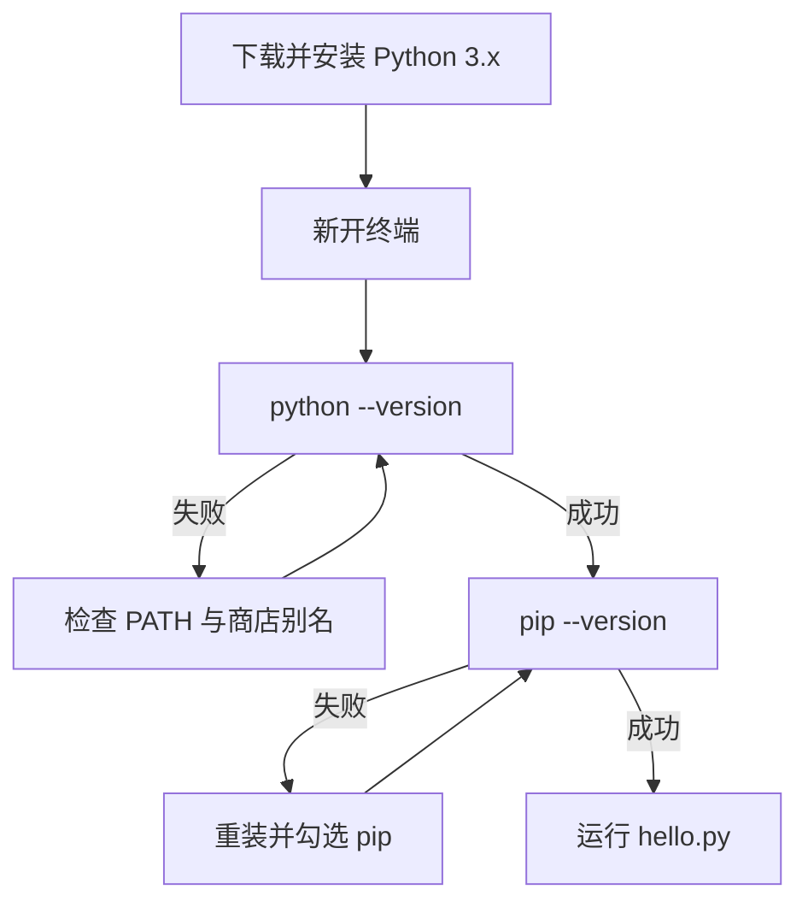

环境装不对,后面每一步都会报"不是内部或外部命令"。这一篇按平台给出安装路径、验证方法,并跑通第一个程序。

## Windows

1. 到 python.org/downloads 下载最新 3.x 安装包(64 位);
2. 运行安装器,**第一屏勾选 "Add python.exe to PATH"**,再点 Install Now;
3. 新开一个终端(旧终端不会刷新 PATH),执行:

```bash
python --version
pip --version
```

两条都输出版本号即成功。

注意:若不勾 PATH,终端里 `python` 会打开 Microsoft Store 的占位别名,表现为"跳转商店"或"找不到命令"。补救:设置 → 应用 → 应用执行别名,关闭 python.exe / python3.exe 两项,或重新运行安装器选 Modify 勾上 PATH。

多版本共存时用 **py 启动器**:`py -3.12 hello.py` 指定版本,`py -0p` 列出已装版本。

## macOS

推荐 Homebrew:

```bash
brew install python@3.12
python3 --version
```

系统自带的 /usr/bin/python3 版本旧且受系统保护,不要用它做开发,也不要 sudo pip 装包到系统环境。

## Linux

用发行版包管理器:

```bash
sudo apt install python3 python3-pip python3-venv   # Debian/Ubuntu
sudo dnf install python3 python3-pip                # Fedora
```

多数发行版自带 python3,但 venv/pip 可能拆成独立包,一并装上。

## 第一个程序

新建 hello.py:

```python
print("Hello, Python")
```

运行:

```bash
python hello.py      # Windows
python3 hello.py     # macOS/Linux
```

输出 `Hello, Python`。print 是内置函数,把内容写到标准输出并换行。

再试一个带输入的:

```python
name = input("你的名字: ")
print(f"你好, {name}")
```

input 从标准输入读一行字符串;f"…" 是格式化字符串字面量,花括号内的表达式会被求值后嵌入(第 2 章细讲)。

## 验证清单



- `python --version` / `python3 --version` 输出 3.12+;
- `pip --version` 可用;
- `python -m venv .venv` 能创建虚拟环境(第 8 章讲为什么需要);
- hello.py 正常输出。

任一步失败,先确认终端是新开的、PATH 里有安装目录、没有商店别名拦截。

## 小结

- Windows 官方安装器勾 PATH;macOS brew;Linux 系统包管理器;
- 新开终端验证 python/pip 版本;
- 商店别名与多版本是 Windows 两大坑,py 启动器管多版本;
- hello.py 用 print 输出,input + f-string 做交互;
- 顺手验证 venv 可创建,为第 8 章铺路。

下一篇讲三种写代码的方式:REPL、脚本与 IDE。
